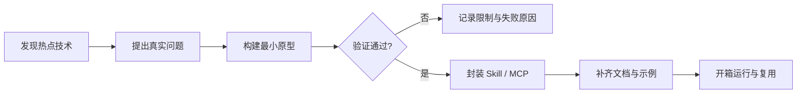

<div align="center">

# ⚡ Hotline

### 前沿技术可用性实验室 · Skill & MCP 开箱即用工厂

探索正在发生的技术，把热点变成工具，把想法变成能力，把能力交付给每一个需要它的人。

对话问答、文件检索、PPT 生成、深度研究与技能包管理，一体化单项目交付。

<p>
  <a href="https://nodejs.org/"></a>
  <a href="https://www.python.org/"></a>
  
</p>

[快速开始](#快速开始) · [架构](#整体架构) · [技能中心](#技能中心与-skill-自进化) · [配置](#配置) · [友情链接](#友情链接)

</div>

---

## 项目简介

Hotline Agent 是一个面向企业级应用的端到端通用智能体（End-to-End Universal Agent）平台，采用多智能体架构，深度融合大语言模型（LLM）能力与现代软件工程架构，提供从感知、推理到执行的全链路智能化解决方案。

本仓库是**单一项目仓库**：Vue 前端、FastAPI 后端、技能中心与技能控制台都在这里，一条命令启动，不再依赖任何外部平台。

## 友情链接

<div align="center">

<a href="https://github.com/zklmiao/prompt-vault"><strong>✦ Prompt Vault</strong></a>

收集、整理与复用提示词，让经过验证的好 Prompt 随时可查、持续积累。

<a href="https://github.com/zklmiao/prompt-vault"></a>

</div>

## 快速开始

### 环境要求

- Node.js 20+（前端构建与开发服务）
- Python 3.11+（后端；本机可直接用 `python`，也可用 uv 管理依赖）

### 私密配置

真实 API Key、密码和服务地址统一放在项目根目录 `.env`，由 `.gitignore` 排除；不含真实密钥的 `.env.example` 模板可以提交。远程环境与本地不同的值使用同一文件中的 `REMOTE_` 前缀配置：Python、PowerShell、Shell 启动脚本及数据库初始化脚本均读取根目录 `.env`，支持 `DODO_ENV_FILE` 指定其他路径；`DODO_ENV_PROFILE=remote` 时应用 `REMOTE_` 配置（去掉前缀后覆盖对应项），PowerShell 远程脚本默认应用该配置。普通开发启动保留 SQLite、本地文件及关闭 Redis 的默认行为。

### 安装与启动

浏览器仍只访问一个 FastAPI 入口，FastAPI 直接服务 Vue 构建产物；长任务由同机独立的 Python Execution Worker 消费。API、Worker 和前端由启动器统一编排。

```bash
# 1) 首次：安装并构建前端
npm --prefix frontend install
npm --prefix frontend run build

# 2) 启动网关 + Execution Worker（页面、API、技能控制台仍在 8888）
npm start
```

启动后：

| 入口 | 地址 |
| --- | --- |
| 应用页面 | http://127.0.0.1:8888/ |
| 后端 API 文档 | http://127.0.0.1:8888/docs |
| 健康检查 | http://127.0.0.1:8888/health |
| 就绪检查 | http://127.0.0.1:8888/health/ready |
| 技能控制台 | http://127.0.0.1:8888/console |

`npm start` 启动 FastAPI Gateway 和 Python Execution Worker 两个进程。当前执行队列、运行状态和 SSE 事件保存在被忽略的 `data/execution.db`，是同机 SQLite 队列，支持 Worker 重启后的事件回放；它还不承担多主机分布式调度。Worker 不在线时 `/health/ready` 返回 503，新的 Agent 运行会被拒绝。

### 常见问题

**启动报 `Errno 10048`（端口 8888 被占用）**：多半是上次开发模式（`node dev-launcher.mjs`）残留的旧后端还在运行。查询占用并结束：

```powershell
netstat -ano | findstr :8888     # 找到 LISTENING 行末尾的 PID
taskkill /PID <PID> /F
```

开发模式下若端口被占，启动器也会打印同样的提示。

### 热部署（改代码自动更新，推荐日常使用）

网关跑在 8888，改完代码不用手动重启或构建：

```bash
npm run hot
```

- 改 Python（`python_backend/`、`main.py` 等所有 `.py`）→ 网关和 Execution Worker 自动重启
- 改 Vue/CSS（`frontend/src/`）→ 自动重新构建，浏览器页面自动刷新（页面内置热部署探针）
- 窗口里会分别提示前端构建完成、后端启动完成，全部就绪后直接访问 <http://127.0.0.1:8888/>

### 前端开发模式（热更新）

修改 Vue 代码时使用开发模式，页面仍是 5180，但 API 请求由 Vite 代理转发到后端，前后端依旧同源：

```bash
node dev-launcher.mjs    # 或 npm run dev
```

前端使用 Vite HMR（修改即时更新），后端 Gateway 与 Python Execution Worker 一起启动；端口可用 `DODO_DEV_FRONTEND_PORT` 和 `DODO_DEV_BACKEND_PORT` 覆盖。改完前端要回到网关 + Worker 模式时，重新执行 `npm --prefix frontend run build` 即可。

### 仅启动后端 / 其他方式

```bash
python -m uvicorn main:app --host 127.0.0.1 --port 8888 --reload   # 开发后端
./run_python_backend.ps1                                            # Windows，读取 .env 后运行
./run_python_backend.sh                                             # Linux / macOS
bash deploy/init_mysql_schema.sh                                    # 初始化 MySQL schema（按需）
uv sync                                                             # 可选：用 uv 重建 .venv
```

## 整体架构

```
┌─────────────────────────────────────────────────────────────────────────────┐
│                           应用层 (Application Layer)                         │
│  ┌─────────────┐  ┌─────────────┐  ┌─────────────┐  ┌─────────────────────┐ │
│  │ 智能问答Agent │ │ 文件问答Agent │  │ PPT生成Agent │  │    深度研究Agent     │ │
│  └──────┬──────┘  └──────┬──────┘  └──────┬──────┘  └──────────┬──────────┘ │
│         └──────────────────────────┴────────────────────┘                  │
│                              AgentEngine（技能路由）                         │
├─────────────────────────────────────────────────────────────────────────────┤
│  服务层：Embedding / 文件管理 / 会话管理 / PPT 渲染 / 文档解析（MinerU）        │
├─────────────────────────────────────────────────────────────────────────────┤
│  工具层：MCP 工具回调（Tavily 搜索）/ 向量检索 / 图片生成 / 技能中心             │
├─────────────────────────────────────────────────────────────────────────────┤
│  基础设施：大模型 API / SQLite(默认) 或 MySQL / 本地文件 或 MinIO / pgvector   │
└─────────────────────────────────────────────────────────────────────────────┘
```

### 多模式智能体

| Agent 类型 | 核心模式 | 适用场景 |
|-----------|---------|---------|
| **WebSearchReactAgent** | ReAct + 联网搜索 | 实时信息查询、新闻分析 |
| **FileReactAgent** | RAG + ReAct | 企业内部文档问答 |
| **PPTBuilderAgent** | 状态机 + 断点续传 | 一句话生成演示文稿 |
| **PlanExecuteAgent** | Plan-Execute-Critique | 深度研究、复杂任务分解 |
| **技能智能体** | 技能中心版本绑定 | 沉淀可复用的工作流经验 |

### 主应用工作台

| 入口 | 能力 | 数据来源 |
| --- | --- | --- |
| 自动化 | 按固定间隔自动提交一次 Agent 运行 | `data/harness-schedules.db`，`/harness/schedules` |
| 插件 | 已安装技能的启停与删除 | `/skill/list` |
| 代码地图 | 系统架构、请求时序与上下文流程，支持刷新和独立打开 | `/code-map`，`/code-map/hotline.html` |
| 轻量机器人 | 角色指令 + 绑定技能，绑定到会话后进入系统提示词 | `data/harness-bots.db`，`/harness/bots` |
| 个人中心 | 昵称与简介、回答风格、界面主题 | `data/harness-profile.db`，`/harness/profile` |
| 模型 API Key | 自带模型服务凭证，本机保存，接口只回掩码 | `data/harness-credentials.db`，`/harness/profile/credentials` |

模型调用统一走 `llm.model_config()`：本机保存的凭证优先于 `.env` 环境变量，两者都没有才判定为「未配置模型」。深色主题由 `frontend/src/theme.css` 提供 token，`html[data-theme="dark"]` 生效。

代码地图由主导航中的「代码地图」进入。生成的 `hotline.html` 与 `vendor/mermaid.min.js` 保存在数据目录的 `code-map/hotline/` 下，默认路径为 `data/code-map/hotline/`，并遵循 Git 忽略规则。资源不完整时页面显示空态，重新生成后点击刷新即可加载。开发模式由 Vite 代理 `/code-map`，合并部署由 FastAPI 直接提供地图与渲染脚本。

### 技术栈

| 层级 | 选型 |
|-----|------|
| 前端 | Vue 3、Vite 6、Lucide 图标 |
| 后端 | Python 3.11+、FastAPI、Uvicorn、SSE 流式响应 |
| 存储 | 本地 SQLite + 文件（默认）；可选 MySQL、Redis、MinIO、PostgreSQL / pgvector |
| 技能中心 | SQLite 目录库（`data/skill-center/catalog.db`），纯标准库实现 |

## 技能中心与 Skill 自进化

技能中心已并入后端：版本目录、项目绑定、评测用例、自进化门禁、灰度发布与自动回滚，全部通过 FastAPI 提供服务，数据库位于 `data/skill-center/catalog.db`（Git 忽略）。

- **技能控制台**：后端启动后打开 <http://127.0.0.1:8888/console>，可新建/编辑技能（SKILL.md + 可选资源）、按版本启用或停用、运行自进化并查看门禁结果。
- **渐进式披露**：技能智能体（`/agent/skills/stream`）使用 LangChain `create_agent` 处理模型与工具调用。技能名称与摘要仅放在动态生成的 `read_skill` 工具描述中，不注入初始消息，也不将技能名称注册成独立工具；模型需要时按技能 ID 调用工具读取完整 `SKILL.md`，参考资料另行按相对路径按需读取。
- **技能来源**：仓库根 `skills/*/SKILL.md`（当前包含开发流程技能 `hotline-tdd`）、原安装目录 `data/skills/`、技能中心中绑定当前项目的版本。仓库技能仅扫描元数据头部；目录查询不读取数据库正文/资源，不自动加载 `skill-center/samples/`。`$技能名` 是传给模型的显式使用提示，不再通过关键词预选后直接注入正文。
- **元数据缓存**：后端进程内按来源缓存文件技能的名称与摘要。每次请求枚举技能并检查 `SKILL.md` 的 inode、修改时间和大小；未变化的条目复用缓存，新增或变更的条目才重新解析头部，删除项从缓存移除。技能中心仍按请求 ID 查询当前灰度版本，避免缓存绕过版本路由。目录变化在下一次技能请求生效；同尺寸内容若被外部程序同时恢复完全相同的 inode/时间戳/大小，stat 签名无法检测。
- **上下文范围**：默认恢复当前会话的任务状态、近期完整交互、历史摘要和相关记忆，再进入技能工具循环；`HOTLINE_CONTEXT_ENABLED=false` 时使用单次技能请求隔离。长期记忆按显式绑定的工作区共享，未绑定工作区时按会话隔离。技能中心灰度按该请求 ID 稳定分桶，任务内固定选中版本；解绑/禁用后后续读取被拒绝。
- **自进化闭环**：评测用例按 `train / selection / test` 分段；`evolve` 只接受最多 8 条 `add/delete/replace` patch，通过静态、动态、回归、增益、安全五道门禁后进入 `staged`，再用 `promote` 灰度绑定、`rollback` 回滚；错误率达到阈值自动回滚。
- **可选模型配置**：`SKILL_EVOLUTION_*`（自动生成 patch）与 `SKILL_JUDGE_*`（独立评分），见 `.env.example`。

命令行工具（`skill-center/`，纯标准库）：

```bash
python skill-center/test_center.py       # 目录库回归测试
python skill-center/test_skill_disclosure.py  # 渐进披露、版本和资源安全
python skill-center/test_agent_tools.py  # 离线 LangChain 工具调用及接口兼容
python skill-center/import_samples.py    # 导入 samples/ 研究样本（默认不绑定）
python skill-center/pull_samples.py      # 更新上游样本（anthropics/skills 固定提交）
```

`samples/` 内容来自 [Anthropic 官方 skills 仓库](https://github.com/anthropics/skills)，`samples/sources.json` 记录固定提交号。这些文件属于研究数据，不是本仓库开发的行为指令。

技能执行边界：

- 模型适配在 `python_backend/llm.py`，通用工具调用及 `read_skill` 工具定义在 `python_backend/modules/execution/`，技能目录和受限资源读取在 `python_backend/skills.py`；根 `skills/` 只放技能包，不承载 Agent 基础设施。
- `read_skill` 只按本次登记的技能 ID 读取技能包内文本资源，禁止宿主机任意路径、越界链接、隐藏/私密文件及二进制内容；不执行 Shell/Python 脚本，不安装工具，不启动工作流引擎。Skill 中提到命令不代表已具备相应执行能力。
- 技能工具描述预算为 8000 字符，超出时提示省略；单文件最多 1 MiB，每页最多 12000 字符，按 `next_offset` 继续读取，不静默截断正文。
- 技能工具循环最多 8 次模型调用、16 次工具调用。工具原始结果保存在本地上下文库，送入模型的结果按输入预算限额，通过 `read_context_source` 分页恢复；较早的完整工具调用与结果成组压缩。任务状态抽取和阶段摘要单独记录调用前快照。错误、预算超限和停止返回错误事件。在途模型请求返回后检查停止信号。
- 需要支持工具调用的 OpenAI-compatible 模型；缺少配置、协议不支持或调用失败时明确报错，不退化为虚构技能执行。执行期间关闭 LangSmith 自动追踪。接口保持 SSE 事件格式，当前在最终答案就绪后发送文本，不承诺逐 Token 流式输出。
- 聊天页按实际 SSE 事件显示理解问题、检索方式、文档名、工具调用与回答生成等阶段。`step` 事件通过 `stage`、`status`、`content` 和可选 `durationMs` 更新同一阶段；工具调用通过 `toolCallId` 区分并行请求。改写提示只在收到实际改写阶段事件时显示，输出期间处理进度和参考来源默认折叠，可手动展开详情；完成后过程收起为摘要，错误时保留展开记录。意图置信度低于门闸阈值时后端发出 `clarify` 事件（三个理解方向 + 自由输入），该轮不产出答案；用户作答后前端把它作为新一轮提问带上原问题上下文重新进入级联。

## 上下文工程与长期记忆

普通聊天、文件问答、研究、PPT 规划和技能执行经过同一上下文入口。Worker 将执行记录里的 `workspace_id` 传给运行时，读取该工作区根目录的 `AGENTS.md`，绑定会话范围，再恢复任务状态、近期交互和历史证据。当前实现面向仓库现有的单用户部署，跨会话共享以已绑定工作区为范围。

装配顺序、分层读取、多跳检索和验收口径见 [上下文工程实现与验收](./docs/context-engineering-design.md)。重排层、冲突时效、权限模型、向量流水线、存储一致性、评测门禁、前端呈现与可观测性的业界做法和建议方案见 [第二阶段能力设计](./docs/stage-two-capability-design.md)。

- `data/context-memory.db` 保存原始消息、工具结果、FTS5 历史索引、任务状态、阶段摘要、记忆撤销记录和持久化投递队列。原有会话保留在既有存储中，通过范围受限的查询读取早期记录。
- 任务状态包含目标、当前请求、带用户原话和来源 ID 的约束、决策、待办及最近完成的对话轮次。自动抽取仅接受当前用户原话中的引用，同主题使用相同 key 更新；任务状态 API 使用 revision 检查并发修改。对话轮次完成与业务任务完成分别表达。
- 历史超过近期 4 轮时生成阶段摘要，摘要记录已覆盖的消息 ID。摘要调用失败时使用带来源的限额摘录，完整原文继续保存在本地。
- 装配器对规则、任务状态、近期完整问答和证据分别处理，优先保留规则、任务状态和当前问题。输入采用 UTF-8 字节上界估算，包含消息和工具定义，并预留输出及安全余量。超长的必需输入返回明确错误。该估算偏保守，实际模型用量仍以 provider usage 为准。
- 文档 hybrid 召回通过 RRF 融合及关键词匹配打破同分，父块内容去重；向量检索范围仍限所选文档，工作区文件另走本地关键词通道。阶段事件与 `/execution/runs/{run_id}/context` 中的快照提供预算、来源、裁剪信息和记忆后端状态。
- 工作区文件在本地 `data/workspace-index.db` 建 FTS5 索引，按文件 mtime 与大小增量同步，删除的文件同步移除，改动后下一次查询即生效。关键词召回分四层：编号与错误码走精确 token，中文 3 字以上走 trigram，2 字中文走 bigram 短语匹配（同样有 bm25 排序），1 字中文与短标识符走 LIKE 兜底，四层结果轮转交错。该工作区用过的文档会挂进同一份索引，既能被词面层召回，也能作为语义通道的候选。
- 工作区语义通道的范围按成员关系决定，不依赖这次查询命中了什么：文档取该工作区用过的全部文档，文件取本地按文件存放的一份向量（取文件头、中、尾的代表性片段，每文件一次 embedding，改动后增量重算）。因此与原文没有任何共同片段的同义问法也能召回；阈值按实测标定，相关问法余弦 0.488 到 0.746、无关问法 0.135 到 0.323，取 0.35。语义通道先粗排前几个文件再把正文交给模型，同分近义文件会一起进证据。语义评测需要真实 embedding 服务，用 `HOTLINE_SEMANTIC_EVAL=1` 显式打开。工作区维度只用于过滤，跨工作区互不召回。
- 模型输入、embedding 查询和 OpenViking 消息执行出站脱敏。匹配到的环境配置、常见凭据、URL、域名及 IP 会被遮蔽；原始证据仅保存在本地。文件名过滤与内容脱敏共同遵循本仓库私密信息规则。

### 工作区、分层与补充检索

主聊天和 Harness 都传递真实 `workspaceId`。浏览器目录导入通过 `/harness/workspaces/import` 保存到数据目录，保留相对路径与根 `AGENTS.md`，成功写入后创建持久化工作区记录。主聊天切换工作区时为已有对话建立新会话，读取历史会话时恢复原工作区。导入单文件上限 50 MB、总量上限 512 MB、最多 5000 个文件。

客户端与服务端同时排除环境配置、local/private 文件、私密目录、密钥文件、依赖与运行数据。索引在打开时清理旧的私密来源，检索与分页读取继续检查来源范围。原文和向量索引都遵守该边界。

工作区来源保存 L0 摘要、L1 带章节来源的抽取式概览，以及 L2 原文分块。全局问题提供目录计数、代表摘要和实际覆盖清单，超出展示额度时标明部分覆盖。技能模式的 `search_memory` 可补查工作区证据，`read_context_source` 支持 `workspace:file:相对路径` 与 `workspace:doc:文档ID` 的分层读取和字符分页。远端 Viking 正文按行分页。

深度模式和关联、依赖、根因、跨文档等问题可进行最多两轮补充检索。证据规划只接受有界查询和已出现的来源 ID，并在覆盖充分、无新增证据、预算不足、取消或轮数达到上限时停止。规划输入快照与 `retrieval_expand` 事件记录实际调用和停止原因。阶段摘要另保留带起止来源的分段记录，后续可按主题检索与分页回读。用户澄清回复重新进入意图级联。

### OpenViking 接入

长期记忆通过 OpenViking HTTP API 接入，提供会话提交、后台抽取、记忆检索和读取能力。Hotline 为每个作用域和撤销代次生成独立 Peer，使用 `self.enabled=false`、`peer.enabled=true`，允许 preferences、entities、events、experiences 类型；实际可用类型取决于服务端 Registry。

完成的问答先写入本地持久化投递队列，Worker 内的后台线程提交 OpenViking Session，再轮询抽取任务。上传失败采用退避重试；未提交上传使用该投递独占的 Session 重建，提交阶段通过 Session ID 查询已存在的抽取任务，处理响应丢失。尚未完成抽取的近期问答也能在同作用域读取，提供跨会话的即时连续性。抽取失败记录错误码，等待服务端处理后继续查询。任务租约支持 Worker 重启后的恢复。

记忆检索先使用支持 `target_uri` 的 `search(mode="list", read_content=false)` 获取 L0 候选，再读取目录 L1 概览，最多为前两个 L2 来源加载各 80 行正文，查询目标限定到当前 Peer 的 memories 子树，并在返回后再次检查路径。技能执行同时获得 `search_memory` 和 `read_context_source` 两个只读工具。OpenViking 未配置或不可用时，模型输入中提供实际后端状态，任务继续使用本地状态和历史证据。

连接参数保存到 Git 忽略的本地 env 文件，沿用 `DODO_ENV_FILE` 加载。以下为回环地址示例，凭据使用本地服务签发的值。

```dotenv
HOTLINE_CONTEXT_ENABLED=true
HOTLINE_CONTEXT_WINDOW=128000
HOTLINE_CONTEXT_INPUT_BUDGET=64000
HOTLINE_CONTEXT_OUTPUT_RESERVE=8192
HOTLINE_CONTEXT_SAFETY_MARGIN=2048
HOTLINE_OPENVIKING_URL=http://127.0.0.1:1933
HOTLINE_OPENVIKING_API_KEY=<LOCAL_ONLY_API_KEY>
HOTLINE_OPENVIKING_TIMEOUT=10
```

配置窗口和输出预留需要与实际模型限制一致。连接配置生效后重启网关和 Worker。OpenViking 服务由外部部署提供，其自身的模型、embedding 和存储配置保存在私密目录。接口契约依据 [OpenViking Session API](https://github.com/volcengine/OpenViking/blob/main/docs/zh/api/05-sessions.md) 和 [检索 API](https://github.com/volcengine/OpenViking/blob/main/docs/zh/api/06-retrieval.md)。

### 上下文管理接口

| 接口 | 用途 |
| --- | --- |
| `GET /harness/context/{conversation_id}` | 读取任务状态、revision、后端配置状态和投递进度 |
| `PUT /harness/context/{conversation_id}/task` | 提交 goal、constraints、decisions、pending 和 revision；事实包含 key、quote、sourceId |
| `GET /harness/context/{conversation_id}/history?q=关键词` | 检索本会话原始记录 |
| `GET /harness/context/{conversation_id}/sources/{source_id}?offset=0&limit=6000` | 分页读取脱敏后的原始证据 |
| `DELETE /harness/context/{conversation_id}/memories` | 请求体提供 uri，立即屏蔽指定记忆并排队远端删除 |
| `DELETE /harness/context/{conversation_id}` | 清除会话记录和上下文，切换共享作用域代次并排队清理远端派生记忆 |

删除共享工作区中的会话时，原有长期记忆命名空间立即失效；后台清理旧 Session 和记忆，并根据保留会话重建新代次。远端清理状态通过投递队列查询。删除操作影响范围包括同工作区的派生记忆视图。

本地验证使用临时 SQLite 存储、本地 HTTP 协议测试服务和脚本化模型，覆盖约束修正、30 轮连续性、作用域隔离、预算、断连重试、原文分页、撤销和 Worker/SSE 正常入口。

```powershell
.\.venv\Scripts\python.exe -m unittest python_backend.modules.context_engineering.test_chain python_backend.modules.context_engineering.test_snapshots -v
.\.venv\Scripts\python.exe -m compileall python_backend
.\.venv\Scripts\python.exe skill-center/test_center.py
.\.venv\Scripts\python.exe skill-center/test_agent_tools.py
npm --prefix frontend run build
```

本地容量验收使用 `cl100k_base` 对已索引分块逐块计数，生成合成 ASCII 语料，测量 SQLite FTS5 检索、原文分页恢复与范围隔离。报告区分索引容量、语义质量和 OpenViking 服务效果，生成文件保存在 Git 忽略的数据目录。

```powershell
.\.venv\Scripts\python.exe -m unittest python_backend.modules.context_engineering.test_completion -v
node --test frontend/src/modules/workspaces/paths.test.js frontend/src/modules/execution/progress.test.js
.\.venv\Scripts\python.exe -m python_backend.modules.context_engineering.benchmark --tokens 100000000 --queries 100 --output data/context-benchmark/new-run
```

验收目录应使用新路径，已有数据库会保留并拒绝覆盖。该脚本使用现有 `langchain-openai` 依赖链中的 `tiktoken`。合成容量结果与真实模型、真实语料、目标 OpenViking 部署的效果分别验收。

## 配置

| 变量 | 说明 |
| --- | --- |
| `DODO_ENV_FILE` | 指定 env 文件路径，默认项目根目录 `.env` |
| `DODO_ENV_PROFILE` | `remote` 时应用 `REMOTE_` 前缀配置 |
| `DODO_STORAGE_BACKEND` / `DODO_FILE_STORAGE_BACKEND` | `sqlite`/`mysql`、`local`/`minio`，本地开发默认 SQLite + 本地文件 |
| `DODO_VECTOR_ENABLED` | 向量检索开关，本地默认关闭 |
| `HOTLINE_CONTEXT_ENABLED` | 上下文恢复开关，默认 true |
| `HOTLINE_CONTEXT_WINDOW` / `HOTLINE_CONTEXT_INPUT_BUDGET` | 模型窗口与输入上界，默认 128000 / 64000 |
| `HOTLINE_CONTEXT_OUTPUT_RESERVE` / `HOTLINE_CONTEXT_SAFETY_MARGIN` | 输出预留与安全余量，默认 8192 / 2048 |
| `HOTLINE_OPENVIKING_URL` / `HOTLINE_OPENVIKING_API_KEY` | OpenViking 连接与凭据，本地私密配置 |
| `HOTLINE_OPENVIKING_TIMEOUT` | 单次记忆 HTTP 请求超时秒数，默认 10 |
| `DODO_SKILL_CATALOG_DB` / `DODO_SKILL_PROJECT` | 技能目录库路径（默认 `data/skill-center/catalog.db`）与绑定项目 ID（默认 `dodo-agent`） |
| `DODO_REPO_SKILLS_DIRECTORY` | 仓库技能包目录，默认根据源码位置定位根 `skills/`，不受启动工作目录影响 |
| `SKILLS_DIRECTORY` | 原技能安装目录，默认 `data/skills/`，与仓库技能目录分别管理 |
| `DODO_DEV_FRONTEND_PORT` / `DODO_DEV_BACKEND_PORT` | 开发端口覆盖，默认 5180 / 8888 |

完整清单见 [.env.example](./.env.example)。

## 目录结构

```text
├─ frontend/          # Vue 3 前端（Vite）
│  └─ src/modules/     # chat、workspaces、memory、retrieval、skills、MCP 等前端模块边界
├─ python_backend/    # Python 后端
│  ├─ api/             # FastAPI Router 与 HTTP/SSE 接口
│  ├─ application/    # 用例编排服务
│  ├─ domain/          # 领域实体、状态和规则
│  ├─ infrastructure/ # SQLite 队列及外部系统适配器
│  ├─ runtime/        # Agent Runtime 抽象
│  ├─ workers/        # 后台 Worker 进程入口
│  └─ modules/        # memory、retrieval、storage、技能、MCP 等能力边界
├─ static/            # favicon 与 console/ 技能控制台页面（Vue 产物由后端服务 frontend/dist）
├─ skill-center/      # 技能中心命令行工具与研究样本
├─ deploy/            # 数据库初始化脚本
├─ sql/ templates/    # SQL schema 与 PPT 模板
├─ docs/              # 设计规范、运维手册与脚本
├─ data/              # 运行数据（Git 忽略）：应用库、上传、技能目录库
├─ main.py            # FastAPI 入口（加载根目录 .env）
└─ dev-launcher.mjs   # 一键启动前端 + 后端
```

### 模块边界

前后端按同名能力模块逐步拆分，API、应用服务、领域和基础设施按依赖方向组织；现有旧入口继续负责兼容装配，迁移不会改变现有接口：

| 模块 | 负责内容 | 当前实现入口 |
| --- | --- | --- |
| `memory` | 会话历史、草稿、项目记忆 | `agents.py`、`storage.py` |
| `retrieval` | 文件、向量、关键词、图谱和联网检索 | `vector_store.py`、`documents.py`、`agents.py` |
| `intent` | 意图目录、意图分类与检索链路选择；关键词粗筛 → embedding 向量召回 → 大模型判定的三级级联，含置信度分级与需求澄清；配置决策模型后改走 System One 协议（阿里云百炼 decision-model-preview，与 TypeSafe Jev 同接口），一次前向同时给出意图与诉求歧义度 | `modules/intent/`、`api/routers/intent.py` |
| `storage` | 会话、文件、文档和对象存储 | `storage.py`、`object_store.py` |
| `context_engineering` | 历史、检索、技能与提示词组装；按运行记录调用前输入的脱敏快照 | `agents.py`、`modules/context_engineering/snapshots.py` |
| `skills` | Skill 版本、绑定、运行时加载 | `skills.py`、`skill_center.py` |
| `mcp` | 外部工具协议和搜索工具 | `agents.py`（逐步迁移） |
| `execution` | 任务生命周期、停止、脚本和 EXE 执行 | `domain/execution`、`application/execution_service.py`、`workers/execution_worker.py` |
| `workspaces` | 文件夹、工作区和任务归属 | 前端工作区状态（逐步持久化） |
| `artifacts` | 新生成 PPT 的运行归属、Hash、索引与下载；文档预览和结果交付 | `modules/artifacts/store.py`、`api/routers/artifacts.py`、`ppt.py`、`documents.py` |

模块目录位于 `python_backend/modules/` 和 `frontend/src/modules/`；协作约束和迁移规则统一见 [AGENTS.md](./AGENTS.md)。

## 设计原则

1. **单项目单仓库**：一个应用一个仓库，前端、后端、工具、文档同仓维护，不再有平台与项目之分。
2. **一个浏览器入口，运行面解耦**：FastAPI 直接服务 Vue 构建产物，页面、接口、技能控制台同源同端口；长任务由独立 Python Execution Worker 承载，执行 API 通过应用服务和队列端口连接基础设施，后续按数据所有权逐步抽取其他服务。
3. **事实优先**：不把计划、推测或未验证结果描述成已实现能力。
4. **可重复验证**：`python skill-center/test_center.py`、`npm --prefix frontend run build` 等命令可重复执行。
5. **安全优先**：不提交密钥、访问令牌、真实个人信息或生产数据；技能内容保存前自动做敏感信息与提示注入扫描。
6. **最小改动**：新增功能只影响必要的文件，不进行无关重构。

协作规则见 [AGENTS.md](./AGENTS.md)。

## 贡献方式

1. 阅读 [AGENTS.md](./AGENTS.md)。
2. 在对应子目录（frontend / python_backend / skill-center）内修改。
3. 运行项目自身的检查命令（后端编译与技能测试、前端构建）。
4. 提交变更时使用清晰的 Conventional Commits 信息。

## 许可证

当前仓库尚未声明开源许可证。正式公开到 GitHub 前，请根据你的授权方式补充 `LICENSE` 文件。
## 我们在做什么

技术的价值，不在于它有多新，而在于它能否在真实场景中稳定工作。

Hotline 关注最新的模型、协议、开发工具和智能工作流，通过快速、可复现的实验回答三个问题：

> **它能不能用？为什么值得用？怎样让别人马上用起来？**

每个实验都尽量走完从发现到交付的完整路径：

```text
热点发现 → 最小原型 → 真实验证 → 工程封装 → 开箱即用
```

我们不收集概念，也不堆叠演示。能够留下来的成果，必须经得起安装、配置、运行和复用。

## 能力地图

| 方向 | 关注内容 | 最终交付 |
| --- | --- | --- |
| **MCP** | 工具、资源、提示模板、外部系统连接 | 可启动的 MCP 服务 |
| **Skills** | 提示词、工作流、脚本和领域方法 | 可复用的 Skill |
| **Plugins** | 完整插件、配置、依赖与运行入口 | 可独立运行的工具 |
| **Experiments** | 新模型、新协议、新框架和新交互 | 可复现的验证结论 |

## 从灵感到能力



## 项目结构

```text
Hotline/
├── mcp/                    # MCP 服务、工具与资源
│   └── <mcp-project>/
├── skills/                 # 可复用的 Skill 定义与工作流
│   └── <skill-project>/
├── plugins/                # 完整插件项目与打包配置
│   └── <plugin-project>/
└── README.md               # 项目入口与实验索引
```

每个独立项目都应尽可能包含自己的 README、依赖清单、示例配置和验证命令，让它可以脱离上下文被理解、安装和运行。

## 快速开始

```bash
# 获取主分支
git clone -b master https://github.com/SC-10749/Hotline.git
cd Hotline

# 选择一个方向开始实验
ls mcp skills plugins
```

创建新项目时，建议从一个小而完整的闭环开始：

1. 写下真实用户场景和成功标准。
2. 用最少依赖完成可运行原型。
3. 记录安装步骤、输入输出和已知限制。
4. 验证后再抽象成 Skill 或 MCP。
5. 为使用者提供一条清晰的启动命令。

## 开发准则

- **实用优先**：先证明能解决问题，再讨论规模化。
- **最小闭环**：每个实验都要能运行、能验证、能复现。
- **清晰交付**：安装、配置、启动和验证步骤必须可读。
- **诚实记录**：明确写出边界、失败案例和不适用场景。
- **安全默认**：示例只使用占位符，真实密钥和服务地址留在本地。
- **独立可用**：插件不依赖另一个项目的内部状态才能启动。

## 什么样的成果会被留下

一个值得交付的 Skill 或 MCP，至少应该做到：

- 用户知道它解决什么问题；
- 用户能在干净环境中安装它；
- 用户能用一条明确命令启动或调用它；
- 用户能看到可预期的输入、输出和错误信息；
- 用户能根据文档判断它是否适合自己的场景。

## 一起把新技术变成新能力

如果一个技术值得关注，就让它接受真实任务的检验；如果一个实验证明有效，就把它整理成任何人都能使用的能力。

**Hotline 不追逐热闹，Hotline 负责让有价值的技术真正抵达。**

<div align="center">

`Explore · Verify · Package · Share`

</div>

