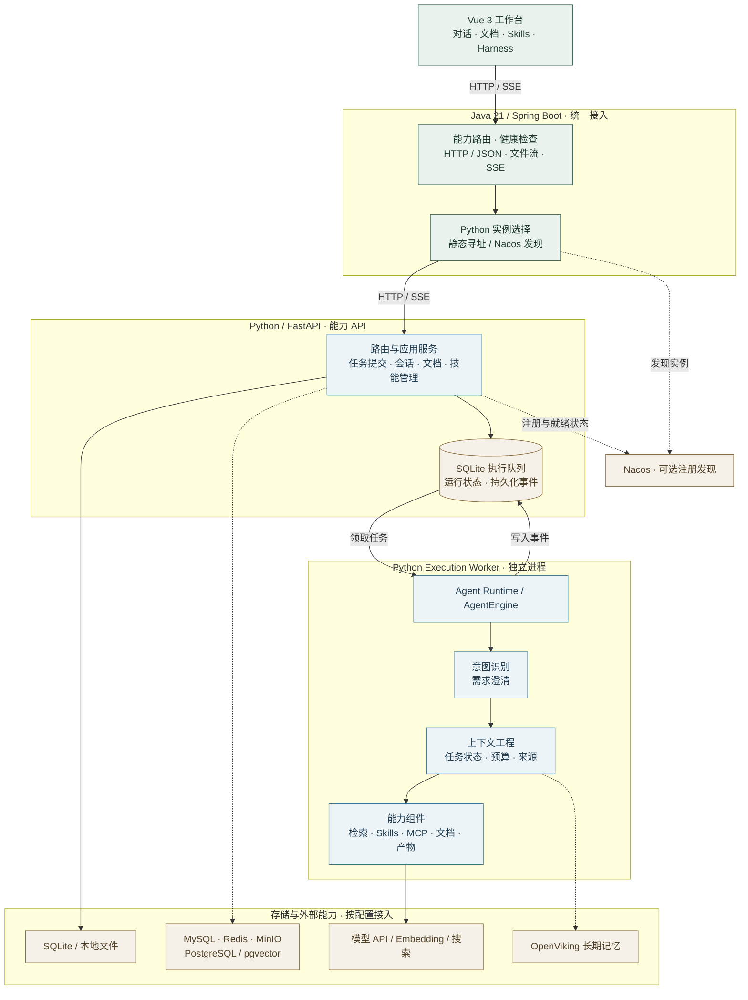
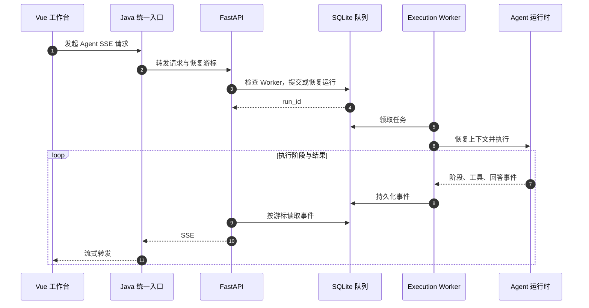
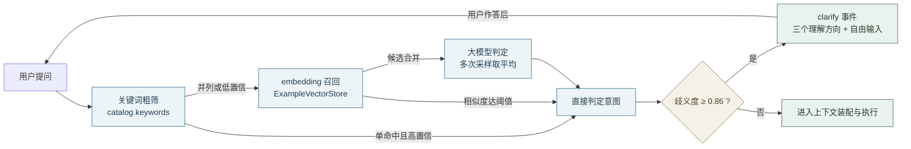
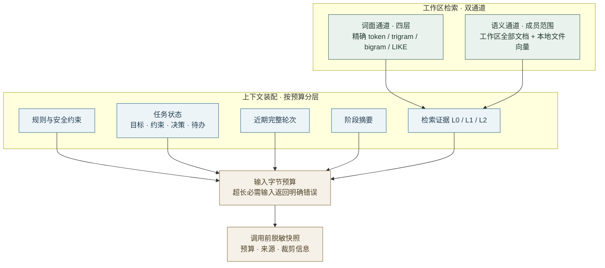
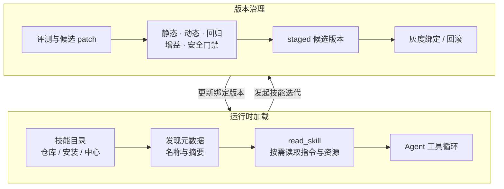

# Hotline Agent

<div align="center">

<picture>
  <source media="(prefers-color-scheme: dark)" srcset="docs/assets/readme-hero-dark.webp">
  
</picture>

### 把前沿 AI 能力，接入真实工作流。

**对话 · 文档问答 · 深度研究 · PPT 生成 · Skills**

<p>
  
  
  
  
  
  
  
</p>

<p>
  <a href="#一句话看懂">一句话看懂</a> ·
  <a href="#技术架构">技术架构</a> ·
  <a href="#能力地图">能力地图</a> ·
  <a href="#快速开始">快速开始</a> ·
  <a href="#技能与记忆">技能与记忆</a> ·
  <a href="#开发指南">开发指南</a> ·
  <a href="#友情链接">友情链接</a>
</p>

</div>

---

## 一句话看懂

Hotline Agent 是一个**持续探索前沿 AI 技术的智能体应用**：把模型、检索、记忆、Skills 与工具调用组合进同一个工作台，覆盖从提问、查找证据到生成交付物的完整任务流程。

架构上采用 **Java / Python 协同的服务化设计**——Vue 提供交互界面，Java 21 / Spring Boot 提供统一入口，FastAPI 装配 AI 能力，独立 Execution Worker 运行长任务。前端、服务端、技能中心与部署工具在同一仓库维护。

<table>
<tr>
<td width="50%" valign="top">

### 从问题到交付

围绕同一个会话完成聊天、文件问答、研究与演示文稿生成，查看实际执行阶段、证据来源和生成结果。

</td>
<td width="50%" valign="top">

### 从能力到复用

以模块接口组合 AI 能力，以版本化 Skill 沉淀工作方法，通过评测、灰度与回滚管理技能变更。

</td>
</tr>
</table>

> **当前阶段** · Java 统一入口、Python 能力 API 与独立 Worker 已接入。AI 能力集中在一个 FastAPI API 部署单元中，执行队列使用同机 SQLite，项目正按能力边界逐步演进。

### 仓库规模

| 维度 | 现状 |
| --- | --- |
| Python 后端 | 132 个文件 / 18.3k 行，`python_backend/` |
| Vue 前端 | 17 个文件 / 7.2k 行，`frontend/src/` |
| Java 入口 | 17 个文件 / 629 行，`java_backend/` |
| 能力模块 | 后端 14 个，前端同名边界 11 个 |
| HTTP 路由 | 17 个路由工厂，5 条 Agent SSE 流 |
| 运行数据 | 全部落在 Git 忽略的 `data/`，按模块拆分本地 SQLite |

## 技术架构

### 服务与能力全景



实线表示主要调用与数据流，虚线表示可选依赖。FastAPI 提供 Vue 构建产物和静态控制台，浏览器通过 Java 入口统一访问。

### 一次 Agent 请求



Worker 离线时，就绪检查返回 503，新的 Agent 运行会被拒绝。事件保存在 `data/execution.db`，支持按游标恢复与事件回放。Java 保留上游 HTTP 状态、内容类型和 SSE 事件，使用虚拟线程处理流式转发。

### 意图三级级联与澄清门闸



意图识别采用关键词粗筛、embedding 向量召回与大模型判定的三级级联，候选按合并去重后再交给模型判定。配置决策模型后改走 System One 协议，一次前向同时给出意图与诉求歧义度。门闸触发时先澄清需求，用户作答后作为新一轮对话重新进入级联。

### 上下文装配与分层检索



语义通道的候选范围按**成员关系**决定——文档取该工作区用过的全部文档，文件取本地按文件存放的一份向量，不依赖这次查询命中了什么。因此与原文没有任何共同片段的同义问法也能召回。

### 职责与技术栈

| 层级 | 当前职责 | 主要技术 |
| --- | --- | --- |
| 工作台 | 会话、工作区、文件、技能、运行观测与设置 | Vue 3、Vite 6、Lucide |
| Java 入口 | 统一接入、能力转发、健康检查、实例选择 | Java 21、Spring Boot 3.5、Nacos |
| Python API | 路由装配、应用用例、资源与运行管理 | Python 3.11+、FastAPI、Uvicorn |
| 执行进程 | 领取任务、Agent 编排、工具调用、事件持久化 | Execution Worker、Agent Runtime、LangChain |
| 能力模块 | 意图、上下文、检索、记忆、Skills、MCP、文档、产物 | `python_backend/modules/` |
| 数据与适配 | 本地持久化与可选外部存储 | SQLite、本地文件、MySQL、Redis、MinIO、pgvector |

Java 当前以统一入口和能力调用为主。身份认证、租户授权、配额、限流、熔断及 Java 业务持久化列入后续规划。多机执行需要升级队列基础设施并完成对应验收。阶段目标见架构草案。[Java / Python 架构方案](docs/微服务架构迁移草案.md)

## 能力地图

| 使用场景 | 当前能力 | 相关模块 |
| --- | --- | --- |
| 日常对话 | 模型问答、按需检索、低置信度需求澄清 | `intent`、`execution` |
| 文件问答 | 文档解析、分块、关键词与向量召回、来源回读 | `documents`、`retrieval` |
| 深度研究 | 证据规划、补充检索、联网工具调用与证据整理 | `execution`、`context_engineering` |
| PPT 生成 | 规划内容、渲染演示文稿、登记与下载产物 | `documents`、`artifacts` |
| 技能执行 | 按需读取 Skill、调用工具、选择绑定版本 | `skills`、`execution` |
| 连续工作 | 任务状态、历史摘要、工作区检索与可选长期记忆 | `context_engineering`、`memory`、`workspaces` |
| 运行管理 | 状态、事件、取消、重试、上下文快照 | `execution`、`governance` |

<details>
<summary><strong>工作台入口与数据来源</strong></summary>

| 入口 | 能力 | 数据来源 |
| --- | --- | --- |
| 自动化 | 按固定间隔提交 Agent 运行 | `/harness/schedules`、`data/harness-schedules.db` |
| 插件 | 已安装技能的启停与删除 | `/skill/list` |
| 代码地图 | 系统架构、请求时序与上下文流程 | `/code-map`、`/code-map/hotline.html` |
| 轻量机器人 | 角色指令、技能绑定与会话关联 | `/harness/bots`、`data/harness-bots.db` |
| 个人中心 | 昵称、简介、回答风格与主题 | `/harness/profile`、`data/harness-profile.db` |
| 模型 API Key | 本机保存凭证，接口返回掩码 | `/harness/profile/credentials`、`data/harness-credentials.db` |

模型调用经 `llm.model_config()` 选择配置，本机保存的凭证优先于环境变量。代码地图产物位于被忽略的 `data/code-map/hotline/`，资源缺失时工作台显示空态，生成后可刷新加载。

</details>

## 快速开始

### 准备环境

| 依赖 | 版本 | 用途 |
| --- | --- | --- |
| JDK | 21 | Java 统一入口，仓库附带 Maven Wrapper |
| Python | 3.11+ | FastAPI、Worker 与技能中心 |
| Node.js | 20+ | 启动器、前端构建与开发服务 |
| uv | 可选 | 安装 Python 依赖及管理 `.venv` |

### 安装与配置

在仓库根目录执行以下命令。

```bash
# 安装 Python 依赖
uv sync

# 安装并构建前端
npm --prefix frontend install
npm --prefix frontend run build
```

使用 pip 时，可在已激活的 Python 3.11+ 虚拟环境中执行 `python -m pip install -r requirements.txt`。启动器优先使用 `uv run python`，未安装 uv 时使用系统 Python，需确保它对应已安装依赖的环境。

模型 Key、真实服务地址和凭据保存在 Git 忽略的根 `.env` 或 `DODO_ENV_FILE` 指定的本地配置中。配置项参考模板，模型也可通过工作台的个人中心配置。[配置模板](.env.example)

本地入门可在当前终端显式选择 SQLite 与本地文件存储，再启动应用。下面使用 PowerShell。

```powershell
$env:DODO_STORAGE_BACKEND = 'sqlite'
$env:DODO_FILE_STORAGE_BACKEND = 'local'
$env:DODO_REDIS_ENABLED = 'false'
$env:DODO_VECTOR_ENABLED = 'false'
npm start
```

Python 启动引导对未设置的本地存储使用 SQLite / 本地文件，Redis 默认关闭。向量开关仍可能由本地配置文件启用，上面的显式环境变量可固定入门环境。MySQL、MinIO、Redis、pgvector 按需配置后接入。

### 打开工作台

| 入口 | 本机默认地址 |
| --- | --- |
| 应用页面 | [打开 Hotline](http://127.0.0.1:8080/) |
| API 文档 | [Swagger UI](http://127.0.0.1:8080/docs) |
| Java 存活检查 | [health/live](http://127.0.0.1:8080/health/live) |
| 全链路就绪检查 | [health/ready](http://127.0.0.1:8080/health/ready) |
| 技能控制台 | [Skill Console](http://127.0.0.1:8080/console) |

`npm start` 启动 Java、FastAPI 和 Execution Worker。启动器检查已有进程身份与健康状态，复用已运行的 Hotline 服务，退出时清理本次创建的进程。

### 选择开发方式

| 命令 | 适用场景 | 浏览器入口 |
| --- | --- | --- |
| `npm start` | 运行已构建的前端和完整后端 | `http://127.0.0.1:8080` |
| `npm run dev` | Vue HMR，联动启动 Java、FastAPI 与 Worker | `http://127.0.0.1:5180` |
| `npm run hot` | Python 改动重启网关和 Worker，Vue 改动重建并刷新 | `http://127.0.0.1:8080` |

开发模式的 Vite 将 API 请求代理到 Java。`DODO_DEV_FRONTEND_PORT`、`HOTLINE_JAVA_PORT` 和 `DODO_PORT` 分别控制前端、Java、Python 端口，默认值为 5180、8080、8888。

<details>
<summary><strong>分进程启动与端口排查</strong></summary>

以下命令分别在独立终端中运行，并使用同一组本地配置。

```powershell
# Java 入口，读取本地 HOTLINE_ 配置
node deploy/start-java.mjs

# Python 能力 API
python -m uvicorn main:app --host 127.0.0.1 --port 8888 --reload

# Python 执行进程
python -m python_backend.modules.execution.worker
```

`run_python_backend.ps1` 和 `run_python_backend.sh` 提供 Python API 启动方式。执行 Agent 任务时还需运行 Worker。

遇到端口冲突时，先确认占用进程的用途。

```powershell
netstat -ano | findstr :8888
Get-Process -Id <PID>
```

Java 默认端口 8080 可用同样的方法查询。Java 可以在 Python 暂时离线时启动，`/health/live` 检查自身存活，`/health/ready` 检查下游就绪情况。

</details>

## 技能与记忆

### 让 Skill 按需进入上下文

技能中心管理版本、项目绑定、评测、自进化、灰度与回滚。运行时先提供技能名称和摘要，模型再通过 `read_skill` 按需读取完整指令与参考资料，控制每轮输入规模。



运行时提供受限的技能文本读取与已注册工具。技能中的脚本描述需要相应执行工具接入后才能运行。技能中心保存前会进行敏感内容与提示注入扫描。

<details>
<summary><strong>技能加载、版本治理与执行边界</strong></summary>

技能中心已并入后端：版本目录、项目绑定、评测用例、自进化门禁、灰度发布与自动回滚，全部通过 FastAPI 提供服务，数据库位于 `data/skill-center/catalog.db`（Git 忽略）。

- **技能控制台**：后端启动后打开 <http://127.0.0.1:8080/console>，可新建/编辑技能（SKILL.md + 可选资源）、按版本启用或停用、运行自进化并查看门禁结果。
- **渐进式披露**：技能智能体（`/agent/skills/stream`）使用 LangChain `create_agent` 处理模型与工具调用。技能名称与摘要仅放在动态生成的 `read_skill` 工具描述中，不注入初始消息，也不将技能名称注册成独立工具；模型需要时按技能 ID 调用工具读取完整 `SKILL.md`，参考资料另行按相对路径按需读取。
- **技能来源**：仓库根 `skills/*/SKILL.md`（当前包含开发流程技能 `hotline-tdd`）、原安装目录 `data/skills/`、技能中心中绑定当前项目的版本。仓库技能仅扫描元数据头部；目录查询不读取数据库正文/资源，不自动加载 `skill-center/samples/`。`$技能名` 是传给模型的显式使用提示，不再通过关键词预选后直接注入正文。
- **元数据缓存**：后端进程内按来源缓存文件技能的名称与摘要。每次请求枚举技能并检查 `SKILL.md` 的 inode、修改时间和大小；未变化的条目复用缓存，新增或变更的条目才重新解析头部，删除项从缓存移除。技能中心仍按请求 ID 查询当前灰度版本，避免缓存绕过版本路由。目录变化在下一次技能请求生效；同尺寸内容若被外部程序同时恢复完全相同的 inode/时间戳/大小，stat 签名无法检测。
- **上下文范围**：默认恢复当前会话的任务状态、近期完整交互、历史摘要和相关记忆，再进入技能工具循环；`HOTLINE_CONTEXT_ENABLED=false` 时使用单次技能请求隔离。长期记忆按显式绑定的工作区共享，未绑定工作区时按会话隔离。技能中心灰度按该请求 ID 稳定分桶，任务内固定选中版本；解绑/禁用后后续读取被拒绝。
- **自进化闭环**：评测用例按 `train / selection / test` 分段；`evolve` 只接受最多 8 条 `add/delete/replace` patch，通过静态、动态、回归、增益、安全五道门禁后进入 `staged`，再用 `promote` 灰度绑定、`rollback` 回滚；错误率达到阈值自动回滚。
- **可选模型配置**：`SKILL_EVOLUTION_*`（自动生成 patch）与 `SKILL_JUDGE_*`（独立评分），见 `.env.example`。

命令行工具（`skill-center/`，纯标准库）：

```bash
python skill-center/test_center.py       # 目录库回归测试
python skill-center/test_skill_disclosure.py  # 渐进披露、版本和资源安全
python skill-center/test_agent_tools.py  # 离线 LangChain 工具调用及接口兼容
python skill-center/import_samples.py    # 导入 samples/ 研究样本（默认不绑定）
python skill-center/pull_samples.py      # 更新上游样本（anthropics/skills 固定提交）
```

`samples/` 内容来自 [Anthropic 官方 skills 仓库](https://github.com/anthropics/skills)，`samples/sources.json` 记录固定提交号。这些文件属于研究数据，不是本仓库开发的行为指令。

技能执行边界：

- 模型适配在 `python_backend/llm.py`，通用工具调用及 `read_skill` 工具定义在 `python_backend/modules/execution/`，技能目录和受限资源读取在 `python_backend/modules/skills/registry.py`；根 `skills/` 只放技能包，不承载 Agent 基础设施。
- `read_skill` 只按本次登记的技能 ID 读取技能包内文本资源，禁止宿主机任意路径、越界链接、隐藏/私密文件及二进制内容；不执行 Shell/Python 脚本，不安装工具，不启动工作流引擎。Skill 中提到命令不代表已具备相应执行能力。
- 技能工具描述预算为 8000 字符，超出时提示省略；单文件最多 1 MiB，每页最多 12000 字符，按 `next_offset` 继续读取，不静默截断正文。
- 技能工具循环最多 8 次模型调用、16 次工具调用。工具原始结果保存在本地上下文库，送入模型的结果按输入预算限额，通过 `read_context_source` 分页恢复；较早的完整工具调用与结果成组压缩。任务状态抽取和阶段摘要单独记录调用前快照。错误、预算超限和停止返回错误事件。在途模型请求返回后检查停止信号。
- 需要支持工具调用的 OpenAI-compatible 模型；缺少配置、协议不支持或调用失败时明确报错，不退化为虚构技能执行。执行期间关闭 LangSmith 自动追踪。接口保持 SSE 事件格式，当前在最终答案就绪后发送文本，不承诺逐 Token 流式输出。
- 聊天页按实际 SSE 事件显示理解问题、检索方式、文档名、工具调用与回答生成等阶段。`step` 事件通过 `stage`、`status`、`content` 和可选 `durationMs` 更新同一阶段；工具调用通过 `toolCallId` 区分并行请求。改写提示只在收到实际改写阶段事件时显示，输出期间处理进度和参考来源默认折叠，可手动展开详情；完成后过程收起为摘要，错误时保留展开记录。意图置信度低于门闸阈值时后端发出 `clarify` 事件（三个理解方向 + 自由输入），该轮不产出答案；用户作答后前端把它作为新一轮提问带上原问题上下文重新进入级联。

</details>

### 让长任务带着上下文继续

普通聊天、文件问答、深度研究、PPT 规划和技能执行共用上下文入口。系统根据工作区与会话恢复规则、任务状态、近期完整问答和相关证据，按预算装配输入，并记录调用前快照。

| 组成 | 保存与恢复的内容 |
| --- | --- |
| 任务状态 | 目标、用户约束及其原话来源、决策、待办、revision |
| 历史与摘要 | 原始消息、近期完整轮次、阶段摘要与分页原文 |
| 工作区证据 | FTS5 索引、语义候选、L0 / L1 / L2 分层来源 |
| 长期记忆 | 可选 OpenViking，会话投递、后台抽取、检索与撤销 |
| 可观测性 | 输入预算、证据来源、裁剪信息、后端状态与运行事件 |

长期记忆按显式绑定的工作区共享，未绑定时按会话隔离。OpenViking 未配置或不可用时，任务继续使用本地状态和历史证据。实现与验证方法见专项文档。[上下文工程实现与验收](docs/context-engineering-design.md)

<details>
<summary><strong>上下文装配、工作区检索、OpenViking 与管理接口</strong></summary>

普通聊天、文件问答、研究、PPT 规划和技能执行经过同一上下文入口。Worker 将执行记录里的 `workspace_id` 传给运行时，读取该工作区根目录的 `AGENTS.md`，绑定会话范围，再恢复任务状态、近期交互和历史证据。当前实现面向仓库现有的单用户部署，跨会话共享以已绑定工作区为范围。

装配顺序、分层读取、多跳检索和验收口径见 [上下文工程实现与验收](./docs/context-engineering-design.md)。重排层、冲突时效、权限模型、向量流水线、存储一致性、评测门禁、前端呈现与可观测性的业界做法和建议方案见 [第二阶段能力设计](./docs/stage-two-capability-design.md)。

- `data/context-memory.db` 保存原始消息、工具结果、FTS5 历史索引、任务状态、阶段摘要、记忆撤销记录和持久化投递队列。原有会话保留在既有存储中，通过范围受限的查询读取早期记录。
- 任务状态包含目标、当前请求、带用户原话和来源 ID 的约束、决策、待办及最近完成的对话轮次。自动抽取仅接受当前用户原话中的引用，同主题使用相同 key 更新；任务状态 API 使用 revision 检查并发修改。对话轮次完成与业务任务完成分别表达。
- 历史超过近期 4 轮时生成阶段摘要，摘要记录已覆盖的消息 ID。摘要调用失败时使用带来源的限额摘录，完整原文继续保存在本地。
- 装配器对规则、任务状态、近期完整问答和证据分别处理，优先保留规则、任务状态和当前问题。输入采用 UTF-8 字节上界估算，包含消息和工具定义，并预留输出及安全余量。超长的必需输入返回明确错误。该估算偏保守，实际模型用量仍以 provider usage 为准。
- 文档 hybrid 召回通过 RRF 融合及关键词匹配打破同分，父块内容去重。文档向量检索按所选文档限定范围，工作区文件通过本地关键词与语义通道召回。阶段事件与 `/execution/runs/{run_id}/context` 中的快照提供预算、来源、裁剪信息和记忆后端状态。
- 工作区文件在本地 `data/workspace-index.db` 建 FTS5 索引，按文件 mtime 与大小增量同步，删除的文件同步移除，改动后下一次查询即生效。关键词召回分四层：编号与错误码走精确 token，中文 3 字以上走 trigram，2 字中文走 bigram 短语匹配（同样有 bm25 排序），1 字中文与短标识符走 LIKE 兜底，四层结果轮转交错。该工作区用过的文档会挂进同一份索引，既能被词面层召回，也能作为语义通道的候选。
- 工作区语义通道的范围按成员关系决定，不依赖这次查询命中了什么：文档取该工作区用过的全部文档，文件取本地按文件存放的一份向量（取文件头、中、尾的代表性片段，每文件一次 embedding，改动后增量重算）。因此与原文没有任何共同片段的同义问法也能召回；阈值按实测标定，相关问法余弦 0.488 到 0.746、无关问法 0.135 到 0.323，取 0.35。语义通道先粗排前几个文件再把正文交给模型，同分近义文件会一起进证据。语义评测需要真实 embedding 服务，用 `HOTLINE_SEMANTIC_EVAL=1` 显式打开。工作区维度只用于过滤，跨工作区互不召回。
- 模型输入、embedding 查询和 OpenViking 消息执行出站脱敏。匹配到的环境配置、常见凭据、URL、域名及 IP 会被遮蔽；原始证据仅保存在本地。文件名过滤与内容脱敏共同遵循本仓库私密信息规则。

### 工作区、分层与补充检索

主聊天和 Harness 都传递真实 `workspaceId`。浏览器目录导入通过 `/harness/workspaces/import` 保存到数据目录，保留相对路径与根 `AGENTS.md`，成功写入后创建持久化工作区记录。主聊天切换工作区时为已有对话建立新会话，读取历史会话时恢复原工作区。导入单文件上限 50 MB、总量上限 512 MB、最多 5000 个文件。

客户端与服务端同时排除环境配置、local/private 文件、私密目录、密钥文件、依赖与运行数据。索引在打开时清理旧的私密来源，检索与分页读取继续检查来源范围。原文和向量索引都遵守该边界。

工作区来源保存 L0 摘要、L1 带章节来源的抽取式概览，以及 L2 原文分块。全局问题提供目录计数、代表摘要和实际覆盖清单，超出展示额度时标明部分覆盖。技能模式的 `search_memory` 可补查工作区证据，`read_context_source` 支持 `workspace:file:相对路径` 与 `workspace:doc:文档ID` 的分层读取和字符分页。远端 Viking 正文按行分页。

深度模式和关联、依赖、根因、跨文档等问题可进行最多两轮补充检索。证据规划只接受有界查询和已出现的来源 ID，并在覆盖充分、无新增证据、预算不足、取消或轮数达到上限时停止。规划输入快照与 `retrieval_expand` 事件记录实际调用和停止原因。阶段摘要另保留带起止来源的分段记录，后续可按主题检索与分页回读。用户澄清回复重新进入意图级联。

### OpenViking 接入

长期记忆通过 OpenViking HTTP API 接入，提供会话提交、后台抽取、记忆检索和读取能力。Hotline 为每个作用域和撤销代次生成独立 Peer，使用 `self.enabled=false`、`peer.enabled=true`，允许 preferences、entities、events、experiences 类型；实际可用类型取决于服务端 Registry。

完成的问答先写入本地持久化投递队列，Worker 内的后台线程提交 OpenViking Session，再轮询抽取任务。上传失败采用退避重试；未提交上传使用该投递独占的 Session 重建，提交阶段通过 Session ID 查询已存在的抽取任务，处理响应丢失。尚未完成抽取的近期问答也能在同作用域读取，提供跨会话的即时连续性。抽取失败记录错误码，等待服务端处理后继续查询。任务租约支持 Worker 重启后的恢复。

记忆检索先使用支持 `target_uri` 的 `search(mode="list", read_content=false)` 获取 L0 候选，再读取目录 L1 概览，最多为前两个 L2 来源加载各 80 行正文，查询目标限定到当前 Peer 的 memories 子树，并在返回后再次检查路径。技能执行同时获得 `search_memory` 和 `read_context_source` 两个只读工具。OpenViking 未配置或不可用时，模型输入中提供实际后端状态，任务继续使用本地状态和历史证据。

连接参数保存到 Git 忽略的本地 env 文件，沿用 `DODO_ENV_FILE` 加载。以下为回环地址示例，凭据使用本地服务签发的值。

```dotenv
HOTLINE_CONTEXT_ENABLED=true
HOTLINE_CONTEXT_WINDOW=128000
HOTLINE_CONTEXT_INPUT_BUDGET=64000
HOTLINE_CONTEXT_OUTPUT_RESERVE=8192
HOTLINE_CONTEXT_SAFETY_MARGIN=2048
HOTLINE_OPENVIKING_URL=http://127.0.0.1:1933
HOTLINE_OPENVIKING_API_KEY=<LOCAL_ONLY_API_KEY>
HOTLINE_OPENVIKING_TIMEOUT=10
```

配置窗口和输出预留需要与实际模型限制一致。连接配置生效后重启网关和 Worker。OpenViking 服务由外部部署提供，其自身的模型、embedding 和存储配置保存在私密目录。接口契约依据 [OpenViking Session API](https://github.com/volcengine/OpenViking/blob/main/docs/zh/api/05-sessions.md) 和 [检索 API](https://github.com/volcengine/OpenViking/blob/main/docs/zh/api/06-retrieval.md)。

### 上下文管理接口

| 接口 | 用途 |
| --- | --- |
| `GET /harness/context/{conversation_id}` | 读取任务状态、revision、后端配置状态和投递进度 |
| `PUT /harness/context/{conversation_id}/task` | 提交 goal、constraints、decisions、pending 和 revision；事实包含 key、quote、sourceId |
| `GET /harness/context/{conversation_id}/history?q=关键词` | 检索本会话原始记录 |
| `GET /harness/context/{conversation_id}/sources/{source_id}?offset=0&limit=6000` | 分页读取脱敏后的原始证据 |
| `DELETE /harness/context/{conversation_id}/memories` | 请求体提供 uri，立即屏蔽指定记忆并排队远端删除 |
| `DELETE /harness/context/{conversation_id}` | 清除会话记录和上下文，切换共享作用域代次并排队清理远端派生记忆 |

删除共享工作区中的会话时，原有长期记忆命名空间立即失效；后台清理旧 Session 和记忆，并根据保留会话重建新代次。远端清理状态通过投递队列查询。删除操作影响范围包括同工作区的派生记忆视图。

本地验证使用临时 SQLite 存储、本地 HTTP 协议测试服务和脚本化模型，覆盖约束修正、30 轮连续性、作用域隔离、预算、断连重试、原文分页、撤销和 Worker/SSE 正常入口。

```powershell
.`.venv`Scripts`python.exe -m unittest python_backend.modules.context_engineering.test_chain python_backend.modules.context_engineering.test_snapshots -v
.`.venv`Scripts`python.exe -m compileall python_backend
.`.venv`Scripts`python.exe skill-center/test_center.py
.`.venv`Scripts`python.exe skill-center/test_agent_tools.py
npm --prefix frontend run build
```

本地容量验收使用 `cl100k_base` 对已索引分块逐块计数，生成合成 ASCII 语料，测量 SQLite FTS5 检索、原文分页恢复与范围隔离。报告区分索引容量、语义质量和 OpenViking 服务效果，生成文件保存在 Git 忽略的数据目录。

```powershell
.`.venv`Scripts`python.exe -m unittest python_backend.modules.context_engineering.test_completion -v
node --test frontend/src/modules/workspaces/paths.test.js frontend/src/modules/execution/progress.test.js
.`.venv`Scripts`python.exe -m python_backend.modules.context_engineering.benchmark --tokens 100000000 --queries 100 --output data/context-benchmark/new-run
```

验收目录应使用新路径，已有数据库会保留并拒绝覆盖。该脚本使用现有 `langchain-openai` 依赖链中的 `tiktoken`。合成容量结果与真实模型、真实语料、目标 OpenViking 部署的效果分别验收。

</details>

## 配置参考

真实 Key、密码、令牌、连接字符串和部署地址仅保存在本地私密配置。`.env`、`.env.*`、`*.env` 及其备份受仓库私密信息规则保护。对外示例使用占位符，本地回环地址可用于演示。[协作规则](AGENTS.md)

| 变量 | 说明 |
| --- | --- |
| `DODO_ENV_FILE` | 指定 env 文件路径，默认项目根目录 `.env` |
| `DODO_ENV_PROFILE` | `remote` 时应用 `REMOTE_` 前缀配置 |
| `DODO_STORAGE_BACKEND` / `DODO_FILE_STORAGE_BACKEND` | `sqlite`/`mysql`、`local`/`minio`，本地开发默认 SQLite + 本地文件 |
| `DODO_VECTOR_ENABLED` | 向量检索开关，本地默认关闭 |
| `HOTLINE_CONTEXT_ENABLED` | 上下文恢复开关，默认 true |
| `HOTLINE_CONTEXT_WINDOW` / `HOTLINE_CONTEXT_INPUT_BUDGET` | 模型窗口与输入上界，默认 128000 / 64000 |
| `HOTLINE_CONTEXT_OUTPUT_RESERVE` / `HOTLINE_CONTEXT_SAFETY_MARGIN` | 输出预留与安全余量，默认 8192 / 2048 |
| `HOTLINE_OPENVIKING_URL` / `HOTLINE_OPENVIKING_API_KEY` | OpenViking 连接与凭据，本地私密配置 |
| `HOTLINE_OPENVIKING_TIMEOUT` | 单次记忆 HTTP 请求超时秒数，默认 10 |
| `DODO_SKILL_CATALOG_DB` / `DODO_SKILL_PROJECT` | 技能目录库路径（默认 `data/skill-center/catalog.db`）与绑定项目 ID（默认 `hotline-agent`） |
| `DODO_REPO_SKILLS_DIRECTORY` | 仓库技能包目录，默认根据源码位置定位根 `skills/`，不受启动工作目录影响 |
| `SKILLS_DIRECTORY` | 原技能安装目录，默认 `data/skills/`，与仓库技能目录分别管理 |
| `DODO_DEV_FRONTEND_PORT` / `HOTLINE_JAVA_PORT` / `DODO_PORT` | 前端 / Java / Python 端口，默认 5180 / 8080 / 8888 |

完整清单见 [.env.example](./.env.example)。

<details>
<summary><strong>Java 寻址、Nacos 注册发现与连接参数</strong></summary>

Java 默认使用静态寻址，目标为 `http://127.0.0.1:8888`。可通过 `HOTLINE_PYTHON_BASE_URL` 覆盖，通过 `HOTLINE_PYTHON_CONNECT_TIMEOUT` 和 `HOTLINE_PYTHON_READ_TIMEOUT` 设置超时。

| 配置 | 作用 |
| --- | --- |
| `HOTLINE_NACOS_ENABLED` | Java 开启 Nacos 能力 |
| `HOTLINE_PYTHON_MODE` | `static` 或 `nacos` 寻址 |
| `HOTLINE_PYTHON_NACOS_ENABLED` | Python 开启注册 |
| `HOTLINE_NACOS_SERVER_ADDR` | 注册中心地址，保存在本地配置 |
| `HOTLINE_NACOS_NAMESPACE` / `HOTLINE_NACOS_GROUP` | 两端使用一致的命名空间与分组 |
| `HOTLINE_PYTHON_SERVICE_NAME` | 默认 `hotline-python-api` |
| `HOTLINE_PYTHON_ADVERTISED_IP` / `HOTLINE_PYTHON_ADVERTISED_PORT` | Python 可达的注册地址 |
| `HOTLINE_NACOS_REGISTER_ENABLED` | Java 自注册开关，默认关闭 |
| `HOTLINE_NACOS_ADVERTISED_IP` | Java 自注册时的可达 IP |

本机隔离测试可使用以下回环配置。

```powershell
$env:HOTLINE_NACOS_SERVER_ADDR = '127.0.0.1:8848'
$env:HOTLINE_PYTHON_NACOS_ENABLED = 'true'
$env:HOTLINE_PYTHON_ADVERTISED_IP = '127.0.0.1'
$env:HOTLINE_PYTHON_ADVERTISED_PORT = '8888'
$env:HOTLINE_NACOS_ENABLED = 'true'
$env:HOTLINE_PYTHON_MODE = 'nacos'
npm start
```

Python 使用官方 `nacos-sdk-python` 3.2.0，由 FastAPI lifespan 管理注册与退出注销。实例带有 `apiVersion=1` 元数据，Worker 未就绪时标记为 `draining`。Java 过滤兼容且可接入的实例，再轮询选择。注册失败时 Python 就绪检查返回 503，并定期重试。

跨主机配置需要填写实际可达地址，两端保持相同的 namespace、group 和 service name，同时放通 Nacos 主端口和 gRPC 端口。Java 自注册需同时启用 Nacos 与自注册开关。

共享配置可通过 `DODO_ENV_FILE` 指定。`DODO_ENV_PROFILE=remote` 会应用 `REMOTE_` 前缀配置，外部环境变量优先。Java 启动脚本仅读取本地文件中的 `HOTLINE_` 项。

先构建 Java，再使用隔离测试注册中心运行 `python deploy/test_service_discovery.py`，通过本地 `HOTLINE_TEST_NACOS_SERVER_ADDR` 指定测试环境。脚本使用独立数据和临时服务名。

当前部署面向单用户环境，Python API 使用内部网络访问。跨服务身份认证、独立 SSE 空闲超时与共享并发限额仍待建设。

</details>

## 开发指南

### 工程目录

```text
Hotline/
├── java_backend/              Java 21 统一入口
│   └── src/main/java/cn/hotline/
│       ├── trigger/http/      HTTP 控制器
│       ├── application/       应用服务
│       ├── domain/            能力端口与领域类型
│       └── infrastructure/    HTTP 适配与服务发现
├── frontend/                  Vue 工作台
│   └── src/modules/           前端能力边界
├── python_backend/
│   ├── api/routers/           FastAPI 路由
│   ├── application/           执行用例
│   ├── domain/                领域实体与协议
│   ├── modules/               AI 能力组件
│   ├── infrastructure/        队列与外部适配
│   ├── runtime/               Agent 运行时接口
│   └── workers/               后台执行进程
├── skill-center/              技能中心工具与研究样本
├── skills/                    仓库 Skill 包
├── static/                    技能控制台与共享资源
├── templates/                 PPT 模板
├── eval/                      评估工具
├── deploy/                    启动、部署与验证脚本
├── sql/                       数据库初始化
├── docs/                      专项文档、草案与历史记录
├── data/                      运行数据与生成文件，Git 忽略
├── main.py                    Python HTTP 入口 main:app
├── DESIGN.md                  前端视觉事实源
└── project.yaml               项目元数据
```

Python 能力边界包括 `intent`、`context_engineering`、`memory`、`retrieval`、`storage`、`skills`、`mcp`、`execution`、`workspaces`、`artifacts`，并扩展文档、测评、治理与保留策略等模块。组件通过接口协作，数据访问由各自的服务与存储边界管理。

Agent 实现在 `modules/execution/engine.py`，文档在 `modules/documents/`，技能管理在 `modules/skills/`，存储适配在 `modules/storage/`，向量存储在 `modules/retrieval/vector_store.py`。根级旧同名 Python 文件保留兼容入口，FastAPI 负责装配。

### 验证命令

在仓库根目录执行。Windows 本机可使用 `.venv/Scripts/python.exe` 替换 `python`。

```powershell
# Python 语法与技能中心
python -m compileall python_backend
python skill-center/test_center.py

# 技能披露与工具调用
python skill-center/test_skill_disclosure.py
python skill-center/test_agent_tools.py

# 前端构建
npm --prefix frontend run build

# Java 验证
.`java_backend`mvnw.cmd -f java_backend/pom.xml verify
```

依赖 MySQL 的整包导入需要可用的数据库配置。本地路由验证可使用临时存储单独装配 `create_*_router` 工厂。修改文档时核对路径、命令、端口、模块与当前代码的一致性。

### 贡献约定

1. 阅读协作规则，在独立分支开展开发。
2. 按对应能力目录修改，跨目录变更说明影响范围。
3. 运行相关验证，检查待提交文件与敏感内容。
4. 使用清晰的 Conventional Commits 信息提交。

协作约定及私密信息保护要求见根目录规则。[AGENTS.md](AGENTS.md)

## 文档导航

| 文档 | 阅读内容 |
| --- | --- |
| [文档目录](docs/index.md) | 项目文档的统一入口 |
| [上下文工程](docs/context-engineering-design.md) | 装配链路、分层读取、多跳检索与验收 |
| [RAG 测评](docs/evaluation.md) | 采集、Ragas 打分与 Prompt 检查 |
| [Java / Python 架构草案](docs/微服务架构迁移草案.md) | 当前进度、服务边界与后续建设阶段 |
| [第二阶段能力草案](docs/stage-two-capability-design.md) | 检索、权限、存储一致性与测评设计 |
| [性能验证方案](docs/performance-benchmark-plan.md) | 分层测量与压测验收方法 |
| [Harness 实施记录](docs/harness-implementation-plan.md) | 控制面建设与历史实施过程 |
| [前端设计系统](DESIGN.md) | 共享令牌、组件、主题与响应式规范 |

需要图形化的架构速览，可打开 [项目总览可视化页](docs/overview.html)。并行 README 草稿保留在文档目录，可继续查阅。[排版草稿](docs/readme-v2-draft.md)

## 友情链接

<table>
<tr>
<td width="50%" valign="top">

### [Prompt Vault](https://github.com/zklmiao/prompt-vault)

收集、整理与复用提示词，让经过验证的好 Prompt 随时可查、持续积累。

<a href="https://github.com/zklmiao/prompt-vault"></a>

</td>
<td width="50%" valign="top">

### 留言与建议

欢迎通过仓库 Issue 交流架构取舍、能力边界与使用场景。改动请遵循根目录的协作规则。

<a href="https://github.com/SC-10749/Hotline/issues"></a>

</td>
</tr>
</table>

## 许可证

当前仓库尚未声明开源许可证，授权方式以未来补充的 `LICENSE` 文件为准。

---

<div align="center">

**Hotline Agent** · 探索、验证、封装，让 AI 能力进入日常工作。

[回到顶部](#hotline-agent) · [文档目录](docs/index.md) · [友情链接](#友情链接)

</div>
