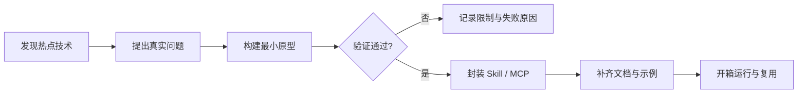

<div align="center">

# ⚡ Hotline

### 前沿技术可用性实验室 · Skill & MCP 开箱即用工厂

探索正在发生的技术，把热点变成工具，把想法变成能力，把能力交付给每一个需要它的人。

对话问答、文件检索、PPT 生成、深度研究与技能包管理，一体化单项目交付。

<p>
  <a href="https://nodejs.org/"></a>
  <a href="https://www.python.org/"></a>
  
</p>

[快速开始](#快速开始) · [架构](#整体架构) · [技能中心](#技能中心与-skill-自进化) · [配置](#配置)

</div>

---

## 项目简介

Dodo Agent 是一个面向企业级应用的端到端通用智能体（End-to-End Universal Agent）平台，采用多智能体架构，深度融合大语言模型（LLM）能力与现代软件工程架构，提供从感知、推理到执行的全链路智能化解决方案。

本仓库是**单一项目仓库**：Vue 前端、FastAPI 后端、技能中心与技能控制台都在这里，一条命令启动，不再依赖任何外部平台。

## 快速开始

### 环境要求

- Node.js 20+（前端构建与开发服务）
- Python 3.11+（后端；本机可直接用 `python`，也可用 uv 管理依赖）

### 私密配置

真实 API Key、密码和服务地址统一放在项目根目录 `.env`，由 `.gitignore` 排除；不含真实密钥的 `.env.example` 模板可以提交。远程环境与本地不同的值使用同一文件中的 `REMOTE_` 前缀配置：Python、PowerShell、Shell 启动脚本及数据库初始化脚本均读取根目录 `.env`，支持 `DODO_ENV_FILE` 指定其他路径；`DODO_ENV_PROFILE=remote` 时应用 `REMOTE_` 配置（去掉前缀后覆盖对应项），PowerShell 远程脚本默认应用该配置。普通开发启动保留 SQLite、本地文件及关闭 Redis 的默认行为。

### 安装与启动

前后端融合为**一个服务**：FastAPI 直接服务 Vue 构建产物，页面与接口同端口。

```bash
# 1) 首次：安装并构建前端
npm --prefix frontend install
npm --prefix frontend run build

# 2) 启动单服务（页面 + API + 技能控制台都在 8888）
npm start        # 等价于 python -m uvicorn main:app --host 127.0.0.1 --port 8888
```

启动后：

| 入口 | 地址 |
| --- | --- |
| 应用页面 | http://127.0.0.1:8888/ |
| 后端 API 文档 | http://127.0.0.1:8888/docs |
| 健康检查 | http://127.0.0.1:8888/health |
| 技能控制台 | http://127.0.0.1:8888/console |

### 常见问题

**启动报 `Errno 10048`（端口 8888 被占用）**：多半是上次开发模式（`node dev-launcher.mjs`）残留的旧后端还在运行。查询占用并结束：

```powershell
netstat -ano | findstr :8888     # 找到 LISTENING 行末尾的 PID
taskkill /PID <PID> /F
```

开发模式下若端口被占，启动器也会打印同样的提示。

### 热部署（改代码自动更新，推荐日常使用）

一个服务跑在 8888，改完代码不用手动重启或构建：

```bash
npm run hot
```

- 改 Python（`python_backend/`、`main.py` 等所有 `.py`）→ 后端自动重启
- 改 Vue/CSS（`frontend/src/`）→ 自动重新构建，浏览器页面自动刷新（页面内置热部署探针）
- 窗口里会分别提示前端构建完成、后端启动完成，全部就绪后直接访问 <http://127.0.0.1:8888/>

### 前端开发模式（热更新）

修改 Vue 代码时使用开发模式，页面仍是 5180，但 API 请求由 Vite 代理转发到后端，前后端依旧同源：

```bash
node dev-launcher.mjs    # 或 npm run dev
```

前端使用 Vite HMR（修改即时更新），后端使用 Uvicorn reload（改 Python 自动重启）。端口可用 `DODO_DEV_FRONTEND_PORT` 和 `DODO_DEV_BACKEND_PORT` 覆盖。改完前端要回到单服务模式时，重新执行 `npm --prefix frontend run build` 即可。

### 仅启动后端 / 其他方式

```bash
python -m uvicorn main:app --host 127.0.0.1 --port 8888 --reload   # 开发后端
./run_python_backend.ps1                                            # Windows，读取 .env 后运行
./run_python_backend.sh                                             # Linux / macOS
bash deploy/init_mysql_schema.sh                                    # 初始化 MySQL schema（按需）
uv sync                                                             # 可选：用 uv 重建 .venv
```

## 整体架构

```
┌─────────────────────────────────────────────────────────────────────────────┐
│                           应用层 (Application Layer)                         │
│  ┌─────────────┐  ┌─────────────┐  ┌─────────────┐  ┌─────────────────────┐ │
│  │ 智能问答Agent │ │ 文件问答Agent │  │ PPT生成Agent │  │    深度研究Agent     │ │
│  └──────┬──────┘  └──────┬──────┘  └──────┬──────┘  └──────────┬──────────┘ │
│         └──────────────────────────┴────────────────────┘                  │
│                              AgentEngine（技能路由）                         │
├─────────────────────────────────────────────────────────────────────────────┤
│  服务层：Embedding / 文件管理 / 会话管理 / PPT 渲染 / 文档解析（MinerU）        │
├─────────────────────────────────────────────────────────────────────────────┤
│  工具层：MCP 工具回调（Tavily 搜索）/ 向量检索 / 图片生成 / 技能中心             │
├─────────────────────────────────────────────────────────────────────────────┤
│  基础设施：大模型 API / SQLite(默认) 或 MySQL / 本地文件 或 MinIO / pgvector   │
└─────────────────────────────────────────────────────────────────────────────┘
```

### 多模式智能体

| Agent 类型 | 核心模式 | 适用场景 |
|-----------|---------|---------|
| **WebSearchReactAgent** | ReAct + 联网搜索 | 实时信息查询、新闻分析 |
| **FileReactAgent** | RAG + ReAct | 企业内部文档问答 |
| **PPTBuilderAgent** | 状态机 + 断点续传 | 一句话生成演示文稿 |
| **PlanExecuteAgent** | Plan-Execute-Critique | 深度研究、复杂任务分解 |
| **技能智能体** | 技能中心版本绑定 | 沉淀可复用的工作流经验 |

### 技术栈

| 层级 | 选型 |
|-----|------|
| 前端 | Vue 3、Vite 6、Lucide 图标 |
| 后端 | Python 3.11+、FastAPI、Uvicorn、SSE 流式响应 |
| 存储 | 本地 SQLite + 文件（默认）；可选 MySQL、Redis、MinIO、PostgreSQL / pgvector |
| 技能中心 | SQLite 目录库（`data/skill-center/catalog.db`），纯标准库实现 |

## 技能中心与 Skill 自进化

技能中心已并入后端：版本目录、项目绑定、评测用例、自进化门禁、灰度发布与自动回滚，全部通过 FastAPI 提供服务，数据库位于 `data/skill-center/catalog.db`（Git 忽略）。

- **技能控制台**：后端启动后打开 <http://127.0.0.1:8888/console>，可新建/编辑技能（SKILL.md + 可选资源）、按版本启用或停用、运行自进化并查看门禁结果。
- **渐进式披露**：技能智能体（`/agent/skills/stream`）使用 LangChain `create_agent` 处理模型与工具调用。初始消息只提供技能名称、摘要与 `skill://` 逻辑入口，模型需要时调用通用 `read_file` 读取完整 `SKILL.md`，参考资料另行按需读取；技能目录不放进工具描述，也不将技能名称注册成独立工具。
- **技能来源**：仓库根 `skills/*/SKILL.md`（当前包含开发流程技能 `hotline-tdd`）、原安装目录 `data/skills/`、技能中心中绑定当前项目的版本。仓库技能仅扫描元数据头部；目录查询不读取数据库正文/资源，不自动加载 `skill-center/samples/`。`$技能名` 是传给模型的显式使用提示，不再通过关键词预选后直接注入正文。
- **元数据缓存**：后端进程内按来源缓存文件技能的名称与摘要。每次请求枚举技能并检查 `SKILL.md` 的 inode、修改时间和大小；未变化的条目复用缓存，新增或变更的条目才重新解析头部，删除项从缓存移除。技能中心仍按请求 ID 查询当前灰度版本，避免缓存绕过版本路由。目录变化在下一次技能请求生效；同尺寸内容若被外部程序同时恢复完全相同的 inode/时间戳/大小，stat 签名无法检测。
- **请求隔离**：每次只向 LangChain 提供当前问题，不接入 history、checkpointer 或持久化记忆；当次工具循环消息临时保留。原接口仍可保存最终问答结果，但不作为下一次技能请求的模型输入。技能中心灰度按该请求 ID 稳定分桶，任务内固定选中版本；解绑/禁用后后续读取被拒绝。
- **自进化闭环**：评测用例按 `train / selection / test` 分段；`evolve` 只接受最多 8 条 `add/delete/replace` patch，通过静态、动态、回归、增益、安全五道门禁后进入 `staged`，再用 `promote` 灰度绑定、`rollback` 回滚；错误率达到阈值自动回滚。
- **可选模型配置**：`SKILL_EVOLUTION_*`（自动生成 patch）与 `SKILL_JUDGE_*`（独立评分），见 `.env.example`。

命令行工具（`skill-center/`，纯标准库）：

```bash
python skill-center/test_center.py       # 目录库回归测试
python skill-center/test_skill_disclosure.py  # 渐进披露、版本和资源安全
python skill-center/test_agent_tools.py  # 离线 LangChain 工具调用及接口兼容
python skill-center/import_samples.py    # 导入 samples/ 研究样本（默认不绑定）
python skill-center/pull_samples.py      # 更新上游样本（anthropics/skills 固定提交）
```

`samples/` 内容来自 [Anthropic 官方 skills 仓库](https://github.com/anthropics/skills)，`samples/sources.json` 记录固定提交号。这些文件属于研究数据，不是本仓库开发的行为指令。

技能执行边界：

- 模型适配在 `python_backend/llm.py`，通用工具调用集成在 `python_backend/modules/execution/`，目录格式化在 `python_backend/modules/context_engineering/skill_catalog.py`；`skills.py` 只提供技能目录和受限资源读取，根 `skills/` 只放技能包，不承载 Agent 基础设施。
- `read_file` 只读取本次登记的技能文本资源，禁止宿主机任意路径、越界链接、隐藏/私密文件及二进制内容；不执行 Shell/Python 脚本，不安装工具，不启动工作流引擎。Skill 中提到命令不代表已具备相应执行能力。
- 技能目录预算为 8000 字符，超出时提示省略；单文件最多 1 MiB，每页最多 12000 字符，按 `next_offset` 继续读取，不静默截断正文。
- 每次请求最多 8 次模型调用、16 次工具调用，工具结果累计最多 64000 字符；错误、超限和停止均返回错误事件，不标记完成。在途模型请求不保证即时取消，返回后会检查停止信号。
- 需要支持工具调用的 OpenAI-compatible 模型；缺少配置、协议不支持或调用失败时明确报错，不退化为虚构技能执行。执行期间关闭 LangSmith 自动追踪。接口保持 SSE 事件格式，当前在最终答案就绪后发送文本，不承诺逐 Token 流式输出。

## 配置

| 变量 | 说明 |
| --- | --- |
| `DODO_ENV_FILE` | 指定 env 文件路径，默认项目根目录 `.env` |
| `DODO_ENV_PROFILE` | `remote` 时应用 `REMOTE_` 前缀配置 |
| `DODO_STORAGE_BACKEND` / `DODO_FILE_STORAGE_BACKEND` | `sqlite`/`mysql`、`local`/`minio`，本地开发默认 SQLite + 本地文件 |
| `DODO_VECTOR_ENABLED` | 向量检索开关，本地默认关闭 |
| `DODO_SKILL_CATALOG_DB` / `DODO_SKILL_PROJECT` | 技能目录库路径（默认 `data/skill-center/catalog.db`）与绑定项目 ID（默认 `dodo-agent`） |
| `DODO_REPO_SKILLS_DIRECTORY` | 仓库技能包目录，默认根据源码位置定位根 `skills/`，不受启动工作目录影响 |
| `SKILLS_DIRECTORY` | 原技能安装目录，默认 `data/skills/`，与仓库技能目录分别管理 |
| `DODO_DEV_FRONTEND_PORT` / `DODO_DEV_BACKEND_PORT` | 开发端口覆盖，默认 5180 / 8888 |

完整清单见 [.env.example](./.env.example)。

## 目录结构

```text
├─ frontend/          # Vue 3 前端（Vite）
│  └─ src/modules/     # chat、workspaces、memory、retrieval、skills、MCP 等前端模块边界
├─ python_backend/    # FastAPI 后端（agents、documents、skills、skill_center 等）
│  └─ modules/         # memory、retrieval、storage、上下文、技能、MCP、执行器等后端模块边界
├─ static/            # favicon 与 console/ 技能控制台页面（Vue 产物由后端服务 frontend/dist）
├─ skill-center/      # 技能中心命令行工具与研究样本
├─ deploy/            # 数据库初始化脚本
├─ sql/ templates/    # SQL schema 与 PPT 模板
├─ docs/              # 设计规范、运维手册与脚本
├─ data/              # 运行数据（Git 忽略）：应用库、上传、技能目录库
├─ main.py            # FastAPI 入口（加载根目录 .env）
└─ dev-launcher.mjs   # 一键启动前端 + 后端
```

### 模块边界

前后端按同名能力模块逐步拆分，当前旧入口继续负责装配，迁移不会改变现有接口：

| 模块 | 负责内容 | 当前实现入口 |
| --- | --- | --- |
| `memory` | 会话历史、草稿、项目记忆 | `agents.py`、`storage.py` |
| `retrieval` | 文件、向量、关键词、图谱和联网检索 | `vector_store.py`、`documents.py`、`agents.py` |
| `storage` | 会话、文件、文档和对象存储 | `storage.py`、`object_store.py` |
| `context_engineering` | 历史、检索、技能和提示词组装 | `agents.py` |
| `skills` | Skill 版本、绑定、运行时加载 | `skills.py`、`skill_center.py` |
| `mcp` | 外部工具协议和搜索工具 | `agents.py`（逐步迁移） |
| `execution` | 任务生命周期、停止、脚本和 EXE 执行 | `agents.py`（逐步迁移） |
| `workspaces` | 文件夹、工作区和任务归属 | 前端工作区状态（逐步持久化） |
| `artifacts` | PPT、文档预览、下载和结果交付 | `ppt.py`、`documents.py` |

模块目录位于 `python_backend/modules/` 和 `frontend/src/modules/`；协作约束和迁移规则统一见 [AGENTS.md](./AGENTS.md)。

## 设计原则

1. **单项目单仓库**：一个应用一个仓库，前端、后端、工具、文档同仓维护，不再有平台与项目之分。
2. **一个服务一个端口**：FastAPI 直接服务 Vue 构建产物，页面、接口、技能控制台同源同端口；开发时才拆成 Vite + Uvicorn 双进程（Vite 代理保持同源）。
3. **事实优先**：不把计划、推测或未验证结果描述成已实现能力。
4. **可重复验证**：`python skill-center/test_center.py`、`npm --prefix frontend run build` 等命令可重复执行。
5. **安全优先**：不提交密钥、访问令牌、真实个人信息或生产数据；技能内容保存前自动做敏感信息与提示注入扫描。
6. **最小改动**：新增功能只影响必要的文件，不进行无关重构。

协作规则见 [AGENTS.md](./AGENTS.md)。

## 贡献方式

1. 阅读 [AGENTS.md](./AGENTS.md)。
2. 在对应子目录（frontend / python_backend / skill-center）内修改。
3. 运行项目自身的检查命令（后端编译与技能测试、前端构建）。
4. 提交变更时使用清晰的 Conventional Commits 信息。

## 许可证

当前仓库尚未声明开源许可证。正式公开到 GitHub 前，请根据你的授权方式补充 `LICENSE` 文件。
## 我们在做什么

技术的价值，不在于它有多新，而在于它能否在真实场景中稳定工作。

Hotline 关注最新的模型、协议、开发工具和智能工作流，通过快速、可复现的实验回答三个问题：

> **它能不能用？为什么值得用？怎样让别人马上用起来？**

每个实验都尽量走完从发现到交付的完整路径：

```text
热点发现 → 最小原型 → 真实验证 → 工程封装 → 开箱即用
```

我们不收集概念，也不堆叠演示。能够留下来的成果，必须经得起安装、配置、运行和复用。

## 能力地图

| 方向 | 关注内容 | 最终交付 |
| --- | --- | --- |
| **MCP** | 工具、资源、提示模板、外部系统连接 | 可启动的 MCP 服务 |
| **Skills** | 提示词、工作流、脚本和领域方法 | 可复用的 Skill |
| **Plugins** | 完整插件、配置、依赖与运行入口 | 可独立运行的工具 |
| **Experiments** | 新模型、新协议、新框架和新交互 | 可复现的验证结论 |

## 从灵感到能力



## 项目结构

```text
Hotline/
├── mcp/                    # MCP 服务、工具与资源
│   └── <mcp-project>/
├── skills/                 # 可复用的 Skill 定义与工作流
│   └── <skill-project>/
├── plugins/                # 完整插件项目与打包配置
│   └── <plugin-project>/
└── README.md               # 项目入口与实验索引
```

每个独立项目都应尽可能包含自己的 README、依赖清单、示例配置和验证命令，让它可以脱离上下文被理解、安装和运行。

## 快速开始

```bash
# 获取主分支
git clone -b master https://github.com/SC-10749/Hotline.git
cd Hotline

# 选择一个方向开始实验
ls mcp skills plugins
```

创建新项目时，建议从一个小而完整的闭环开始：

1. 写下真实用户场景和成功标准。
2. 用最少依赖完成可运行原型。
3. 记录安装步骤、输入输出和已知限制。
4. 验证后再抽象成 Skill 或 MCP。
5. 为使用者提供一条清晰的启动命令。

## 开发准则

- **实用优先**：先证明能解决问题，再讨论规模化。
- **最小闭环**：每个实验都要能运行、能验证、能复现。
- **清晰交付**：安装、配置、启动和验证步骤必须可读。
- **诚实记录**：明确写出边界、失败案例和不适用场景。
- **安全默认**：示例只使用占位符，真实密钥和服务地址留在本地。
- **独立可用**：插件不依赖另一个项目的内部状态才能启动。

## 什么样的成果会被留下

一个值得交付的 Skill 或 MCP，至少应该做到：

- 用户知道它解决什么问题；
- 用户能在干净环境中安装它；
- 用户能用一条明确命令启动或调用它；
- 用户能看到可预期的输入、输出和错误信息；
- 用户能根据文档判断它是否适合自己的场景。

## 一起把新技术变成新能力

如果一个技术值得关注，就让它接受真实任务的检验；如果一个实验证明有效，就把它整理成任何人都能使用的能力。

**Hotline 不追逐热闹，Hotline 负责让有价值的技术真正抵达。**

<div align="center">

`Explore · Verify · Package · Share`

</div>
