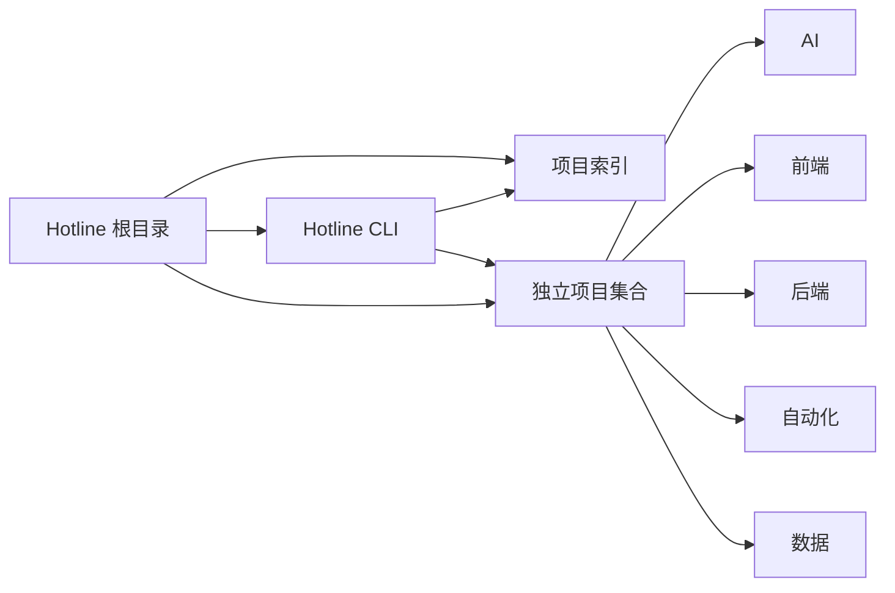

<div align="center">

# Hotline

**热点技术整合实验仓库**

收集、验证并组织 AI、前端、后端、自动化、数据与其他技术方向的独立项目。

让每个项目独立安装、配置、运行和验证，是 Hotline 的建设目标。

<p>
  <a href="https://nodejs.org/"></a>
  <a href="https://pnpm.io/"></a>
  
</p>

[快速开始](#快速开始) · [项目结构](#项目结构) · [新增项目](#如何新增项目) · [路线图](#路线图)

</div>

---

## 为什么做 Hotline

热点技术更新很快，单独保存 Demo 容易失控：目录混乱、启动方式不一致、实验状态不清楚，也很难知道哪些项目可以复用。

Hotline 采用“**统一规范，项目独立运行**”的方式：

- 一个目录对应一个可以独立运行的项目
- 一个项目拥有自己的依赖、配置、README 和验证方式
- 根目录提供统一的索引和 CLI
- 项目之间通过 API、CLI、共享包或明确的数据格式协作
- 明确区分想法、原型、可运行项目和已归档项目

## 项目结构

```text
Hotline/
├─ projects/                 # 独立技术项目
│  └─ <category>/
│     └─ <project-name>/
├─ catalog/                  # 项目索引与元数据
├─ tools/
│  └─ hotline-cli/           # 项目发现与校验 CLI
├─ AGENTS.md                 # 协作规则与大模型行为约束
├─ package.json              # 根目录命令
└─ pnpm-workspace.yaml       # Workspace 配置
```

项目之间的关系可以理解为：



## 快速开始

### 环境要求

- Node.js 20+
- pnpm 9+

### 私密配置

真实 API Key、密码和服务地址统一放在仓库根目录 `.env`，由 `.gitignore` 排除；不含真实密钥的 `.env.example` 模板可以提交。远程环境与本地不同的值使用同一文件中的 `REMOTE_` 前缀配置，无需维护第二个配置文件。

豆豆 Agent 的 Python、PowerShell、Shell 启动脚本及数据库初始化脚本均读取根目录 `.env`，支持通过 `DODO_ENV_FILE` 指定其他路径。Python/Shell 通过 `DODO_ENV_PROFILE=remote` 应用 `REMOTE_` 配置（去掉前缀后覆盖对应项）；PowerShell 远程启动脚本默认应用该配置。普通开发启动保留 SQLite、本地文件及关闭 Redis 的默认行为。

### 安装依赖

```bash
pnpm install
```

### 查看项目

```bash
# 列出所有项目
pnpm hotline list

# 按名称、分类或描述搜索
pnpm hotline search ai

# 查看单个项目
pnpm hotline info projects/ai/example-project

# 检查项目元数据和 README
pnpm hotline validate
```

当前仓库包含一个用于验证结构的示例项目：

```text
projects/ai/example-project/
```

> **当前阶段：基础骨架。** CLI 已编写，依赖安装、编译和实际运行尚未验证。示例项目仅展示目录与元数据结构，不包含 AI 业务功能。CLI 当前读取各项目的 `project.yaml`；`catalog/projects.json` 是预留文件，尚未接入自动索引。

## 如何新增项目

创建目录：

```text
projects/<category>/<project-name>/
├─ README.md
├─ project.yaml
├─ src/
├─ tests/
└─ .env.example
```

创建 `project.yaml`：

```yaml
name: example-project
category: ai
status: prototype
description: 项目用途和当前验证目标
language:
  - python
mode: offline-demo
commands:
  install: pip install -r requirements.txt
  run: python main.py
  test: pytest
```

`mode` 必须明确说明项目的外部能力：

| 值 | 含义 |
| --- | --- |
| `offline-demo` | 不访问外部服务，可离线运行 |
| `mock` | 使用模拟服务或模拟数据 |
| `real-api` | 会调用真实外部 API，必须说明凭证和风险 |

项目 README 应至少说明用途、状态、依赖、环境变量、启动命令、测试命令和已知限制。

## 项目状态

| 状态 | 含义 |
| --- | --- |
| `idea` | 想法、调研或技术记录 |
| `prototype` | 正在验证的原型 |
| `working` | 按文档可以运行 |
| `stable` | 经过持续验证，可以作为稳定参考 |
| `archived` | 停止维护，仅保留记录 |

状态只代表当前仓库中的验证程度，不代表生产可用性。

## 设计原则

1. **项目独立**：每个项目拥有自己的依赖、配置、启动和测试方式。
2. **边界清晰**：项目默认不直接访问其他项目的内部代码、数据库或运行时状态。
3. **事实优先**：不把计划、推测或未验证结果描述成已实现能力。
4. **可重复验证**：项目必须提供清晰、可重复执行的命令。
5. **安全优先**：不提交密钥、访问令牌、真实个人信息或生产数据。
6. **最小改动**：新增功能只影响必要的项目和文件，不进行无关重构。

更完整的协作规则见 [AGENTS.md](./AGENTS.md)。

## 路线图

- [x] 建立独立项目目录约定
- [x] 建立项目元数据格式
- [x] 提供 TypeScript CLI
- [x] 提供示例项目
- [ ] 增加项目初始化命令
- [ ] 增加安全的项目启动、测试和构建执行器
- [ ] 增加项目标签、依赖关系和验证结果
- [ ] 增加 Vue Web 项目浏览器
- [ ] 增加 GitHub Actions 基础校验

路线图表示计划，不代表尚未完成的功能已经存在。

## 贡献方式

添加或修改项目时：

1. 阅读 [AGENTS.md](./AGENTS.md)。
2. 进入对应的独立项目目录操作。
3. 补充项目 README、`project.yaml` 和配置示例。
4. 运行项目自身的检查命令。
5. 再运行根目录的 `pnpm hotline validate`。
6. 提交变更时使用清晰的 Conventional Commits 信息。

## 许可证

当前仓库尚未声明开源许可证。正式公开到 GitHub 前，请根据你的授权方式补充 `LICENSE` 文件。

