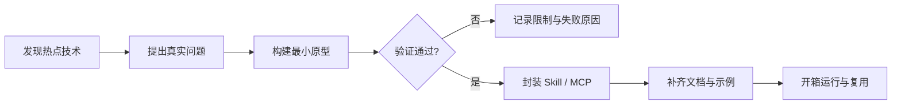

<div align="center">

# ⚡ Hotline

### 前沿技术可用性实验室 · Skill & MCP 开箱即用工厂

探索正在发生的技术，把热点变成工具，把想法变成能力，把能力交付给每一个需要它的人。

[](https://github.com/SC-10749/Hotline/tree/master)
[](https://github.com/SC-10749/Hotline)
[](https://github.com/SC-10749/Hotline)

</div>

---

## 我们在做什么

技术的价值，不在于它有多新，而在于它能否在真实场景中稳定工作。

Hotline 关注最新的模型、协议、开发工具和智能工作流，通过快速、可复现的实验回答三个问题：

> **它能不能用？为什么值得用？怎样让别人马上用起来？**

每个实验都尽量走完从发现到交付的完整路径：

```text
热点发现 → 最小原型 → 真实验证 → 工程封装 → 开箱即用
```

我们不收集概念，也不堆叠演示。能够留下来的成果，必须经得起安装、配置、运行和复用。

## 能力地图

| 方向 | 关注内容 | 最终交付 |
| --- | --- | --- |
| **MCP** | 工具、资源、提示模板、外部系统连接 | 可启动的 MCP 服务 |
| **Skills** | 提示词、工作流、脚本和领域方法 | 可复用的 Skill |
| **Plugins** | 完整插件、配置、依赖与运行入口 | 可独立部署的插件项目 |
| **Experiments** | 新模型、新协议、新框架和新交互 | 可复现的验证结论 |

## 从灵感到能力



## 项目结构

```text
Hotline/
├── mcp/                    # MCP 服务、工具与资源
│   └── <mcp-project>/
├── skills/                 # 可复用的 Skill 定义与工作流
│   └── <skill-project>/
├── plugins/                # 完整插件项目与打包配置
│   └── <plugin-project>/
└── README.md               # 项目入口与实验索引
```

每个独立项目都应尽可能包含自己的 README、依赖清单、示例配置和验证命令，让它可以脱离上下文被理解、安装和运行。

## 快速开始

```bash
# 获取主分支
git clone -b master https://github.com/SC-10749/Hotline.git
cd Hotline

# 选择一个方向开始实验
ls mcp skills plugins
```

创建新项目时，建议从一个小而完整的闭环开始：

1. 写下真实用户场景和成功标准。
2. 用最少依赖完成可运行原型。
3. 记录安装步骤、输入输出和已知限制。
4. 验证后再抽象成 Skill 或 MCP。
5. 为使用者提供一条清晰的启动命令。

## 开发准则

- **实用优先**：先证明能解决问题，再讨论规模化。
- **最小闭环**：每个实验都要能运行、能验证、能复现。
- **清晰交付**：安装、配置、启动和验证步骤必须可读。
- **诚实记录**：明确写出边界、失败案例和不适用场景。
- **安全默认**：示例只使用占位符，真实密钥和服务地址留在本地。
- **独立可用**：插件不依赖另一个项目的内部状态才能启动。

## 什么样的成果会被留下

一个值得交付的 Skill 或 MCP，至少应该做到：

- 用户知道它解决什么问题；
- 用户能在干净环境中安装它；
- 用户能用一条明确命令启动或调用它；
- 用户能看到可预期的输入、输出和错误信息；
- 用户能根据文档判断它是否适合自己的场景。

## 一起把新技术变成新能力

如果一个技术值得关注，就让它接受真实任务的检验；如果一个实验证明有效，就把它整理成任何人都能使用的能力。

**Hotline 不追逐热闹，Hotline 负责让有价值的技术真正抵达。**

<div align="center">

`Explore · Verify · Package · Share`

</div>
