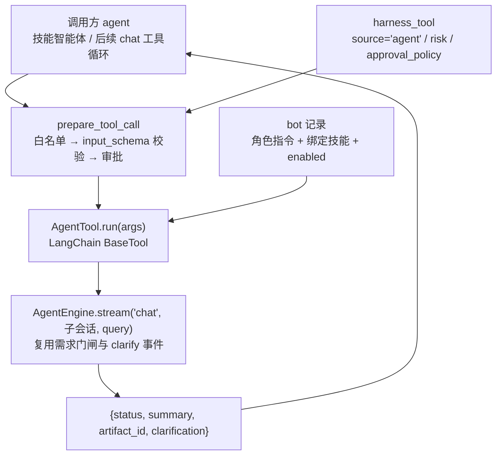

# Agent as Tool：把「需求分析助手」注册进工具注册中心

> 状态：**P1（进程内 Agent Tool）已实现**，P2（MCP 暴露）与 P3（Java 编排层）仍是草案方案。实现进度以根 README 为准。
> 结论先行：不新建「Agent 注册中心」数据库。Hotline 已有工具登记表（`harness_tool`）、
> 工具治理链（`prepare_tool_call`）和 LangChain 工具循环；「需求分析助手」以
> `source='agent'` 登记为**工具**，由调用方 agent 通过已有工具列表调用。

## 1. 目标与边界

**目标**

- 把已经落地的「需求分析助手」（`skills/requirement-analysis` + `modules/intent/requirement.py`）包装成一个**可被调用的工具**，注册进已有工具注册中心。
- 调用方可以是技能智能体（`/agent/skills/stream`）、后续的 chat 工具循环，或者 Java 统一入口。
- 注册一次即可被多处发现与调用，定义、版本、权限、审批沿用现有登记表与治理链，不新增平行设施。

**边界（本期不做）**

- 不引入新的 Agent 框架依赖（LangChain 已经是仓库既有依赖，见 `pyproject.toml`）。
- 不新建独立数据库、不新建独立注册中心服务。
- 不做跨进程的分布式 Agent 注册（留到 P2 的 MCP 形态）。
- 不改前端交互：工具调用沿用现有 SSE 事件与澄清卡片。

## 2. 开源与框架参考（均已实读源码或规范原文）

| 来源 | 我实际读到的机制 | 对 Hotline 的启示 |
| --- | --- | --- |
| [MCP Server Tools 规范](https://modelcontextprotocol.io/specification/2025-06-18/server/tools) | `tools/list` 发现、`tools/call` 调用；工具定义含 `name`、`description`、`inputSchema`、`outputSchema`、`annotations`；结果分 `content` 与 `structuredContent`；错误分协议错误与工具执行错误（`isError`）；服务端必须校验入参、限流、脱敏输出 | 工具契约直接照搬这五件套；返回结构化结果 + 摘要双轨；错误两类分开 |
| [A2A 协议规范](https://raw.githubusercontent.com/a2aproject/A2A/main/docs/specification.md) | 数据模型层 Task / Message / **AgentCard** / Part / Artifact；操作层含发送消息、获取任务、获取 Agent Card；绑定层 JSON-RPC / gRPC / HTTP+REST | 「智能体名片」用 AgentCard 思路描述一个 agent 能干什么；跨智能体任务用 Task 生命周期而不是同步阻塞 |
| [AG2 `AssistantAgent`](https://raw.githubusercontent.com/microsoft/autogen/main/python/packages/autogen-agentchat/src/autogen_agentchat/agents/_assistant_agent.py) | Agent 同时是工具持有者与 handoff 目标；`max_tool_iterations` 限制工具迭代；`reflect_on_tool_use` 决定工具结果是否再过一次模型；`tool_call_summary_format` 控制工具结果摘要格式 | 子 agent 的返回必须**摘要化**后再进父 agent 上下文；父 agent 需要能选「直接用结果」或「再想一次」 |
| [Spring AI Tool Calling](https://docs.spring.io/spring-ai/reference/api/tools.html) | `@Tool` 声明式定义；工具调用循环是一等组件（`ToolCallingAdvisor` + `ToolCallingManager`）；**模型决定调用，应用负责执行**，模型拿不到工具背后的 API | 明确边界：Agent Tool 的执行在应用侧，模型只给参数；工具描述要写清「什么时候该调用」 |
| [LangChain4j `ToolSpecification`](https://raw.githubusercontent.com/langchain4j/langchain4j/main/langchain4j-core/src/main/java/dev/langchain4j/agent/tool/ToolSpecification.java) | 工具契约 = `name` + `description` + `JsonObjectSchema parameters` + `strict` + `metadata` | Java 侧消费同一份契约；`metadata` 正好放 agent 绑定、风险等级 |
| [AgentScope Java 2.0](https://raw.githubusercontent.com/agentscope-ai/agentscope-java/main/README.md) | 统一事件系统（32 类事件）做实时渲染与人工介入；**权限系统**管工具调用；面向分布式、长任务、可控执行 | 澄清与审批属于「事件」而不是「阻塞」；工具调用要能被暂停等待人工 |
| [Spring AI Alibaba Graph](https://deepwiki.com/alibaba/spring-ai-alibaba/7.3-agentscope-starter) | `com.alibaba.cloud.ai.graph.action` 下用状态机编排多智能体，带状态序列化与中断 | 需要多步编排时，用显式状态而不是自由对话 |

## 3. Hotline 现状盘点（落点依据）

| 层 | 现状 | 文件 |
| --- | --- | --- |
| 工具注册（进程内） | `BUILTIN_TOOLS` 是「名称 → 说明」的内置工具表，目前只有 `read_skill` | `python_backend/modules/execution/tools.py:21` |
| 工具注册（持久） | `harness_tool` 表：`tool_id/name/source/scope/risk/status/description/input_schema/approval_policy/revision` | `python_backend/infrastructure/registry_store.py:41` |
| 注册接口 | `GET/POST/PUT /harness/tools` + `POST /harness/tools/{id}/test`（`source` 支持 `mcp:…` 与 `builtin`） | `python_backend/api/routers/registry.py` |
| 工具治理 | `prepare_tool_call`：Agent 工具白名单 → `input_schema` 校验 → 风险/审批策略阻塞等待 | `python_backend/modules/execution/tools.py:243` |
| 工具调用循环 | 技能智能体走 LangChain `create_agent`，工具列表在 `tools = [read_skill]` 处组装；`_ExecutionGuard` 限 8 次模型调用 / 16 次工具调用 | `python_backend/modules/execution/engine.py:734`、`modules/execution/langchain_agent.py:32` |
| 外部工具协议 | 最小 stdio MCP 客户端：`initialize` / `tools/list` / `tools/call`（协议版本 2024-11-05） | `python_backend/modules/mcp/__init__.py` |
| 智能体定义 | `harness_bot`（名称/角色指令/绑定技能/启用）+ `harness_bot_session`（会话→机器人） | `python_backend/infrastructure/bot_store.py` |
| 人设注入 | `load_persona` → `_persona_block` 把角色指令、技能正文、回答风格追加进系统提示词 | `python_backend/infrastructure/persona.py`、`modules/execution/engine.py:297` |
| 需求级澄清 | 绑定需求分析技能的机器人走需求门闸，`clarify` 事件给三个方向 + 自由输入；`CLARIFY_FLAG` 标记未完成轮次 | `python_backend/modules/intent/requirement.py`、`modules/execution/engine.py:555` |

**关键结论**：Hotline 缺的不是「注册中心」，而是**把一个 bot 定义适配成 LangChain 工具**的那一层适配器，以及「工具被调用时 agent 需要澄清用户」的中断语义。

## 4. 概念模型



| 概念 | 含义 | 落点 |
| --- | --- | --- |
| `AgentDefinition` | 一个 agent 能干什么：角色指令 + 绑定技能 + 启用状态 | 复用 `harness_bot`，不新增表 |
| `AgentTool` | 一个可被模型调用的入口：工具契约 + 执行适配 | 新增 `modules/execution/agent_tool.py` |
| `AgentInvocation` | 一次调用：入参、run_id、耗时、用量、结果状态 | 复用现有 run 事件与 `_current_run_id` |
| `AgentCard` | 智能体名片：对外描述能力（借鉴 A2A） | 由 AgentTool 的工具描述与 `harness_tool` 行合成 |

## 5. 三条落地路径对比

| 路径 | 做法 | 复用面 | 新增量 | 适用 |
| --- | --- | --- | --- | --- |
| **P1 进程内 Agent Tool** | 在 Python 进程内把 bot 适配成 LangChain 工具，登记 `source='agent'` | 登记表、治理链、技能智能体工具循环 | 一个适配器 + 一处挂载 + 一个分支 | **推荐先做**：最小且完整 |
| **P2 MCP 暴露** | 把同一个 AgentTool 包成 stdio MCP server（`tools/list`、`tools/call`），用现有 MCP 客户端注册 | 现有 MCP 客户端与协议 | 一个 server 进程 + 契约对齐 | 跨进程、跨语言（Java 可直接消费） |
| **P3 Java 编排层** | Java 21 + Spring AI / MCP Java SDK 作为统一注册与路由，Python 只做执行 | Java 统一入口定位 | 较大（Java 侧模型配置、路由、审计） | 需要多租户路由与审计时再做 |

**推荐路径：P1 → P2**。理由：P1 落地后，P2 只是把同一个「入参 → 执行 → 结构化结果」契约换个传输方式，契约不变；P3 是治理升级而不是能力升级，等 P1/P2 跑通再评估。

**为什么不新建 Agent 注册中心**：仓库里已有两套注册与版本设施——技能中心目录（版本、项目绑定、灰度、自进化）与工具登记表（`harness_tool`）。再开第三套只会让「一个 agent 在几处登记」成为常态。AgentTool 的定义源就是 bot 记录，登记进 `harness_tool` 只是**给同一份定义加一份可调用视图**。

## 6. 推荐方案详细设计（P1）

### 6.1 注册

登记一行工具，名字与 bot 一一对应：

```json
{
  "name": "requirement_analysis",
  "source": "agent",
  "scope": "workspace",
  "risk": "low",
  "status": "configured",
  "description": "把一段需求描述变成可验收的结构化需求；需求说不清时先返回澄清方向。调用前先用 read_skill 读取 requirement-analysis 技能说明。",
  "input_schema": {
    "type": "object",
    "properties": {
      "query":        { "type": "string", "description": "待分析的原始需求描述" },
      "conversation_id": { "type": "string", "description": "复用已有会话继续澄清；留空表示新会话" },
      "clarification": { "type": "string", "description": "用户对上一轮澄清的回答" }
    },
    "required": ["query"]
  },
  "approval_policy": "risk-based"
}
```

登记方式有两种，等价：

- 启动种子（与 `python_backend/seed_bots.py` 同源）：bot 创建时同步登记一行 `harness_tool`，保证「机器人存在 ⇒ 可被调用」。
- 运行时按需登记：调用方装配工具时扫描启用的 bot，缺哪登哪（`source='agent'`）。

### 6.2 工具契约与返回

模型看到的是 LangChain 工具描述，由 `name`、`description`、`args_schema` 三件套组成（与 MCP 的 `name/description/inputSchema` 同构，与 LangChain4j `ToolSpecification` 同构）。

工具返回值是 JSON 字符串，三种状态：

```json
{
  "status": "ok",                     // ok | needs_clarification | error
  "summary": "需求文档摘要（给父 agent 读，长度受限）",
  "artifact_id": "artifact-…",        // 完整需求文档落在产物库时给出
  "clarification": {                   // 仅 needs_clarification 时存在
    "question": "做个工单系统",
    "options": [ { "label": "…", "hint": "…" } ]
  },
  "usage": { "inputTokens": 0, "outputTokens": 0 }
}
```

**摘要 + 产物双轨**（对应 MCP 的 `content` / `structuredContent` 与 resource link）：完整需求文档写入已有产物库（`modules/artifacts`），工具只回摘要 + `artifact_id`。理由是父 agent 的上下文有预算（`ContextBudget`），长文档进上下文会挤爆预算；这是 AG2 `tool_call_summary_format` 要解决的问题。

### 6.3 执行适配（P1 核心）

```text
父 agent（技能智能体）
  │ tool_call: requirement_analysis(query="做个工单系统")
  ▼
prepare_tool_call('requirement_analysis', args)   ← 复用：白名单 / schema 校验 / 审批
  │
  ▼
AgentTool.run(args)
  │  ① 取 bot 定义（instruction + skills）→ 构造 persona
  │  ② 组装子会话：conversation_id 缺省则新建
  │  ③ 调 AgentEngine.stream('chat', 子会话, query) 收集事件
  │  ④ 判定：
  │      - 收到 clarify 事件 → status=needs_clarification（带三个方向）
  │      - 收到 text 事件    → status=ok（摘要 + artifact_id）
  │      - 收到 error 事件   → status=error
  ▼
返回 JSON 给父 agent 的工具结果
```

关键实现约束：

- **同进程直接调用**，不走 HTTP/SSE：子 agent 的事件不冒泡到父流（除非显式要求），父流只看到一条 `toolCall` 事件 + 最终回答。
- **子 agent 的澄清不阻塞**：见 6.4。
- **子 agent 复用现有上下文工程**：传入父会话的 `conversation_id` 时，任务状态、历史摘要、证据都按现有机制恢复；不传则开独立会话。
- **子 agent 的产出按现有预算裁剪**：`_ExecutionGuard` 的 8 次模型调用 / 16 次工具调用上限对子 agent 同样生效，防止工具调用里再套工具调用导致失控。

### 6.4 澄清中断语义（最关键的一处）

子 agent 需要问用户，但工具调用是同步的。三个候选：

| 方案 | 做法 | 优点 | 缺点 |
| --- | --- | --- | --- |
| A 同步阻塞 | 子 agent 的 `clarify` 事件直接冒泡到父流，父 tool call 挂起等用户 | 交互最自然 | 父 tool call 一直占着循环，超时、取消、审批全乱；AG2 的 `max_tool_iterations` 会白白消耗预算 |
| B 结构化返回（推荐 P1） | 工具返回 `status=needs_clarification` + 三个方向；父 agent 转述给用户；用户作答后**再调一次**该工具，带上 `clarification` 参数 | 不阻塞、符合 MCP 的 `工具结果` 语义、与现有 `clarify` 卡片一致 | 父 agent 需要负责转述与二次调用 |
| C 独立任务（A2A 式，P2 预留） | 子 agent 作为独立 agent 接消息，父 agent 只拿到 taskId，用 `tasks/get` 查进度 | 适合长任务与跨进程 | 交互链路重，本期过重 |

**推荐 B**，落地要点：

1. 子 agent 的澄清状态用现有 `CLARIFY_FLAG` 机制落在会话记录里（`thinking` 字段），父 agent 二次调用时带上同一 `conversation_id`，引擎侧的 `clarified` 判断会自动跳过重复追问（现有实现已具备）。
2. 父 agent 的转述要保真：工具结果里带上 `question` 和三个方向，父 agent 应原样呈现，而不是自己再解释一遍。
3. 二次调用时父 agent 传的 `clarification` 参数拼进子会话问题（形如「原问题：… 我想要的是：…」），与前端 `answerClarify` 的既有格式一致。

### 6.5 权限、审批、灰度

- 全部复用 `prepare_tool_call`：Agent 工具白名单（`set_tool_policy`）、`input_schema` 类型校验、高风险审批阻塞。
- 需求分析只读不写外部系统，`risk='low'`，`approval_policy='risk-based'`；将来若允许它写产物库或外部系统，改成 `always` 即可，无需改调用链。
- 灰度：工具登记有 `revision` 字段（乐观锁），可与技能中心的灰度绑定对齐；P1 只做「启用/停用」二元开关（`status`）。

### 6.6 观测与事件

- 每次工具调用记 `run_id`（`set_current_run_id` 已有），与运行记录关联。
- 父流事件：沿用现有 `toolCall` / `step` 事件，工具名 = `requirement_analysis`。
- 子 agent 内部阶段（检索、上下文装配、模型调用）默认不冒泡；需要时以 `details` 摘要挂到父事件上。

### 6.7 失败与降级

| 场景 | 处理 |
| --- | --- |
| 模型未配置 | 工具返回 `status=error`（沿用现有「未配置模型」提示），父 agent 如实转述，不伪造结果 |
| 工具不在白名单 | `prepare_tool_call` 抛错，父 agent 收到错误，不得重试绕过 |
| 子 agent 超时 / 取消 | 继承父任务的停止信号（`threading.Event`），工具返回 error |
| 需求仍不清晰 | 返回 `needs_clarification`，由父 agent 决定是否再次澄清 |

## 7. 代码落点清单

| 动作 | 文件 | 内容 |
| --- | --- | --- |
| 新增 | `python_backend/modules/execution/agent_tool.py` | `AgentTool`：从 bot 定义生成 LangChain 工具；入参 schema；执行与返回封装 |
| 改动 | `python_backend/modules/execution/tools.py` | `BUILTIN_TOOLS` 增加 agent 类工具的登记分支；`find_builtin_tool` 支持按来源查找 |
| 改动 | `python_backend/modules/execution/engine.py` | `_stream_skills` 工具列表装配处追加 agent 工具（当前在 734 行） |
| 改动 | `python_backend/api/routers/registry.py` | `/harness/tools/{id}/test` 增加 `source='agent'` 分支（做一次干跑自检） |
| 改动 | `python_backend/seed_bots.py` | 种子同步登记 `harness_tool` 行 |
| 新增 | `python_backend/test_agent_tool.py` | 单测：契约生成、白名单拒绝、澄清中断、摘要长度上限 |

## 8. 分阶段实施与验收

| 阶段 | 内容 | 验收 |
| --- | --- | --- |
| **P0** | 评审本文契约（工具名、三个入参、三种返回状态、澄清中断语义） | 契约冻结，落到本文 |
| **P1** | 进程内 Agent Tool：适配器 + 登记表 + 技能智能体挂载 + 单测 | ✅ 已实现，见第 11 节；`python -m unittest python_backend.test_agent_tool` |
| **P2** | 同一契约包成 stdio MCP server，用现有 MCP 客户端注册 | `tools/list` 能列出该工具；`tools/call` 返回结构化结果；Java 侧可消费 |
| **P3（可选）** | Java 编排层：AgentCard 缓存、路由、审计 | 审计可追溯每次 agent 调用 |

## 9. 风险与不做的事

| 风险 | 说明 | 应对 |
| --- | --- | --- |
| 父子 agent 上下文双倍开销 | 子 agent 有独立上下文与模型调用 | 子 agent 返回摘要 + artifact；父 agent 预算不变 |
| 工具描述膨胀 | 每个 agent 工具都占工具描述预算（`_skill_tool_description` 同类限制，8000 字符） | agent 工具数量受限，描述写短，超限按现有逻辑省略 |
| 递归调用 | agent 工具又被 agent 调用，形成环 | `_ExecutionGuard` 限制迭代；子 agent 装配时不注入 agent 工具 |
| 澄清语义漂移 | 父 agent 自行解释澄清方向 | 工具返回里保留 question 与 options 原样；前端卡片格式不变 |
| 重复登记 | bot 与 tool 两处登记不一致 | 以 bot 为定义源；登记行可由种子重建，幂等 |

明确不做：不做多租户 Agent 注册中心；不做 agent 间自由对话（handoff / A2A 消息协作留到 P2 之后）；不把 Agent Tool 暴露成公网接口；不改前端交互。

## 10. 参考来源

- MCP Server Tools：https://modelcontextprotocol.io/specification/2025-06-18/server/tools
- A2A 协议规范：https://raw.githubusercontent.com/a2aproject/A2A/main/docs/specification.md
- AG2 AssistantAgent 源码：https://raw.githubusercontent.com/microsoft/autogen/main/python/packages/autogen-agentchat/src/autogen_agentchat/agents/_assistant_agent.py
- Spring AI Tool Calling：https://docs.spring.io/spring-ai/reference/api/tools.html
- LangChain4j ToolSpecification 源码：https://raw.githubusercontent.com/langchain4j/langchain4j/main/langchain4j-core/src/main/java/dev/langchain4j/agent/tool/ToolSpecification.java
- AgentScope Java 2.0：https://raw.githubusercontent.com/agentscope-ai/agentscope-java/main/README.md
- Spring AI Alibaba Graph 源码结构：https://deepwiki.com/alibaba/spring-ai-alibaba/7.3-agentscope-starter
- 仓库内现状：见第 3 节表格中的文件与行号

## 11. 实现记录（P1）

已落地：

| 动作 | 文件 | 说明 |
| --- | --- | --- |
| 新增 | `python_backend/modules/execution/agent_tool.py` | `AgentTool` 适配器：按登记表装配工具、注入机器人人设、调用治理链、返回 MCP 风格结构化结果 |
| 改动 | `python_backend/modules/execution/engine.py` | `_agent_tools()` 读登记表装配工具；`_run_agent_tool()` 跑子会话并把澄清转成 `needs_clarification`；技能智能体工具列表追加 agent 工具 |
| 改动 | `python_backend/api/routers/registry.py` | `/harness/tools/{id}/test` 增加 `source='agent'` 分支（校验机器人存在与启用状态） |
| 改动 | `python_backend/seed_bots.py` | 种子同步登记 `requirement_analysis` 工具行（`input_schema.agent.bot_id` 指向机器人） |
| 新增 | `python_backend/test_agent_tool.py` | 10 项单测：装配、停用不挂载、工具调用、白名单拒绝、澄清返回、摘要截断、澄清答案拼接 |

与设计的两处偏差：

1. **子会话不落库**：工具是无状态的，澄清答案由调用方通过 `clarification` 参数带回，子 agent 不写会话记录，也不新建会话——避免子会话出现在会话列表里。
2. **不写产物库**：完整需求文档直接作为工具结果摘要返回（上限 4000 字），父 agent 的工具结果预算还有一层裁剪与归档；产物库接入留到 P2。

实测（真实模型，隔离数据目录）：技能智能体先 `read_skill` 读取技能说明，再调用 `requirement_analysis`；子 agent 命中需求门闸后返回 `needs_clarification` 与三个方向，**父 tool call 不阻塞**，父 agent 据此向用户提问；用户作答后父 agent 再次调用该工具，子 agent 依据补充信息给出更细的方向。
