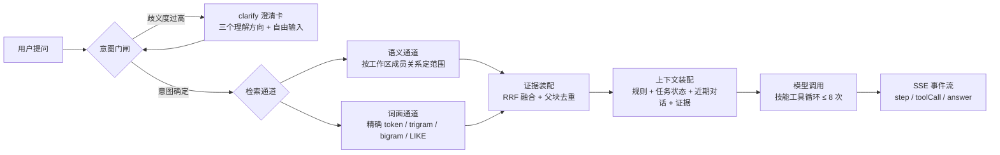
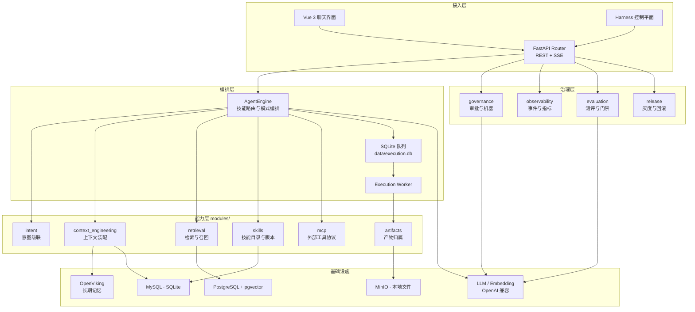
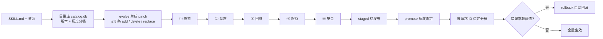

> 并行排版草稿，保留供后续选用，尚未替换主说明。本文包含 Java 入口迁移前的运行描述；当前架构、端口和启动命令以 [主 README](../README.md) 为准。

<div align="center">

  

  # ⚡ Hotline Agent

  ### 端到端通用智能体平台

  **意图级联 × 上下文工程 × 技能自进化 × 运行治理**

  <p>
    <a href="https://www.python.org/"></a>
    <a href="https://fastapi.tiangolo.com/"></a>
    <a href="https://vuejs.org/"></a>
    
    
    
    
    
  </p>

  <p align="center">
    <b>一个浏览器入口</b> — 页面 / API / 技能控制台同源同端口 <code>:8888</code><br>
    <b>两个进程</b> — FastAPI 网关 + 独立 Execution Worker，队列可回放、可停止<br>
    <b>三层留痕</b> — 意图判定、检索证据、上下文预算，全链路可追溯可导出
  </p>

  <p align="center">
    <a href="#-快速开始">🚀 快速开始</a> · 
    <a href="#-能力矩阵">🎯 能力矩阵</a> · 
    <a href="#-系统架构">🏗️ 系统架构</a> · 
    <a href="#-技能中心与自进化闭环">🧩 技能中心</a> · 
    <a href="#-上下文工程与长期记忆">🗂 上下文工程</a> · 
    <a href="#-harness-控制平面">🎛 控制平面</a> · 
    <a href="#-验证与测试">🧪 验证</a>
  </p>

</div>

---

## ✨ 这是什么

**Hotline Agent** 是一个单仓库交付的端到端通用智能体平台。它把「用户的一句话」到「可交付产物」之间的每一段都做成了可观察、可回放、可治理的工程对象：

- **意图不是猜测，而是级联** — 关键词粗筛 → embedding 向量召回 → 大模型判定，三级级联带置信度分级；歧义度超阈值时先澄清再执行。
- **上下文不是拼接，而是装配** — 规则、任务状态、近期完整对话、阶段摘要与检索证据分层装配，按字节预算裁剪，调用前留下脱敏快照。
- **技能不是文档，而是可演化的版本** — SKILL.md 带版本目录、灰度绑定、自进化 patch 与五道门禁，错误率超阈值自动回滚。
- **执行不是黑盒，而是运行记录** — 每一次运行都有事件流、指标、上下文快照与产物归属，可导出、可重放。

> 技术栈一句话：**Vue 3 + Vite 6** 前端、**FastAPI + LangChain** 后端、**SSE** 流式交互、**SQLite 队列** 承载长任务，本地零外部依赖即可跑起来，生产可切 MySQL / Redis / MinIO / PostgreSQL + pgvector。

---

## 📊 仓库速览

| 维度 | 现状 | 位置 |
| --- | --- | --- |
| 后端 Python | 121 个文件 / 18.3k 行 | `python_backend/` |
| 前端 | 13 个文件 / 5.7k 行 | `frontend/src/` |
| Agent 模式 | 5 条 SSE 智能体流 | `/agent/{chat,file,pptx,deep,skills}/stream` |
| HTTP 端点 | 120+ | `python_backend/api/routers/` |
| 控制台一级模块 | 14（三大分区） | `frontend/src/HarnessApp.vue` |
| 能力模块 | 后端 13 个 / 前端同名 11 个 | `python_backend/modules/` ↔ `frontend/src/modules/` |
| 运行数据 | 全部落在被 Git 忽略的 `data/` | 15 个按模块拆分的本地 SQLite 库 |
| 验证命令 | 4 条可重复执行 | 见 <a href="#-验证与测试">🧪 验证与测试</a> |

---

## 🎯 能力矩阵

<table>
<tr><th width="16%">能力</th><th width="52%">说明</th><th width="32%">入口</th></tr>
<tr><td>🗣️ 多模式智能体</td><td>对话问答、文件问答、PPT 生成、深度研究、技能助手，五种模式共用同一引擎与上下文入口</td><td><code>/agent/*/stream</code></td></tr>
<tr><td>🧭 意图级联与澄清门闸</td><td>关键词粗筛 → embedding 召回 → 大模型/决策模型判定，置信度不足转澄清卡，用户作答后作为新一轮重入级联</td><td><code>/intent/classify</code></td></tr>
<tr><td>🗂️ 上下文工程</td><td>任务状态、阶段摘要、证据分页、预算裁剪、调用前脱敏快照</td><td><code>/harness/context/*</code></td></tr>
<tr><td>🧠 长期记忆</td><td>OpenViking Peer + 本地投递队列 + 撤销代次，未配置时降级为本地状态并如实上报后端状态</td><td><code>modules/memory/openviking.py</code></td></tr>
<tr><td>🔎 多通道检索</td><td>词面四层（精确 token / trigram / bigram / LIKE）+ 工作区语义通道，范围按成员关系而非本次命中决定</td><td><code>modules/retrieval/</code></td></tr>
<tr><td>🧩 技能中心</td><td>版本目录、项目绑定、灰度分桶、自进化 patch、五道门禁、自动回滚</td><td><code>/console</code></td></tr>
<tr><td>⚙️ 执行与调度</td><td>SQLite 执行队列、事件回放、停止/重试、定时任务、Worker 排空</td><td><code>/execution/runs/*</code></td></tr>
<tr><td>🛡️ 运行治理</td><td>高风险审批流、审批审计、通知下发、机器状态与错误聚合</td><td><code>/harness/approvals</code></td></tr>
<tr><td>📈 可观测</td><td>运行事件、指标、趋势、导出归档</td><td><code>/harness/observability/*</code></td></tr>
<tr><td>🧪 测评中心</td><td>数据集、用例、快照、批量运行、多次运行对比、失败回放</td><td><code>/evaluation/*</code></td></tr>
<tr><td>🚀 发布治理</td><td>灰度推进、门禁阈值（端到端通过率 / RAG 忠实度 / 高风险误调用）、回滚、灰度观测</td><td><code>/release/*</code></td></tr>
<tr><td>📦 产物管理</td><td>PPT 等产物的运行归属、Hash、索引、预览、下载与清理</td><td><code>/harness/artifacts</code></td></tr>
<tr><td>🔀 模型路由</td><td>多模型注册、fallback 链、连通性测试、凭据掩码存储</td><td><code>/harness/models</code></td></tr>
<tr><td>🗺️ 代码地图</td><td>系统架构、请求时序与上下文流程图，可刷新、可独立打开</td><td><code>/code-map</code></td></tr>
</table>

---

## 🧭 一次请求的完整旅程



> **门闸是可解释的**：每一层都留下候选与相似度证据，最终结论能回溯到是哪一层、哪一条命中的。

---

## 🏗️ 系统架构



### 关键设计取舍

<table>
<tr><th width="26%">决策</th><th width="74%">理由</th></tr>
<tr><td>页面与 API 同端口</td><td>FastAPI 直接服务 Vue 构建产物，同源免跨域；开发期用 Vite 代理保持同样的同源语义</td></tr>
<tr><td>网关与 Worker 分离</td><td>长任务不占住请求线程；Worker 重启后事件可回放；<code>/health/ready</code> 会在 Worker 缺席时返回 503 并拒绝新运行</td></tr>
<tr><td>语义通道独立于词面通道</td><td>语义候选按「该工作区用过的全部内容」取，而不是词面命中的派生，否则同义改写会整体失效</td></tr>
<tr><td>事实只增不覆盖</td><td>记忆与任务状态采用追加 + 状态位表达失效，避免覆盖式写入引入不可靠判断</td></tr>
<tr><td>私密信息出站脱敏</td><td>模型输入、embedding 查询与记忆提交统一遮蔽环境配置、凭据、URL、域名与 IP，原文只留本地</td></tr>
</table>

---

## 🧭 意图级联与澄清门闸

意图识别采用三级级联，命中越靠后越权威：

1. **关键词粗筛** — 并列命中时优先更具体的词，单命中只给中间置信，不早退。
2. **embedding 向量召回** — 按 scope 各建一份缓存，未配置 embedding 自动跳过；相似度达标时可直接作为判定层。
3. **大模型 / 决策模型判定** — 配置决策模型后走 **System One 协议**（阿里云百炼 `decision-model-preview`，与 TypeSafe Jev 同接口），一次前向同时给出意图与诉求歧义度。

| 环节 | 行为 |
| --- | --- |
| 置信度分级 | 充足 → 直接执行；不足 → 转澄清 |
| 澄清卡 | 给出三个理解方向 + 自由输入框，该轮不产出答案 |
| 用户作答 | 作为新一轮提问携带原问题上下文重新进入级联 |
| 未配置决策模型 | 退回普通大模型判定，功能不缺失，只是歧义度精度下降 |

---

## 🧩 技能中心与自进化闭环

技能中心已并入后端：版本目录、项目绑定、评测用例、自进化门禁、灰度发布与自动回滚全部由 FastAPI 提供，目录库存放在 `data/skill-center/catalog.db`。



### 渐进式披露

技能名称与摘要只放在动态生成的 `read_skill` 工具描述里，**不注入初始消息**，也不把技能名注册成独立工具。模型按需用技能 ID 调用工具读取完整 `SKILL.md`，参考资料再按相对路径按需读取。

- 工具描述预算 8000 字符，超出提示省略；单文件 ≤ 1 MiB，每页 ≤ 12000 字符，按 `next_offset` 续读，不静默截断正文。
- 技能工具循环最多 8 次模型调用、16 次工具调用；工具原始结果本地留存，送入模型前按输入预算限额裁剪。
- `read_skill` 只读技能包内文本资源：禁止宿主机任意路径、越界链接、隐藏与私密文件、二进制内容；不执行 Shell/Python、不安装工具、不启动工作流引擎。
- 技能内容保存前自动做敏感信息与提示注入扫描。

### 技能来源

| 来源 | 路径 | 说明 |
| --- | --- | --- |
| 仓库技能 | `skills/*/SKILL.md` | 当前含开发流程技能 `hotline-tdd` |
| 安装目录 | `data/skills/` | 与仓库技能目录分别管理 |
| 技能中心 | 绑定当前项目的灰度版本 | 按请求 ID 稳定分桶 |

> 文件技能的名称与摘要在后端进程内按 inode / 修改时间 / 大小做元数据缓存，未变化的条目不重复解析。

---

## 🗂 上下文工程与长期记忆

普通聊天、文件问答、研究、PPT 规划与技能执行走同一个上下文入口。

### 装配顺序

```text
规则 (AGENTS.md)  →  任务状态  →  近期完整问答  →  阶段摘要  →  检索证据
        ↑ 优先保留              ↑ 按预算裁剪
```

- **任务状态**含目标、当前请求、带用户原话与来源 ID 的约束、决策与待办；自动抽取只接受当前用户原话中的引用，同主题用同一 key 更新；API 用 revision 检查并发修改。
- **阶段摘要**在历史超过近期 4 轮时生成，记录已覆盖的消息 ID；摘要调用失败时退化为带来源的限额摘录，原文仍在本地。
- **预算**按 UTF-8 字节上界估算，计入消息与工具定义，并预留输出与安全余量；超长的必需输入返回明确错误而非静默截断。
- **快照**提供每次调用前输入的脱敏副本，可在 `/execution/runs/{run_id}/context` 查看预算、来源、裁剪信息与记忆后端状态。

### 工作区检索：两条独立通道

| 通道 | 候选范围 | 命中方式 |
| --- | --- | --- |
| 词面通道 | 工作区已索引内容 | 精确 token（编号/错误码）→ trigram（中文 ≥3 字）→ bigram（2 字中文短语）→ LIKE 兜底，四层轮转交错 |
| 语义通道 | 该工作区用过的**全部**文档与文件向量 | 文件头/中/尾代表性片段各取一次 embedding，按余弦阈值排序 |

> 语义阈值按实测标定：相关问法 0.488–0.746，无关问法 0.135–0.323，取 **0.35**。工作区维度只用于过滤，跨工作区互不召回。

### 长期记忆（OpenViking）

- 为每个作用域与撤销代次生成独立 Peer：`self.enabled=false`、`peer.enabled=true`，允许 preferences / entities / events / experiences。
- 完成的问答先写本地持久化投递队列，后台线程提交 OpenViking Session 并轮询抽取任务；上传失败退避重试，响应丢失时用 Session ID 复查既有任务。
- 记忆检索先取 L0 候选，再读目录 L1 概览，最多为前两个 L2 来源各加载 80 行正文，查询限定在当前 Peer 的 memories 子树，返回后再次校验路径。
- 撤销与删除：屏蔽指定记忆立即生效并排队远端删除；删除共享工作区中的会话时，原命名空间立即失效，后台按保留会话重建新代次。
- OpenViking 未配置或不可用时，模型输入中如实给出后端状态，任务继续使用本地状态与历史证据。

---

## 🎛 Harness 控制平面

主应用之外的独立控制平面，把「跑起来」升级为「管得住」。三大分区共 14 个一级模块：

| 分区 | 模块 | 能力 |
| --- | --- | --- |
| **控制平面** | 运行总览 | 关键指标、待审批数、机器在线情况 |
| | 执行任务 | 运行列表、事件流、取消、重试、上下文快照 |
| | 测评中心 | 数据集、用例、快照、运行、对比、回放 |
| | Agent 实例 | 实例注册、版本、diff、绑定技能 |
| | 工作空间 | 目录导入、检出、快照、变更记录 |
| **能力注册表** | 工具与 MCP | 工具注册、风险等级、审批策略、连通性测试 |
| | Skills | 目录浏览、版本绑定、灰度比例 |
| | 模型路由 | 模型注册、fallback 链、成本策略、凭据掩码 |
| **运行治理** | 机器与运行时 | 机器列表、错误聚合、drain 排空 |
| | 待审批 | 审批申请、批量决策、审计流水、通知 |
| | 产物与存储 | 产物列表、预览、下载、清理 |
| | 追踪与日志 | 运行事件、指标、趋势、导出 |
| | 发布治理 | 灰度推进、门禁阈值、回滚、灰度观测 |
| | Harness 设置 | 全局配置与保留策略 |

另外在主应用中提供：自动化任务（定时提交运行）、插件管理、轻量机器人、个人中心（昵称 / 简介 / 回答风格 / 主题）与模型 API Key 管理。

---

## 🚀 快速开始

### 环境要求

| 依赖 | 版本 | 是否必需 |
| --- | --- | --- |
| Node.js | 20+ | 前端构建与开发服务必需 |
| Python | 3.11+ | 后端必需（可用 `uv` 管理） |
| 大模型 API | OpenAI 兼容 | 对话功能必需，仅启动页面不需要 |
| MySQL / Redis / MinIO / pgvector | — | 按需启用，本地可全部关掉 |

### 1️⃣ 安装与构建

```bash
npm --prefix frontend install
npm --prefix frontend run build
```

### 2️⃣ 配置

真实密钥与服务地址统一写在项目根目录 `.env`（Git 忽略），模板见 `.env.example`（不含真实密钥，可提交）。

想用纯本地零依赖跑起来，在 `.env` 里关掉外部服务：

```dotenv
DODO_STORAGE_BACKEND=sqlite
DODO_FILE_STORAGE_BACKEND=local
DODO_REDIS_ENABLED=false
DODO_VECTOR_ENABLED=false
```

> 默认值跟随生产形态：`DODO_STORAGE_BACKEND` 默认 `mysql`，文件存储随之默认 `minio`，Redis 与向量检索默认开启。远程环境差异用同一文件中的 `REMOTE_` 前缀配置，配合 `DODO_ENV_PROFILE=remote` 应用。

### 3️⃣ 启动

```bash
npm start     # 网关 + Execution Worker，页面与 API 同端口 8888
```

| 入口 | 地址 |
| --- | --- |
| 应用页面 | <http://127.0.0.1:8888/> |
| 后端 API 文档 | <http://127.0.0.1:8888/docs> |
| 健康检查 | <http://127.0.0.1:8888/health> |
| 就绪检查 | <http://127.0.0.1:8888/health/ready> |
| 技能控制台 | <http://127.0.0.1:8888/console> |
| Harness 控制平面 | 主应用导航进入 |

### 🔥 日常开发

```bash
npm run hot   # 热部署：改 Python 自动重启网关与 Worker，改 Vue 自动重建并刷新页面
npm run dev   # 前端开发模式：Vite HMR 在 :5180，API 由 Vite 代理转发到 :8888
```

<details>
<summary><b>常见问题速查</b></summary>

**启动报 `Errno 10048`（端口 8888 被占用）**

多半是上次开发模式残留的旧后端：

```powershell
netstat -ano | findstr :8888     # 找到 LISTENING 行末尾的 PID
taskkill /PID <PID> /F
```

**`/agent/*/stream` 返回 503 / `/health/ready` 显示 executionWorker unavailable**

Execution Worker 没在跑。只起网关不够，用 `npm start` 或单独执行 `python -m python_backend.modules.execution.worker`。

**`import python_backend.fastapi_app` 直接抛 `Access denied`**

本机没有可用 MySQL，导入时会在 `PgVectorStore` 连接处失败。这不代表代码有问题：验证路由请在临时目录里单独装配 `api/routers/*` 的 `create_*_router` 工厂函数再打请求。

**想切换远程环境**

`DODO_ENV_PROFILE=remote` 应用 `REMOTE_` 前缀配置；PowerShell 远程脚本默认应用该配置；`DODO_ENV_FILE` 可指定其他 env 文件路径。

</details>

---

## 🧾 配置速查

| 变量 | 默认 | 说明 |
| --- | --- | --- |
| `DODO_ENV_FILE` | 项目根 `.env` | 指定 env 文件路径 |
| `DODO_ENV_PROFILE` | — | `remote` 时应用 `REMOTE_` 前缀配置 |
| `DODO_STORAGE_BACKEND` | `mysql` | `sqlite` / `mysql` |
| `DODO_FILE_STORAGE_BACKEND` | `minio`（mysql 时） | `local` / `minio` |
| `DODO_REDIS_ENABLED` | 随存储后端 | 分布式任务锁与停止广播 |
| `DODO_VECTOR_ENABLED` | 随存储后端 | 向量检索开关 |
| `DODO_MODEL` / `DEEPSEEK_API_KEY` | — | 对话模型与凭据 |
| `DODO_EMBEDDING_BASE_URL` / `DODO_EMBEDDING_MODEL` | — | 向量模型，意图第二层与语义通道依赖 |
| `DODO_DECISION_BASE_URL` / `DODO_DECISION_MODEL` | `decision-model-preview` | 决策模型（System One 协议），未配置则走普通大模型判定 |
| `HOTLINE_CONTEXT_ENABLED` | `true` | 上下文恢复开关 |
| `HOTLINE_CONTEXT_WINDOW` / `HOTLINE_CONTEXT_INPUT_BUDGET` | `128000` / `64000` | 模型窗口与输入上界 |
| `HOTLINE_CONTEXT_OUTPUT_RESERVE` / `HOTLINE_CONTEXT_SAFETY_MARGIN` | `8192` / `2048` | 输出预留与安全余量 |
| `HOTLINE_OPENVIKING_URL` / `HOTLINE_OPENVIKING_API_KEY` / `HOTLINE_OPENVIKING_TIMEOUT` | — / — / `10` | 长期记忆连接与超时 |
| `DODO_SKILL_CATALOG_DB` / `DODO_SKILL_PROJECT` | `data/skill-center/catalog.db` / `hotline-agent` | 技能目录库与绑定项目 |
| `DODO_REPO_SKILLS_DIRECTORY` | 自动定位根 `skills/` | 仓库技能包目录，不受启动工作目录影响 |
| `SKILLS_DIRECTORY` | `data/skills/` | 原技能安装目录 |
| `DODO_DEV_FRONTEND_PORT` / `DODO_DEV_BACKEND_PORT` | `5180` / `8888` | 开发端口覆盖 |

完整清单见 [`.env.example`](../.env.example)。

---

## 🗂️ 目录结构

```text
Hotline/
├─ frontend/            # Vue 3 前端（Vite）
│  └─ src/modules/      # chat、workspaces、memory、retrieval、skills、mcp…
├─ python_backend/      # Python 后端
│  ├─ api/routers/      # FastAPI Router（REST + SSE）
│  ├─ application/      # 用例编排服务
│  ├─ domain/           # 领域实体、状态与规则
│  ├─ infrastructure/   # SQLite 队列与外部系统适配器
│  ├─ runtime/          # Agent Runtime 抽象
│  ├─ modules/          # 11 个能力边界：intent / context_engineering /
│  │                    # retrieval / memory / storage / skills / mcp /
│  │                    # execution / workspaces / artifacts / governance…
│  └─ workers/          # 后台 Worker 进程入口
├─ skill-center/        # 技能中心命令行工具与研究样本
├─ static/console/      # 技能控制台静态页（Vue 产物由后端服务 frontend/dist）
├─ deploy/              # 数据库初始化脚本
├─ sql/ templates/      # SQL schema 与 PPT 模板
├─ eval/                # RAG 评测与提示词静态检查（隔离 venv）
├─ docs/                # 设计规范、阶段方案与运维手册
├─ data/                # 运行数据（Git 忽略）
├─ main.py              # FastAPI 入口（加载根目录 .env）
├─ start-services.mjs   # 网关 + Worker 编排（npm start）
├─ hot-deploy.mjs       # 热部署（npm run hot）
└─ dev-launcher.mjs     # 前端开发模式（npm run dev）
```

### 模块边界

前后端按同名能力模块拆分，API、应用服务、领域与基础设施按依赖方向组织；旧入口继续负责兼容装配，迁移不改变现有接口。

| 模块 | 负责内容 | 主要入口 |
| --- | --- | --- |
| `intent` | 意图目录、三级级联、置信度分级、澄清门闸、System One 决策模型 | `modules/intent/`、`api/routers/intent.py` |
| `context_engineering` | 历史、检索、任务状态与提示词装配、脱敏快照 | `modules/context_engineering/` |
| `retrieval` | 文件、向量、关键词、图谱与联网检索 | `modules/retrieval/` |
| `memory` | 会话历史、草稿、项目记忆、OpenViking 接入 | `modules/memory/` |
| `storage` | 会话、文件、文档与对象存储 | `modules/storage/` |
| `skills` | 技能版本、绑定、运行时加载 | `modules/skills/`、`skill_center.py` |
| `mcp` | 外部工具协议与搜索工具 | `modules/mcp/`、`api/routers/mcp.py` |
| `execution` | 任务生命周期、停止、脚本与 EXE 执行、调度 | `modules/execution/`、`workers/` |
| `workspaces` | 文件夹、工作区与任务归属 | `modules/workspaces/` |
| `artifacts` | 产物运行归属、Hash、索引与下载 | `modules/artifacts/` |
| `governance` | 审批、机器、通知与保留策略 | `modules/governance/` |
| `evaluation` | 数据集、用例、快照与运行对比 | `modules/evaluation/` |

> 协作约束与迁移规则见 [AGENTS.md](../AGENTS.md)。

---

## 🧪 验证与测试

```bash
# 后端编译检查
.\.venv\Scripts\python.exe -m compileall python_backend

# 技能中心回归
.\.venv\Scripts\python.exe skill-center/test_center.py

# 前端构建
npm --prefix frontend run build

# 上下文工程链路与快照
.\.venv\Scripts\python.exe -m unittest \
  python_backend.modules.context_engineering.test_chain \
  python_backend.modules.context_engineering.test_snapshots -v

# 前端单测
node --test frontend/src/modules/workspaces/paths.test.js frontend/src/modules/execution/progress.test.js
```

其他可执行校验：

| 命令 | 覆盖内容 |
| --- | --- |
| `python skill-center/test_skill_disclosure.py` | 渐进式披露、版本与资源安全 |
| `python skill-center/test_agent_tools.py` | 离线 LangChain 工具调用与接口兼容 |
| `python -m unittest python_backend.modules.context_engineering.test_completion -v` | 上下文完成度与容量 |
| `python -m python_backend.modules.context_engineering.benchmark` | 索引容量、检索质量（合成语料） |

---

## 📚 文档索引

| 文档 | 内容 |
| --- | --- |
| [AGENTS.md](../AGENTS.md) | 协作规则、目录边界、私密信息保护 |
| [DESIGN.md](../DESIGN.md) | 前端视觉唯一事实源：色板、排版、动效、响应式 |
| [上下文工程实现与验收](context-engineering-design.md) | 装配顺序、分层读取、多跳检索与验收口径 |
| [第二阶段能力设计](stage-two-capability-design.md) | 重排、冲突时效、权限模型、向量流水线、评测门禁与业界做法对照 |
| [Harness 实施计划](harness-implementation-plan.md) | 控制平面落地路径 |
| [性能测量与压测方案](performance-benchmark-plan.md) | 容量与并发测量方法 |
| [微服务架构迁移草案](微服务架构迁移草案.md) | 后续拆分方向（草案） |
| [独立 RAG 测评工具](./evaluation.md) | RAG 评测（Ragas 打分）与提示词静态检查 |

---

## 🧭 设计原则

1. **单项目单仓库** — 前端、后端、技能中心、脚本与文档同仓维护，不再有平台与项目之分。
2. **一个浏览器入口，运行面解耦** — 页面与接口同源同端口；长任务交给独立 Worker，队列与事件可回放。
3. **事实优先** — 不把计划、推测或未验证结果描述成已实现能力；未落地的方案留在标注为草案的文档里。
4. **可重复验证** — 验证命令写在本文档与 AGENTS.md，任何人都能复跑。
5. **安全优先** — 不提交密钥、令牌、真实服务地址与生产数据；技能内容保存前自动做敏感信息与提示注入扫描。
6. **最小改动** — 新增功能只影响必要文件，不做无关重构。

---

## 🤝 参与贡献

1. 先读 [AGENTS.md](../AGENTS.md)，了解目录边界与私密信息规则。
2. 在对应子目录（`frontend/` / `python_backend/` / `skill-center/`）内修改，跨目录改动在提交说明里写清影响范围。
3. 跑通本文档「验证与测试」中的命令。
4. 使用清晰的 Conventional Commits 信息提交。

协作开发使用独立分支：先提交到个人分支，再合并主分支并处理冲突。

---

## 📄 许可证

当前仓库尚未声明开源许可证。正式对外公开前，请按你的授权方式补充 `LICENSE` 文件。

---

<div align="center">

**Explore · Verify · Package · Share**

把有价值的技术真正交付到能用起来的地方。

</div>
