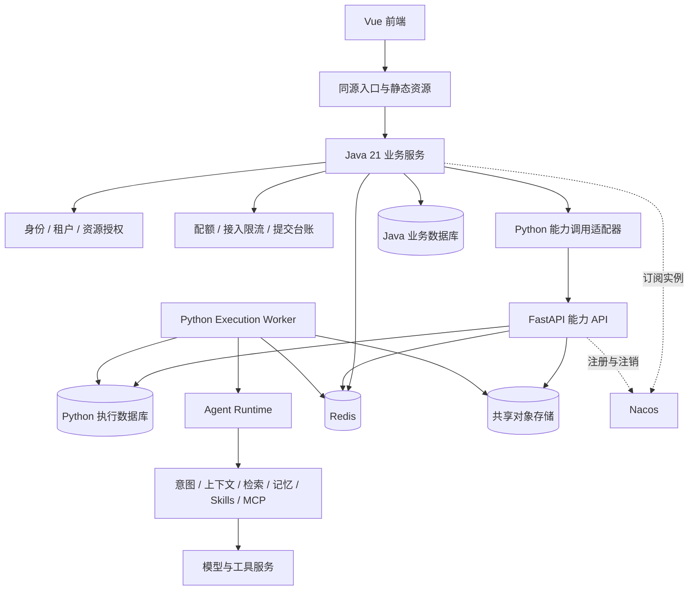
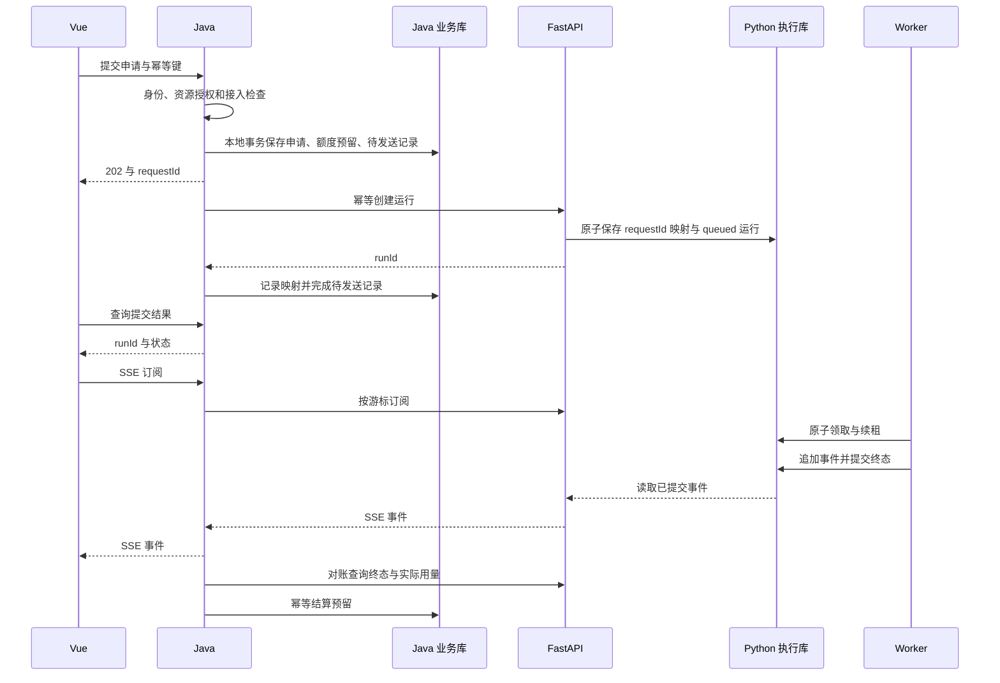
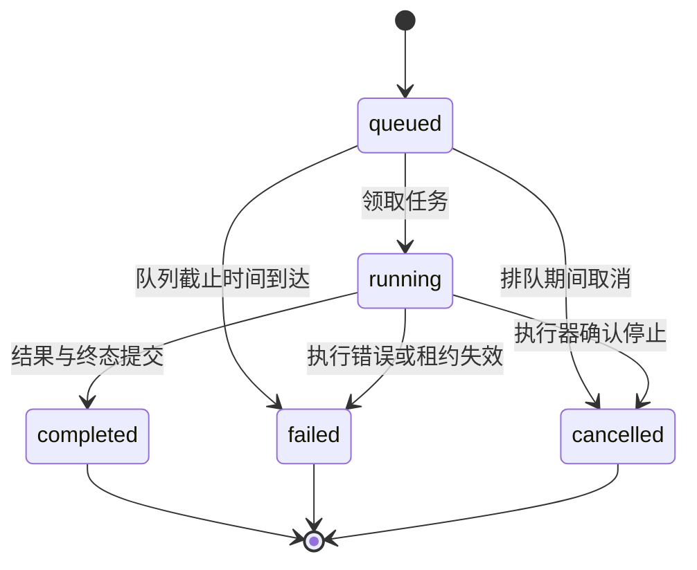

# Hotline Java 21 与 Python 能力服务架构方案

> 状态为架构草案。更新日期为 2026-11-13。
>
> 本文记录目标架构、技术决策、契约和实施验收。当前已有 Vue、FastAPI、同机 Python Execution Worker，以及 Java 21 服务骨架。Java 业务接入、多租户、分布式队列属于后续建设内容，Python 自动注册现已接入。
>
> 本次修订承接原《微服务架构迁移草案》的执行面拆分成果，将后续统一业务入口调整为 Java 21。默认选型与容量数字用于设计和验证，具体补丁版本、资源规格及上线指标在实施评审与压测后冻结。

## 1. 目标与核心决策

### 当前落地进度

Java 21 统一入口已接入 Python 业务路由、上传下载及 SSE，并支持静态寻址与 Nacos 实例发现。Python 的执行引擎、文档、技能、存储和向量适配已迁入能力模块，原根目录文件保留兼容入口。FastAPI 已接入官方 Nacos 3.x SDK 的注册与退出注销，SDK 负责 gRPC 保活与重连，注册循环同步 Worker 就绪元数据。前端开发代理默认指向 Java 8080，`npm start` 启动 Java、FastAPI 和 Worker。

Java 已增加配置化流程编排（场景 JSON 与处理器映射，按 `order` 决定串行或并行）和基于 Redis 或进程内存的接入治理（黑名单、固定窗口限流、并发租约、每日提交计数），并提供 `/api/v1/capabilities/overview` 与 `/api/v1/execution/requests` 两个自有接口，接口与参数见根 README。与本文目标的差距：调用方标识来自未认证的请求头或来源 IP，提交记录未持久化且没有幂等键，流程配置修改后需重启，治理管理接口没有认证。

后续章节中 P1 至 P4 是更完整的生产化目标。身份认证、多租户、跨服务身份、分布式队列和容量验收仍未完成；原有表格中部分文件路径记录迁移前基线，当前路径以根 README 为准。

### 目标决策

Hotline 采用 Java 业务服务、Python 能力服务和 Python 执行 Worker 协同的架构。

- Java 使用 JDK 21，负责身份、租户、资源权限、业务用例、配额、流量治理和对外 API。
- Python 保留意图识别、上下文工程、模型编排、记忆、检索、Skills、MCP、文档处理及工具执行。
- Java 与 Python 通过版本化 HTTP/JSON 和 SSE 契约协作，Nacos 提供实例注册与发现。
- 长任务持久化后异步执行，浏览器连接、Java 实例和 FastAPI 实例均可独立重启。
- 初期保持一个 Java 部署单元、一个 Python API 部署单元和一组 Worker，各内部模块保留清晰边界。
- 继续使用单仓库。新增 Java 工程建议位于 `java_backend/`，实施时增加目录并更新根文档和元数据。
- 多主机阶段默认以 PostgreSQL 承载新的业务与执行元数据，采用不同逻辑数据库和独立账号。Redis 负责共享限流、短期缓存和唤醒通知，对象存储承载跨实例读取的文件与产物。

Java 负责接入容量和业务治理，系统可完成的任务吞吐由 Worker、模型供应商配额、数据库和工具服务共同决定。扩容需要同时观察接入、排队和执行三个阶段。

## 2. 当前代码基线

以下内容已经通过本次源码阅读核对。

| 范围 | 当前实现 | 对迁移的影响 |
| --- | --- | --- |
| Java 入口 | `java_backend/` 提供 Spring Boot 应用、能力端口与健康调用适配器 | 在现有分层上逐步接入业务与权限 |
| 应用入口 | 根 `main.py` 加载环境后导出 `python_backend.fastapi_app.app` | 可以保留本地启动与旧入口 |
| HTTP 装配 | `python_backend/fastapi_app.py` 装配路由、存储和生命周期 | 后续增加内部路由与注册适配器 |
| 执行用例 | `python_backend/application/execution_service.py` 使用 `ExecutionQueue` 协议 | 可通过端口接入分布式队列适配器 |
| 队列适配 | `python_backend/infrastructure/queue/sqlite.py` 继承现有 `ExecutionStore` | 需要进一步抽出 Worker 使用的存储端口 |
| 执行状态 | `python_backend/modules/execution/store.py` 保存任务、事件、取消、心跳和租约 | 多主机版本需要增加幂等、隔离和租约写入约束 |
| 后台执行 | `python_backend/workers/execution_worker.py` 领取任务并调用运行时 | 可以继续复用 Agent 实现 |
| Worker 入口 | `python_backend/modules/execution/worker.py` 提供兼容入口 | 原启动命令可以持续使用 |
| 执行接口 | 已有创建、查询、事件、SSE、取消和重试接口 | 优先作为跨语言接入切片 |
| 流式读取 | SSE 生成器约每 80 ms 查询状态和事件，每 15 秒发送空闲心跳 | 需要治理高连接数下的数据库读放大 |
| 任务恢复 | SSE 可用事件游标恢复，租约过期的运行被标记失败 | 需要区分事件回放、重新执行和检查点恢复 |
| 进程与存储 | 当前执行队列是同机 SQLite，Worker 独立运行 | 跨主机部署前需要共享任务、事件和资源存储 |
| 身份范围 | 当前文档描述单用户部署，工作区参与上下文范围绑定 | 多租户需要贯穿接口、队列、检索、记忆与文件访问 |

现有执行接口包括 `POST /execution/runs`、`GET /execution/runs/{run_id}`、`GET /execution/runs/{run_id}/stream`、取消和重试接口。旧 `/agent/*/stream` 路径同时承担提交与读取，迁移时通过兼容适配器承接，新的跨服务协议将提交与订阅分开。

`ExecutionQueue` 当前覆盖应用服务需要的操作。Worker 仍会使用领取、写事件、完成和续租等具体存储方法，多主机改造需同时覆盖这两类调用方。

上述路径均为当前源码位置。相关现状也见根项目说明。[根 README](../README.md)

## 3. 总体架构



### 3.1 对外入口

浏览器通过同源入口访问前端静态资源与 Java API。生产入口可以使用已有反向代理能力，`/api/**` 进入 Java，SSE 也经过同一授权入口。前端运行时配置采用同源相对路径。

Java 在单个 Spring Boot 应用内实现业务管理与 BFF 聚合。出现独立网关扩缩容、多业务服务统一入口等实际需求时，再增加独立网关部署单元。

迁移期盘点前端、技能控制台、Bot、定时任务、下载链接和其他直接调用方。兼容路径也要经过统一鉴权和资源授权，内部管理接口受同一访问边界保护。

### 3.2 两种 Python 能力使用方式

| 使用方式 | 典型场景 | 编排归属 |
| --- | --- | --- |
| 完整 Agent 任务 | 对话、深度研究、PPT、技能运行 | Python 编排意图、上下文、模型和工具 |
| 独立能力调用 | 业务流程调用检索、文档解析、特定技能 | Java 编排业务步骤，Python 执行能力 |

一次 Agent 任务中的意图识别、上下文组装和模型工具循环优先在 Python 进程内完成。需要独立权限、计费、扩容或复用契约的能力，再暴露稳定的跨服务接口。

## 4. 领域边界与数据所有权

### 4.1 职责分配

| 能力域 | Java 的职责 | Python 的职责 |
| --- | --- | --- |
| 身份与租户 | 登录、令牌、成员、角色、租户配置 | 验证内部身份上下文并执行范围校验 |
| 工作区 | 成员权限、资源目录、可见范围 | 使用授权工作区构建上下文与执行环境 |
| 会话 | 用户可见会话归属与分享权限 | 会话上下文、摘要和运行时历史 |
| 执行 | 接入申请、资源授权、额度预留、业务查询聚合 | 运行状态、排队、租约、取消、重试和事件 |
| 文档与检索 | 文档的业务归属、访问授权、上传配额 | 解析、切分、索引、检索与引用证据 |
| 记忆 | 访问范围、保留政策、删除请求 | 记忆提取、存储适配、召回和上下文预算 |
| Skills 与 MCP | 可用目录、租户授权、发布审批入口 | 版本执行、资源读取、工具协议与运行时限制 |
| 产物 | 用户下载授权、业务关联 | 生成、校验、产物元数据及对象引用 |
| 审计与用量 | 业务审计和额度账本 | 记录真实执行、模型用量与工具结果 |

工作区和会话的稳定 ID 在 Java 侧分配，Python 保存这些 ID 的执行关联。迁移完成前已有 ID 保留并建立映射，避免破坏历史任务、文件和事件引用。

### 4.2 唯一权威来源

- Java 数据库拥有用户、租户、成员关系、资源 ACL、业务提交台账和额度账本。
- Python 数据库拥有 `run`、`attempt`、执行事件、租约、检查点及执行产物元数据。
- Java 可以保存任务状态投影，查询详情时以 Python 的版本号和权威状态校准。
- Python 保存执行所需的授权范围快照与策略版本，权限政策由 Java 管理。
- 两侧通过 API、稳定 ID 和版本化事件交互，各自使用独立数据库账号和迁移脚本。
- 原始文件由文档能力管理对象引用，Java 保存业务资源关联。对象 key 采用租户命名空间，应用仍需校验资源授权。

### 4.3 Java 工程结构建议

初期采用一个 Maven 工程、一个应用进程，按包组织用例和能力边界。

```text
java_backend/                         规划新增
  pom.xml
  src/main/java/<base_package>/
    trigger/http/                     Controller、SSE 入口
    api/dto/                          对外 DTO 与错误契约
    application/                      提交、授权、查询、取消用例
    domain/
      identity/                       用户、租户与权限规则
      admission/                      额度与接入政策
      execution/                      业务提交模型与能力端口
    infrastructure/
      adapter/port/                   Python 能力端口实现
      adapter/repository/             本地仓储实现
      gateway/dto/                    Python 协议 DTO
      gateway/                        HTTP 与 SSE 客户端
      dao/po/                         业务持久化对象
      redis/                          共享限流与缓存
      config/                         发现、连接池、线程与观测配置
```

领域层定义 `AgentExecutionPort` 等接口，基础设施层负责协议转换、发现和网络调用。Python 的 DTO、错误枚举及 HTTP 客户端类型通过适配器转换后进入 Java 用例。

## 5. 技术选型与版本策略

| 项目 | 方案默认值 | 选型理由与约束 |
| --- | --- | --- |
| Java | JDK 21，使用持续维护的发行版补丁 | 用户已明确指定 |
| Java 应用 | Spring Boot 3.5.x、Spring Cloud 2025.0.x、Spring Cloud Alibaba 2025.0.x 兼容线 | 官方版本对应关系明确，具体补丁版本在实施时检查支持周期与安全公告后固定 |
| 请求处理 | Spring MVC，评估启用虚拟线程 | 业务用例以数据库和远程 I/O 为主 |
| 普通 HTTP | Spring RestClient 与受控连接池 | 统一超时、错误映射、发现与重试 |
| SSE 上游 | WebClient 流式读取，独立连接预算 | 持续消费事件流，避免完整响应聚合 |
| SSE 下游 | MVC SseEmitter 与显式写出执行器 | 明确线程、缓冲、取消及资源释放责任 |
| 身份 | Spring Security，外部身份协议采用 OIDC/OAuth2 | 可对接组织身份系统，首版仍可提供本地身份适配 |
| 注册发现 | Nacos，Java 采用匹配的客户端，Python 采用官方 SDK | 两端验证同一服务分组与发现行为 |
| 执行持久化 | PostgreSQL 行锁队列与事件表 | 当前已有 psycopg 依赖，可复用事务与持久化能力 |
| Java 持久化 | PostgreSQL 独立业务数据库，Flyway 管理迁移 | 减少新建设施的数据库种类 |
| 缓存与限流 | Redis | 支持多 Java 实例共享计数和令牌桶 |
| 应用保护 | Sentinel | 管理应用资源限流、并发保护与熔断 |
| 文件与产物 | S3 兼容对象存储，复用已有 MinIO 适配 | 支持跨主机读取和产物生命周期 |
| 可观测 | OpenTelemetry、Micrometer、Prometheus | 关联 Java、Python、Worker 的调用与运行信息 |

Spring Cloud Alibaba 官方列出了上述版本线的对应关系。文中使用兼容线表达选型，工程落地时通过 BOM 固定完整版本并保存依赖清单。[官方版本说明](https://sca.aliyun.com/en/docs/2025.x/overview/version-explain/)

JDK 21 虚拟线程适用于等待 I/O 的大量并发任务。启用后仍需限制数据库连接、下游调用和执行任务数量，并通过 JFR 检查阻塞期间的线程 pinning。[Oracle Java 21 虚拟线程文档](https://docs.oracle.com/en/java/javase/21/core/virtual-threads.html)

PostgreSQL 是本方案对新增存储的默认选择，正式实施前核实已有生产数据库约束。已有 MySQL、SQLite 和向量存储逐模块迁移，历史数据在完成映射、备份与核验后切换。Java 业务库与 Python 执行库可以共用数据库基础设施，但分别授权、迁移、备份和限额。

## 6. 跨语言契约

### 6.1 契约约定

- 对外接口使用 `/api/v1`，Java 调用的 Python 接口使用 `/internal/v1`。以下路径均为目标协议。
- ID 使用字符串，时间使用带时区的 RFC 3339 UTC 表达，字段统一使用 camelCase。
- 通过 OpenAPI 定义请求、响应、错误和枚举，SSE 事件使用独立 JSON Schema。
- 新增可选字段保持向后兼容，语义变化通过主版本或明确的新事件类型表达。
- 普通请求携带 `traceparent` 与请求关联 ID。Worker 的运行 span 通过持久化上下文建立关联。
- Java 内部 JWT 通过 `Authorization` 传递。外部调用方传入的用户、租户和授权头在边界处清除，再由 Java 构建可信上下文。
- `Idempotency-Key` 表达业务提交身份，追踪 ID 用于观测，两者分别生成和保存。

### 6.2 对外接口

| 方法与路径 | 语义 |
| --- | --- |
| `POST /api/v1/execution/requests` | Java 持久化提交申请并预留额度，返回 202 |
| `GET /api/v1/execution/requests/{requestId}` | 查询提交结果及关联的 runId |
| `POST /api/v1/execution/requests/{requestId}/cancel` | 取消尚在提交阶段的申请，处理与运行创建的竞态 |
| `GET /api/v1/execution/runs/{runId}` | 授权后聚合权威运行状态 |
| `GET /api/v1/execution/runs/{runId}/stream` | 授权后订阅或恢复事件流 |
| `POST /api/v1/execution/runs/{runId}/cancel` | 发起协作式取消 |
| `POST /api/v1/execution/runs/{runId}/retry` | 产生新的提交申请，关联原任务 |
| `GET /api/v1/artifacts/{artifactId}/download` | 授权下载或签发短时下载凭证 |

提交请求示意如下，身份与租户由认证上下文提供。

```json
{
  "conversationId": "conversation_demo",
  "workspaceId": "workspace_demo",
  "agent": "chat",
  "query": "分析已授权工作区中的资料",
  "fileIds": ["file_demo"]
}
```

Java 完成本地事务后即可返回以下结果，Python 接受任务后通过查询接口返回 `runId`。

```json
{
  "requestId": "request_demo",
  "status": "accepting",
  "runId": null
}
```

`202` 表示提交申请已持久化。前端展示提交中，在取得 `runId` 后订阅运行事件。Java 若在响应前完成调用，可以直接带回 `runId` 与 `accepted` 提交状态，并附运行状态 `queued`。跨语言 HTTP 调用发生在 Java 本地事务提交之后。

### 6.3 Python 内部接口

| 方法与路径 | 语义与约束 |
| --- | --- |
| `POST /internal/v1/execution/runs` | 根据 requestId 幂等创建运行，校验内部身份、授权范围和执行容量 |
| `GET /internal/v1/execution/requests/{requestId}` | 查询既有运行或持久化的提交拒绝结果 |
| `POST /internal/v1/execution/requests/{requestId}/close` | 原子关闭提交身份，阻止迟到创建，并返回已有关联运行 |
| `GET /internal/v1/execution/runs/{runId}` | 返回权威状态、版本号和用量摘要 |
| `GET /internal/v1/execution/runs/{runId}/events` | 按游标分页返回持久事件 |
| `GET /internal/v1/execution/runs/{runId}/stream` | 回放后持续输出 SSE |
| `POST /internal/v1/execution/runs/{runId}/cancel` | 幂等设置取消意图，返回当前状态 |
| `GET /internal/v1/artifacts/{artifactId}` | 返回授权范围内的产物元数据 |

创建运行的内部请求包含 `requestId`、`reservationId`、`tenantId`、`actorId`、`workspaceId`、资源引用、`authorizationVersion`、`submissionDeadline` 和执行参数。有效范围受签名声明与 Python 资源归属查询共同约束。

内部令牌将 requestId、动作和授权资源范围绑定到当前调用，Python 校验声明与请求的一致性。后台重投保持提交截止时间与请求摘要稳定，每次调用重新获取有效的内部令牌。

独立检索、解析等 API 在出现首个业务调用方时按相同规则增加契约。现有单文件参数 `fileId` 与新 `fileIds` 通过适配器转换，首版可限制数组长度为 1，并在 Schema 中明确。

### 6.4 错误处理

| HTTP 状态 | 业务错误 | 调用方行为 |
| --- | --- | --- |
| 400 | `INVALID_ARGUMENT` | 修正参数 |
| 401 | `UNAUTHENTICATED` | 更新或重新建立身份 |
| 403 | `FORBIDDEN` | 结束当前操作 |
| 404 | `RESOURCE_NOT_FOUND` | 隐藏不可访问资源的存在性 |
| 409 | `IDEMPOTENCY_CONFLICT`、`INVALID_STATE` | 核对请求内容或读取最新状态 |
| 410 | `EVENT_CURSOR_EXPIRED` | 获取状态快照并重新建立事件游标 |
| 429 | `QUOTA_EXCEEDED`、`QUEUE_FULL` | 结合 Retry-After 提示稍后提交 |
| 503 | `CAPACITY_UNAVAILABLE`、`DEPENDENCY_UNAVAILABLE` | 有预算的退避或等待提交恢复 |
| 504 | `UPSTREAM_TIMEOUT` | 查询已有提交结果，按同一幂等身份协调 |

错误体包含 `code`、用户可读 `message`、`requestId` 和 `retryable`。服务地址、凭据、堆栈和完整模型提示留在受控诊断边界内，响应仅包含脱敏信息。

## 7. 任务提交、幂等与跨服务一致性

### 7.1 主调用流程



### 7.2 Java 提交台账与 Outbox

Java 在一个本地事务中写入业务提交申请、额度预留和待发送 Outbox。短路径与后台投递器共用同一个 requestId，投递器通过租约领取记录，支持重启后继续发送。

提交状态分为 `accepting`、`accepted`、`rejected` 和 `closed`。其中 `accepted` 需要持久化有效的 `runId`，`closed` 需要确认 Python 侧已经关闭提交身份，并完成必要的运行取消协调。

Java 对外幂等键按租户、操作者与操作类型限定作用域，在数据库中建立唯一约束，并关联规范化请求摘要。Python 以 `(tenantId, requestId)` 唯一约束保存提交记录，创建运行和建立映射位于同一事务。相同身份与相同摘要返回既有结果，摘要不同返回 409。

摘要纳入资源范围和执行配置版本，避免相同文字覆盖不同语义。网络响应丢失后，Java 使用相同 requestId 查询或重投。超时期间预留仍保持待确认，Java 后台对账负责恢复结果。

临时容量不足保留可重试语义，在提交截止时间内由投递器退避协调。权限拒绝、参数错误和主动关闭等最终结果持久化为不可重新创建的提交记录，客户端查询可获得确定结果。

这种提交身份设计参考 AWS 对客户端请求标识与安全重试的实践，Hotline 的台账、Outbox 和运行映射是结合当前异步执行链路制定的应用方案。[AWS 幂等 API 实践](https://aws.amazon.com/builders-library/making-retries-safe-with-idempotent-APIs/)

### 7.3 提交关闭与额度结算

单次查询返回不存在仍可能与迟到创建并发。提交超过截止时间、用户取消提交或永久拒绝时，Java 调用内部 `close` 接口，以数据库唯一约束和行锁串行化关闭与创建。

- 关闭先发生，Python 保存关闭记录，后续迟到创建返回明确的关闭结果。
- 创建先发生，关闭返回既有 runId，Java 转入运行取消流程并等待终态。
- Python 返回确定拒绝且保存结果后，Java 幂等释放预留。
- Python 无法访问时，申请保留待确认状态，持续对账并告警。
- 关闭记录和幂等记录至少覆盖提交截止时间、最长重试窗口、消息保留期与时钟偏差。清理后过期请求仍受服务端截止时间验证约束。

业务额度账本以 `reservationId` 和结算类型建立唯一约束。终态通知、定期对账与用户查询触发的补偿使用同一结算路径，重复事件只产生一次账本效果。首版采用对账轮询，增加终态回调时使用 Python 本地事务 Outbox 投递。

接入额度预留、租户未完成任务上限、Python 运行槽位和模型并发分别管理。预留先限制可接收的工作量，运行和模型槽位在实际使用时获取，完成后按真实用量结算。

### 7.4 权限变化与长任务

JWT 用于授权服务调用，Worker 保存经过验证的执行身份、范围和政策版本。排队任务真正开始执行前重新校验权限。长任务在使用高风险工具、读取新增资源和签发产物下载凭证时检查当前授权。

成员退出、资源撤权和租户停用会推进授权版本，Java 发起相关任务取消。权限查询不可用时，高风险操作暂停或失败并记录原因，后续按明确政策恢复。

Java 为 Python 与 Worker 提供受服务身份保护的授权判定接口，输入租户、执行身份、资源 ID、动作与已知策略版本，返回允许范围和当前版本。普通读取可采用短时版本缓存，高风险动作查询当前政策。长任务使用服务身份重新判定授权，排队时保存的身份快照作为判定输入。

## 8. 执行状态、Worker 与共享队列

### 8.1 状态模型

Python 运行的公开状态延续 `queued`、`running`、`completed`、`failed` 和 `cancelled`。取消请求使用独立 `cancelRequested` 标记。Java 的 `accepting` 属于提交阶段，Python 接受后进入运行生命周期。



取消接口返回已接受的取消意图和当前状态。Worker 停止可中断操作、回收子进程和临时文件后提交 `cancelled`。外部副作用已有结果时，保存结果并按业务补偿规则处理。完成与取消竞态通过运行版本和条件更新决定最终状态，终态保持单向收敛。

### 8.2 PostgreSQL 队列

初始多主机方案由 Python 执行库同时保存运行、队列、事件和 Worker 租约。任务入队与提交映射在同一事务完成，Worker 通过短事务领取待执行行。

`FOR UPDATE SKIP LOCKED` 适合多消费者领取队列表中的可用行。事务在领取与租约更新后立即提交，模型调用和工具执行在事务外进行。[PostgreSQL 行锁说明](https://www.postgresql.org/docs/current/sql-select.html#SQL-FOR-UPDATE-SHARE)

建议按以下数据模型实现。

| 表或集合 | 主要字段与约束 |
| --- | --- |
| `execution_request` | tenantId、requestId、请求摘要、截止时间、关闭标记、runId，租户与请求 ID 唯一 |
| `execution_run` | runId、tenantId、actorId、workspaceId、状态、版本、截止时间、取消标记、sourceRunId |
| `execution_attempt` | attemptId、runId、workerId、leaseEpoch、leaseUntil、结果 |
| `execution_event` | runId、seq、attemptId、schemaVersion、事件体，runId 与 seq 唯一 |
| `execution_worker` | workerId、能力标签、容量、心跳、draining 状态 |
| `execution_tool_operation` | 稳定工具操作 ID、幂等身份、外部结果或待核实状态 |

事件序号在持有运行行锁的事务内分配，事件插入与相应状态变更一起提交。同一个运行中的提交顺序与 seq 顺序一致，SSE 仅推进到已提交的连续游标，避免并发事务提交乱序造成漏读。

队列接纳检查与容量计数在同一事务内执行，并按租户或队列容量行加锁。单个租户的排队配额、运行配额与任务类型队列共同参与调度，防止某个租户长时间占满运行槽位。

### 8.3 租约与执行恢复

Worker 领取后获得递增的 `leaseEpoch`。续租、写事件、保存检查点和提交终态均需匹配当前 Worker、epoch 与有效租约。租约过期由协调器推进状态，旧 Worker 的迟到写入会被数据库条件更新拒绝。

心跳周期 5 秒、运行租约 45 秒可作为首轮测试参数，与当前适配器默认值衔接。租约依据数据库时间判断，并验证线程阻塞、GC、网络分区和数据库切换对续租的影响。

执行恢复按操作能力分级。

- 检索、读取和支持幂等键的工具操作允许有限重试。
- 存在稳定检查点时，从确认完成的步骤恢复，记录新的 attempt。
- 无法证明副作用安全的脚本、EXE 和外部写操作，租约丢失后先标记失败或待核实，再由业务处理。
- 人工重试创建新的提交申请和 runId，关联 `sourceRunId`，保留原运行证据。

外部工具调用使用跨 attempt 稳定的操作 ID，发起前记录意图，返回后保存结果。Worker 在外部操作成功后崩溃时，通过工具查询或人工核实收敛。租约控制与外部工具的幂等能力共同决定重复副作用风险。

### 8.4 队列扩展条件

当队列表锁竞争、任务扫描或事件写入成为可测瓶颈，再评估独立消息队列。届时通过 Python 本地事务 Outbox 将运行记录投递到消息系统，消费者按 runId 和操作身份去重，确认边界覆盖结果持久化。

Redis 在首版作为事件唤醒通道。通知丢失后依赖数据库补读恢复，数据库持久化事件承担事件回放职责。

## 9. SSE、事件协议与连接治理

### 9.1 事件封套

每个业务事件包含 `schemaVersion`、`runId`、`seq`、`type`、`occurredAt`、`attemptId`、`traceId` 和 `payload`。示例如下。

```text
id: 42
event: progress
data: {"schemaVersion":1,"runId":"run_demo","seq":42,"type":"progress","occurredAt":"2026-11-10T02:00:00Z","attemptId":"attempt_demo","traceId":"trace_demo","payload":{"stage":"retrieval","status":"completed"}}

```

同一个运行内使用单调递增 seq，Java 校验后转发并保持 SSE 的 `id`。前端按 `(runId, seq)` 去重。未知可选事件类型可以忽略，未知必需版本则显式报错。

单个事件建议限制为 64 KiB，长文本拆分为多个有序事件，大型结构和二进制内容通过授权资源引用传递。生产者在持久化前校验事件大小，避免单条事件持续触发慢连接保护。

### 9.2 恢复规则

1. 前端首次订阅携带 runId，Java 校验租户、成员和运行可见范围。
2. 重连携带 `Last-Event-ID`，手动 fetch 重连时由客户端显式设置游标。
3. Python 先补发游标之后的已持久化事件，再进入持续订阅。
4. 最终业务事件和运行终态原子提交，客户端读取到终态后关闭连接。
5. 心跳采用 SSE 注释，空闲期间建议每 15 秒发送一次，代理空闲超时建议至少 60 秒。
6. 事件超出保留期返回 410，并提供状态快照与最小可用游标。游标超过当前最大值返回 400。
7. 浏览器断开触发连接资源释放，任务继续按生命周期运行。用户通过取消接口表达停止意图。

### 9.3 浏览器认证

同源场景优先使用 HttpOnly、Secure、合适 SameSite 策略的会话 Cookie，写操作配置 CSRF 防护。若已有 Bearer Token 机制，则使用支持请求头的 fetch 流式客户端，并实现重连、令牌更新和游标恢复。

访问令牌和长期凭据通过受保护的 Cookie 或请求头传递。SSE 连接建立时校验授权，连接期间按会话到期时间与权限版本策略重新检查，撤权后终止订阅。

### 9.4 Java 转发实现约束

普通 HTTP 与 SSE 使用独立连接预算，流式上游连接持续占用应计入容量。WebClient 负责流式读取，SseEmitter 写出使用显式管理的执行器，并配置连接完成、超时、错误和客户端断开的统一清理路径。

Reactor 回调中的阻塞写出转交写出执行器，每个连接的事件与字节缓冲都有上限。初始可取 128 条或 256 KiB，先触达任一限制则中断慢连接，客户端凭游标补读。具体阈值通过大事件和慢客户端测试调整。

SseEmitter 与 HTTP 客户端库在 JDK 21 下的锁和阻塞行为需要 JFR 验证。MVC 请求线程采用虚拟线程后，流式桥接的调度、连接池和缓冲仍显式管理。

### 9.5 Python 读取放大治理

当前每连接约 80 ms 轮询一次状态和事件。1,000 条活跃连接会形成约 12,500 次轮询循环每秒，每轮包含多个存储读取，这是基于代码间隔推算的压力估计。

目标实现按 runId 合并同进程订阅，读取提交后的事件后扇出。跨实例使用 Redis 通知唤醒，配合约 1 秒的兜底补读和分页读取。API 中同步存储访问移入受控线程执行器或异步驱动，验证事件循环延迟和连接池饱和行为。

## 10. 多租户、安全与执行隔离

### 10.1 身份传播

Java 验证外部身份与资源权限，向 Python 签发短时内部 JWT，包含 issuer、audience、subject、tenantId、作用域、授权版本和有效期。Python 固定允许的签名算法、issuer 和 audience，通过公钥验证并处理密钥轮换。

内部令牌按服务调用签发，公钥分发与私钥保管分离。生产服务链路启用 TLS，组织已有证书体系时接入双向 TLS。令牌、模型凭据和工具凭据由运行环境或受控凭据存储注入。

### 10.2 资源范围

- tenantId 从可信认证上下文取得，并与请求对象和数据记录交叉校验。
- 任务、会话、工作区、文档、记忆、产物、审批和事件查询均执行租户与资源范围过滤。
- 向量检索、关键词检索和检索缓存都携带租户与授权资源集合，索引构建也保存相同归属。
- 缓存 key 包含租户、工作区、授权范围版本与必要的模型配置版本。
- 定时任务和 Bot 使用独立服务身份，执行前校验当前所属租户、授权范围和配额。
- 下载授权在生成凭证时验证，签名链接短时有效，产物内容检查与文件名清理在下载路径执行。

通过行级隔离、复合索引和访问层校验保证查询范围。PostgreSQL RLS 可以作为后续增强，连接池下的会话变量清理需单独验证。

### 10.3 工具与主机边界

现有脚本、EXE 和本地工作区能力需要明确执行位置。服务器托管工作区保存于受控执行环境，本机绝对路径访问通过独立桌面执行器处理，并以出站连接领取已授权任务。

多租户不可信脚本运行在容器或具备文件系统、身份和网络隔离能力的沙箱中，限制目录挂载、CPU、内存、执行时间和出网目标。子进程负责生命周期和资源回收，其隔离能力需要与执行身份和沙箱边界配合。

Windows EXE 使用带 Windows 能力标签的专用执行池，校验操作系统、依赖与授权目录后领取任务。工具实行允许清单与风险分级，高风险操作关联审批记录。Worker 使用最小权限账号，运行结束后清理临时资源。

### 10.4 配置与私密信息

仓库内示例使用明确占位符。真实配置保存在 Git 忽略的 `*.local.*`、`*.private.*`、`private/`、`secrets/` 或本地运行数据目录，实际保存前检查忽略状态。

Nacos 初期仅管理实例与可公开的运行参数。数据库密码、模型密钥和真实服务连接信息通过私密配置注入。观测采集对请求正文、模型提示、工具参数、产物地址和 HTTP 头实施脱敏与保留期控制。

## 11. Nacos 注册发现与健康检查

### 11.1 服务标识

建议使用 `hotline-python-api` 与 `hotline-java-api` 作为稳定服务名。Java 初期可由边缘静态上游定位，Python 服务发现优先接入 Nacos。开发、测试和生产采用独立环境 namespace，同一环境内使用约定的 group。

实例元数据包括协议主版本、构建版本、能力标签和 draining 状态。实例注册地址必须可以被调用方访问，容器地址、宿主地址、TLS 和相关 SDK 网络通道通过部署预检验证。

Worker 的领取与执行能力通过执行库中的 Worker 注册、心跳和能力标签管理。实际对外提供 HTTP API 的进程注册为服务实例。

### 11.2 生命周期

1. FastAPI 启动后完成必要依赖初始化并进入可服务状态。
2. 使用官方 SDK 注册临时实例，按固定 SDK 版本验证连接保活、断线重连和重新注册行为。
3. Java 订阅指定服务并筛选健康、启用且协议兼容的实例，调用端执行负载分配。
4. 停机时设置 draining 并退出接入，注销实例，留出发现收敛和连接排空时间。
5. FastAPI 关闭订阅和连接，Worker 停止领取并按策略完成或释放当前运行。

Python SDK 具备注册、注销和订阅 API。FastAPI 集成封装在基础设施适配器中，启动失败与注册失败分别记录状态。[Nacos Python SDK](https://nacos.io/docs/latest/manual/user/python-sdk/usage/)

### 11.3 探针分层

| 探针 | 目标 | 失败影响 |
| --- | --- | --- |
| 存活探针 | 进程与事件循环仍响应 | 持续失败后重启进程 |
| API 就绪探针 | 身份验证、持久化和读取链路可服务 | 从 API 路由候选集中移出 |
| 执行接纳探针 | 可用 Worker、队列容量、模型路线满足接纳政策 | 新任务返回容量状态 |
| 能力探针 | 检索、解析或特定工具服务可用 | 对应能力降级或拒绝 |

当前 `/health/ready` 依赖 Worker 心跳。目标架构需要拆出 API 就绪与执行接纳探针，让 Worker 故障期间的任务查询、取消和事件回放继续有独立的服务能力判断。

### 11.4 发现异常

Nacos 短时不可用时，可在明确的缓存年龄上限内使用已知健康实例，并持续记录发现陈旧度。无可用候选实例、缓存过期或调用熔断时，新请求进入有界协调流程或返回 503。

SDK 的空列表保护、失败保护和本地缓存行为需按固定版本逐项验证，调用适配器只接受满足健康、协议和排空条件的候选。对主动摘除实例的恢复规则单独测试。

已有 SSE 连接可以持续到完成或排空超时，重连通过共享运行和事件数据切换实例。普通短请求按待处理数或受控轮询分配，SSE 连接数单独计量。

## 12. 并发治理、超时与容量

### 12.1 三层容量约束

| 层次 | 控制维度 | 满载行为 |
| --- | --- | --- |
| Java 接入 | 用户与租户请求速率、提交中申请数量、未完成任务数、SSE 连接数 | 429、Retry-After 或持久化后的提交状态 |
| Python 调度 | 全局与租户队列容量、任务类别、运行槽位、排队截止时间 | 拒绝接纳、继续有限排队或提交确定失败 |
| 模型与工具 | 供应商 RPM/TPM、并行连接、CPU、内存、出网与工具容量 | 获取令牌后执行或在预算内等待 |

Sentinel 用于 Java 应用资源的流量和熔断保护。多实例租户配额使用共享原子计数或账本约束，按部署模型验证 Sentinel 本地规则与全局额度的关系。异步调用的资源统计范围必须覆盖实际调用完成阶段。[Sentinel 使用说明](https://github.com/alibaba/Sentinel/wiki/How-to-Use)

Redis 分布式模型槽位带有持有者、过期和续约机制，释放校验持有者身份。Redis 不可用时，依赖共享令牌控制的执行暂停接纳，避免每个实例独立放大供应商并发。

单次任务配置 token、工具调用次数、执行时长和成本上界，额度预留依据可执行上界计算。需要追加预算时先获取增量预留，执行器在下一次模型或工具调用前检查剩余预算，结算记录真实已发生用量。

### 12.2 初始预算

以下均为首轮联调参数，后续根据延迟分布和压测调整。

| 项目 | 建议起点 |
| --- | --- |
| 内部 HTTP 建连超时 | 1 秒 |
| 任务创建单次响应超时 | 3 秒 |
| 状态查询单次响应超时 | 2 秒 |
| 首轮前台提交协调预算 | 5 秒，随后通过持久化申请查询 |
| 后台提交截止时间 | 60 秒，到期进入关闭提交协议 |
| 短调用自动重试 | 最多 1 次，并受整体 deadline 约束 |
| SSE 心跳 | 15 秒 |
| SSE 空闲超时 | 60 秒起，服务、代理和客户端统一核对 |
| SSE 慢连接缓冲 | 128 条事件或 256 KiB |
| Worker 心跳与租约 | 5 秒与 45 秒 |
| 任务排队和执行时限 | 按 chat、研究、解析和脚本分别配置 |

短调用采用带抖动的指数退避，在调用适配器层统一控制重试。创建仅使用同一幂等身份重投，429 尊重 Retry-After。模型调用和工具执行分别依据其副作用语义制定重试政策。[AWS 超时、重试与退避实践](https://aws.amazon.com/builders-library/timeouts-retries-and-backoff-with-jitter/)

### 12.3 容量估算

用 Little 定律估算稳定负载下的在途量，`L = λ × W`。如果一个任务平均执行 20 秒，期望每秒完成 5 个任务，平均执行中的任务约为 100 个。

若 100 个执行槽位面对每秒 20 个新任务，且实际吞吐约为每秒 5 个，队列约每秒净增长 15 个。1,000 个排队位置约在 67 秒内耗尽。这些数字仅为数学示例，具体容量取决于模型与工具约束。

容量报告同时给出请求吞吐、任务完成吞吐、排队时间、首事件时间、活动流数量、模型限额和单位任务成本。Worker 扩容依据最老任务年龄、运行槽位占用和供应商余量，Java 扩容依据接入延迟、活动连接、CPU、堆与下游连接占用。

## 13. 观测、SLO 与故障处理

### 13.1 观测关联

统一关联 requestId、runId、attemptId 与 traceId。高基数 ID 放入日志与追踪，Prometheus 指标标签使用服务、环境、能力、模型路由和受控错误类别。

核心指标包括提交延迟、Outbox 积压年龄、待确认申请数、队列深度、排队 P95、运行成功率、首事件时间、租约过期次数、SSE 重连与缓冲溢出、事件循环延迟、数据库池等待、模型限流和额度对账差异。

### 13.2 验证目标

首轮以固定模拟模型和工具服务建立可重复基线，再用真实依赖验证端到端表现。

- 在记录的参考硬件上尝试 1,000 条活动 SSE 连接与 100 个模拟执行任务。
- 在已冻结的接入负载内，提交本地持久化 P95 目标为 300 ms 以内。
- 持久化事件到浏览器可见的 P95 目标为 1 秒以内。
- 请求流量达到目标值两倍时，内存与队列容量保持有界，过载请求得到可解释的拒绝结果。
- 重复提交、跨实例重连、Worker 丢失和投递响应丢失后，系统收敛到单一运行映射与可核对的额度结算。

上述为验收提案。正式 SLO 需要同时定义负载模型、持续时间、成功样本口径、真实模型波动和故障窗口。

### 13.3 故障矩阵

| 故障 | 预期行为 | 恢复与核对 |
| --- | --- | --- |
| Java 在预留后崩溃 | 申请与 Outbox 已持久化 | 新实例领取并按同一身份投递 |
| Python 创建成功但响应丢失 | 运行已存在，Java 保持待确认 | 查询 requestId 并补写映射 |
| Java 取消提交时创建请求迟到 | 关闭与创建在 Python 串行化 | 已创建则取消运行，先关闭则拒绝创建 |
| Worker 失去租约 | 拒绝旧 epoch 的状态和事件写入 | 按能力确定失败、检查点恢复或核实副作用 |
| Nacos 暂时不可用 | 已有连接持续，发现缓存受年龄约束 | 超限后有界失败并告警 |
| Redis 不可用 | 事件通过数据库补读 | 配额和模型令牌相关写操作按保护政策拒绝或暂停 |
| 数据库不可用 | 新写请求失败，Worker 暂停领取 | 依靠幂等身份协调重试，恢复后对账 |
| 客户端读取缓慢 | 连接缓冲触达上限后关闭 | 使用事件游标恢复 |
| 对象上传完成后元数据失败 | 对象暂时成为孤立对象 | 按稳定对象 key 重试注册，后台核对清理 |
| 用户被撤权 | 新请求拒绝，活动订阅关闭，高风险执行停止 | 取消运行并记录已完成副作用 |

## 14. 部署、迁移与回滚

### 14.1 部署形态

本地继续使用现有 Vue、FastAPI 和 Worker 启动方式。联调模式增加 Java 与隔离的基础设施配置，多主机验证完成后再启用面向用户的新入口。

生产候选形态包括同源边缘入口、多 Java 实例、多 FastAPI 实例、按任务类别分组的 Worker、Nacos、PostgreSQL、Redis 与共享对象存储。数据库、注册中心和缓存的高可用级别由上线 SLA 与资源预算确定。

Java 请求实例、FastAPI 请求实例与 Worker 进程分别扩缩容。生产定时调度采用单独调度角色或数据库领导租约，当前 FastAPI lifespan 启动的定时任务、保留清理和发布观察流程在多副本前逐项盘点并明确唯一执行者。

工作区本地文件、SQLite 索引、进程内缓存和凭据文件也纳入多主机盘点。共享元数据采用数据库，原始文件与产物使用对象存储，需要主机局部性的任务通过能力标签和受控执行器路由。

### 14.2 数据迁移

1. 盘点 SQLite、现有关系库、向量库与本地文件，列出表、ID、归属、引用与数据规模。
2. 为历史资源建立默认租户和所有者映射，待核实归属的数据先保持受限访问。
3. 使用独立迁移程序在隔离库导入，校验数量、关键字段、对象校验和与引用完整性。
4. 切换窗口停止新提交并排空 Worker，冻结旧写入，导出增量后进行最终核对。
5. 启动新服务，执行租户隔离、历史任务、事件回放、文件检索和产物下载冒烟。
6. 旧存储进入受控只读保留期，备份与恢复演练通过后再执行经授权的数据清理。

迁移数据、真实连接信息、备份和核验产物保存在被 Git 忽略的本地目录或私密运行设施。

现有 SQLite 的事件 ID 来自全局自增序列，同一运行的 ID 可能存在间隔。迁移时为新协议建立每运行 seq，并保存旧事件 ID 到新 seq 的映射。旧 SSE 路径通过兼容适配器转换游标，映射覆盖兼容保留期与历史回放要求。

### 14.3 灰度与回滚

按租户或稳定工作区分流，路由决策写入提交记录。已有运行持续使用创建时选定的协议和数据后端，查询与取消沿同一映射路由。

首次灰度限定单一 Python 数据后端，避免同一任务跨新旧后端重复创建。新增字段先采用可兼容的扩展迁移，删字段和改变约束在旧版本退出后执行。

Java 入口回滚时保留新身份边界与已有提交对账能力，兼容入口继续校验授权。数据后端切换后的回滚需先停止接入、排空或冻结运行、执行经验证的反向迁移并核对额度，按数据版本制定独立操作手册。

## 15. 分阶段实施与退出条件

| 阶段 | 交付范围 | 退出条件 |
| --- | --- | --- |
| P0 契约与盘点 | 路由、调用方、数据归属、身份传播、OpenAPI、事件 Schema、现状基线 | 旧调用链可复现，新旧协议转换与租户隔离测试方案明确 |
| P1 单机跨语言切片 | Java 21 工程、单一 Python 地址适配、完整任务链路、可信内部身份、资源授权 | 创建、查询、SSE、取消及下载通过 Java 正常入口验证 |
| P2 提交与执行可靠性 | 提交台账、Outbox、额度账本、幂等关闭协议、租约 fencing、共享执行库、对象存储 | 超时、重投、进程崩溃、迟到创建与跨实例读取通过故障注入 |
| P3 Nacos 与多实例 | 注册发现、探针拆分、排空、后台单例协调、共享限流与事件读取治理 | 双 Java、双 FastAPI、多 Worker、发现异常和滚动升级验证通过 |
| P4 生产容量与安全 | 压测、可观测、权限撤销、工具隔离、备份恢复与灰度回滚 | 达到冻结的 SLO，故障矩阵和恢复手册完成演练 |
| P5 按需能力抽取 | 根据独立负载抽取解析、检索或技能部署单元 | 数据所有权、契约、观测和运维责任明确，具有测得的扩容收益 |

P1 单机阶段仍需执行完整身份和资源授权。多租户正式开放前完成 P2 至 P4 的相关退出条件。各阶段工期根据盘点后的接口、数据量与人员配置评估。

## 16. 验证计划

### 16.1 必须覆盖的场景

- 旧 `/agent/*/stream`、新提交接口与技能控制台均经过预期的权限入口。
- 并发使用同一幂等键只得到一个业务申请和一个运行映射，参数冲突返回 409。
- 运行已创建但响应丢失、Java 重启、Outbox 重复领取均能够恢复正确关联。
- 提交关闭、迟到创建、运行完成与取消竞态保持合法终态和额度账本一致。
- Worker 租约过期后旧进程写入被拒绝，副作用不确定状态有明确处理路径。
- 跨租户任务、文件、记忆、检索、事件、审批和产物访问被阻止。
- SSE 切换实例、重复事件、终态回放、游标过期和慢客户端符合契约。
- Nacos 断开、返回空候选、排空和实例故障符合缓存与拒绝规则。
- 多 FastAPI 副本下定时任务、清理器和发布观察流程按唯一执行政策运行。
- 历史任务、历史 ID、文件资源和产物在迁移后仍可按原归属访问。

### 16.2 仓库现有验证命令

Python 验证使用本仓库虚拟环境。

```powershell
.\.venv\Scripts\python.exe -m compileall python_backend
.\.venv\Scripts\python.exe skill-center/test_center.py
.\.venv\Scripts\python.exe -m unittest python_backend.modules.execution.test_execution -v
npm --prefix frontend run build
```

当前本机整包导入存在已知数据库连接限制。接口测试通过临时目录存储装配 `create_*_router` 工厂，使用测试客户端验证。真实数据库联调安排在隔离环境。

Java 骨架已提供 Maven Wrapper 与 `verify`，当前 11 项测试覆盖健康调用、就绪检查、异常与重定向响应、配置校验、发现实例筛选，以及发现与自注册开关独立性。后续业务阶段增加身份与资源授权、幂等提交和 SSE 桥接验证，分布式行为在双 API 与多 Worker 的临时数据库环境中验证。

骨架验证包括 Java `verify` 打包与 11 项测试、Python 编译检查和技能中心验证。另以真实 Java JAR 进程连接隔离的 FastAPI 健康测试服务，验证健康调用、依赖就绪及模拟 Worker 离线后的 503 行为。真实 Nacos 注册与 Python Execution Worker 业务链路在对应接入阶段联调，容量目标通过后续压测冻结。

## 17. 开源与大厂实践参考

参考内容用于解释设计来源，具体边界和表结构由 Hotline 的代码与运行约束推导。引用页面核查日期为 2026-11-10，实施时为实际采用的依赖固定版本或提交。

| 参考 | 可以借鉴的做法 | 在 Hotline 中的应用 |
| --- | --- | --- |
| Dify 部署定义 | API 与后台 Worker 分离，后台队列按任务职责配置 | 保留现有 Worker，按负载拆分交互与重任务池 |
| Spring Cloud Alibaba | 通过兼容版本线组合 Spring、Nacos 和流量治理组件 | 固定 BOM，验证发现、限流与客户端行为 |
| Sentinel | 资源级流量保护、并发限制与熔断 | Java 应用保护，结合共享租户额度与 Python 执行容量 |
| AWS Builders’ Library | 客户端请求身份、有限重试、退避与抖动 | 提交幂等、超时后协调、单点重试预算 |
| Oracle Java 21 | 虚拟线程的 I/O 并发模型与 pinning 诊断 | JDK 21 请求处理与流式桥接验证 |
| PostgreSQL | 行级锁和跳过已锁记录的队列消费模式 | 共享执行队列、短事务领取与租约 |
| Nacos Python SDK | 注册、注销与实例订阅 | FastAPI 生命周期适配与故障演练 |

Dify 的参考限于公开部署结构与 API/Worker 分工，本文采用的行锁队列、Java 提交台账和权限模型属于 Hotline 方案设计。高关注度项目用于寻找成熟边界，实际采用仍需结合现有依赖与运维成本验证。[Dify 部署定义](https://github.com/langgenius/dify/blob/main/docker/docker-compose.yaml)

主要一手资料如下。

1. [Spring Cloud Alibaba 版本兼容关系](https://sca.aliyun.com/en/docs/2025.x/overview/version-explain/)
2. [Nacos Python SDK 官方使用手册](https://nacos.io/docs/latest/manual/user/python-sdk/usage/)
3. [Sentinel 官方使用说明](https://github.com/alibaba/Sentinel/wiki/How-to-Use)
4. [Oracle Java 21 虚拟线程](https://docs.oracle.com/en/java/javase/21/core/virtual-threads.html)
5. [AWS 超时、重试、退避与抖动](https://aws.amazon.com/builders-library/timeouts-retries-and-backoff-with-jitter/)
6. [AWS 通过幂等 API 实现安全重试](https://aws.amazon.com/builders-library/making-retries-safe-with-idempotent-APIs/)
7. [PostgreSQL SELECT 与行锁](https://www.postgresql.org/docs/current/sql-select.html#SQL-FOR-UPDATE-SHARE)
8. [Dify 官方部署定义](https://github.com/langgenius/dify/blob/main/docker/docker-compose.yaml)

## 18. 实施前待冻结项

以下项目已经给出方案默认值，P0 阶段结合实际环境核实并形成决策记录。

| 项目 | 本文默认值 | 冻结依据 |
| --- | --- | --- |
| JDK | 21 | 用户已指定 |
| Java 框架线 | Boot 3.5.x 与对应 Cloud、Alibaba 兼容线 | 组件支持周期、安全公告与验证结果 |
| 元数据基础设施 | PostgreSQL，Java 与 Python 逻辑隔离 | 已有数据库运维要求、数据规模与迁移成本 |
| 初始队列 | PostgreSQL 行锁队列 | 压测与持久化恢复验证 |
| 注册中心 | Nacos | 两端 SDK 兼容与网络可达性 |
| 身份来源 | Spring Security，预留组织 OIDC 适配 | 现有账号体系与租户模型 |
| 首个接入能力 | 完整任务执行链路 | 现有接口和 Worker 基础最完整 |
| 本地资源执行 | 托管工作区或独立桌面执行器 | 真实使用场景与资源访问边界 |
| 容量目标 | 先建立模拟依赖基线 | 参考硬件、模型配额、成本与实际并发 |

首个可交付版本以 Java 提交申请、可信内部调用、Python 执行、SSE 恢复和额度对账构成完整闭环。后续扩容与能力拆分沿这套契约演进。
